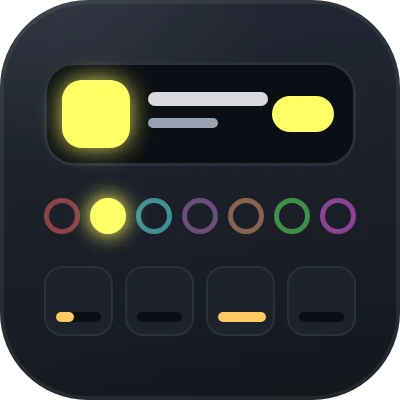
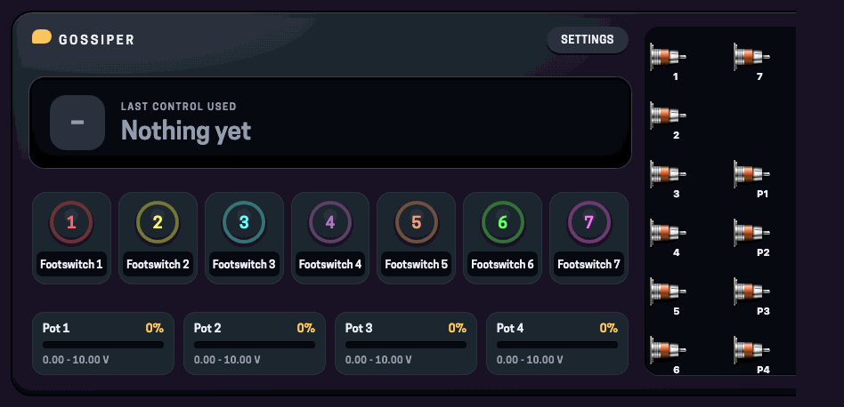
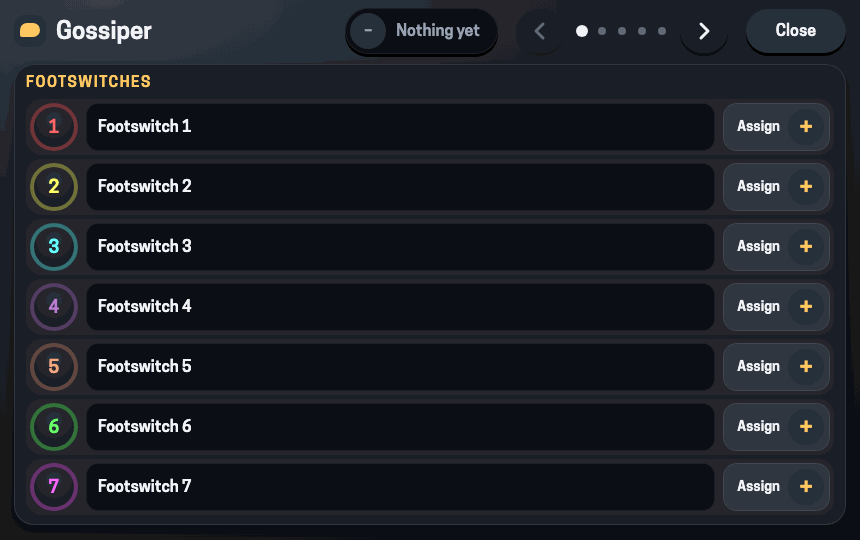
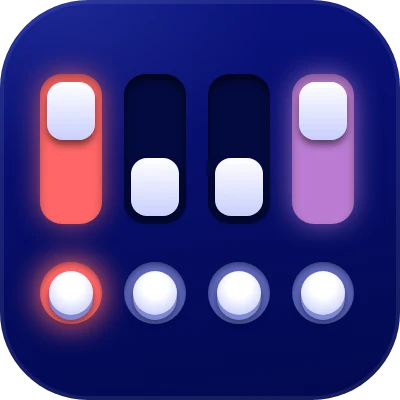
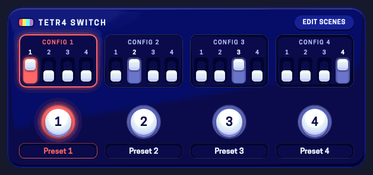
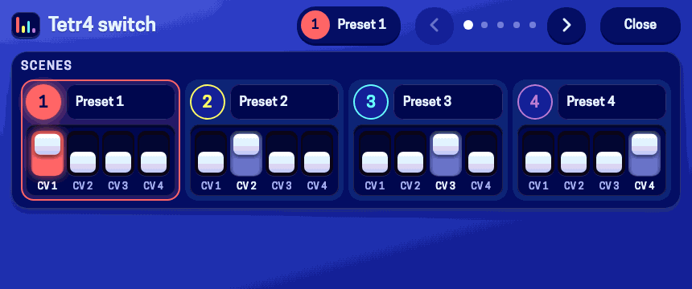
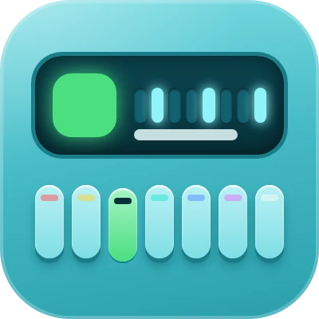
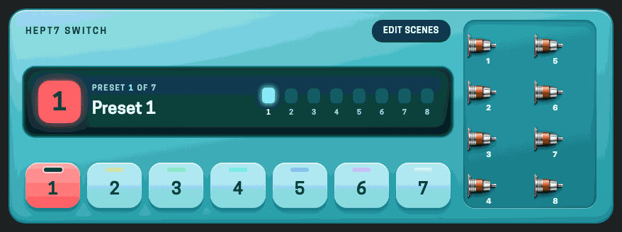
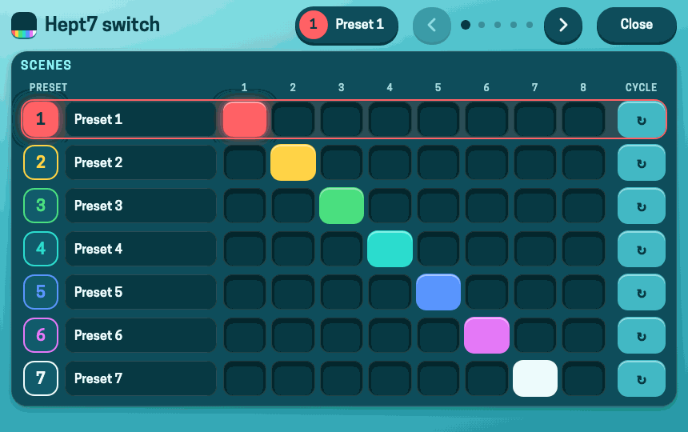

# SrMouraSilva - Plugins

Lv2 Utilitary plugins focused on [Mod Dwarf](https://mod.audio/dwarf/) devices.

## Documentation

**[srmourasilva.github.io/plugins-lv2](https://srmourasilva.github.io/plugins-lv2/)**: the user manual of each plugin, the guides for plugin developers (custom settings pages, GIFs, alternative thumbnails, HTML manuals, the preview) and the downloads, in one site. It is built from this repository by [a workflow](./.github/workflows/docs.yml) and published on GitHub Pages; to build it here:

```bash
pip install markdown pillow
python3 tools/site/build_site.py --out _site      # then open _site/index.html
```

## Gossiper



Shows a lv2-hmi notification when a button is turned on or turned off. Useful if you use an external midi controller that doesn't have feedback resources like LED. As an educated gossiper, it will only gossipes if you are looking to it (i.e., an "assignable" parameter is showing on device' screen).

* **New look**: a graphite pedal with an amber accent: a display, a disc per footswitch in its own colour, a meter per knob and the 11 CV jacks on a back plate that is part of the plugin
* 7 footswitches (each mirrored on a `CV Foot - Out N` output) and 4 potentiometers (scaled into a `[Minimum, Maximum]` CV range)
* **Custom footswitch labels**: click on a footswitch label in the plugin GUI and type a name (up to 15 characters). The notification shows this name, and it is saved with the pedalboard/preset
* **A display with the last control used** (`Footswitch 2 - ON`, `Pot 3 - 63%`) on the plugin itself, so devices that cannot show notifications, such as the MOD Duo, still tell which footswitch was pressed
* **A full-screen settings page** with the assignments grouped by purpose (footswitches, potentiometers, screen pop-ups), editable names and Min/Max voltages. It never scrolls vertically: what does not fit goes on another page, to the right (arrows, dots or a swipe)
* Ports organised in groups (footswitches, notifications, each potentiometer, CV outputs), so they are easier to find on the device's assignment screen
* Requires MOD Dwarf firmware v1.13 or newer for the notifications; on older firmware, or on devices without HMI such as the MOD Duo, the plugin still loads and the CV outputs still work (just without notifications)

The pedal, with the controls moved from outside as a MIDI controller would, and its settings page:





[User manual](./plugins/resources/gossiper.lv2/docs/manual.md) ([PDF](./plugins/resources/gossiper.lv2/modgui/manual.pdf)) · [Forum thread](https://forum.mod.audio/t/gossiper-plugin-to-say-what-is-happening-when-you-are-looking-it/9660)

## Tetr4 Switch



LV2 audio plugin inspired on loop/preset switchers for guitar rigs, but focused on the MOD Devices universe.

With it, is possible to define four presets of active CV and change between them with a footswitch.





* 4 CV outputs, with a dip switch per output in each of the 4 presets, and a footswitch-assignable selector per preset
* **New look**: the four banks of mini DIP switches stay, and the bank of the playing preset lights up in the colour of its preset. Each footswitch is a ring that is part of the casing (it is the LED) with a raised cap in the middle: only the cap goes down when it is pressed. The names are edited on the pedal, and *Edit scenes* opens the settings page
* **Full-screen settings page**: instead of MOD UI's generic settings window, the plugin brings its own page (`modgui:settingsTemplate`, see [tetr4-switch-settings.html](./plugins/resources/tetr4-switch.lv2/modgui/tetr4-switch-settings.html)). It is built for touch: one card per preset with its name and its four DIP switches, hardware assignment tiles grouped by purpose and the saved presets list. What does not fit the screen goes on another page, to the right (arrows, dots or a swipe)
* **Custom preset labels**: each of the four presets can be renamed (instead of `Prst 1`...`Prst 4`) from the plugin GUI. The labels are saved with the pedalboard/preset and are sent back to the GUI after a state restore
* **Custom HMI**: the preset footswitches and the preset selector knob get their own LED colour (preset 1 red, 2 yellow, 3 cyan, 4 magenta; lit while the preset is active, off otherwise), and the label of the active preset is shown as a notification on the device screen (like Gossiper, it needs a page with one of the notify parameters assigned). The HMI `WidgetControl` feature is optional, so the plugin also loads on hosts without it, such as the MOD Duo
* Ports organised in groups (preset selection, one group per preset)
* 4 factory presets: *Four-scene guitar rig*, *One-of-four selector*, *Arrangement builder* and *Rhythm / Lead / Ambient / Kill*
* [User manual](./plugins/resources/tetr4-switch.lv2/docs/manual.md) (an HTML page with the same text is what the device opens: [manual.html](./plugins/resources/tetr4-switch.lv2/modgui/manual.html); the original [PDF](./plugins/resources/tetr4-switch.lv2/modgui/manual.pdf) is kept) · [Forum thread](https://forum.mod.audio/t/tetr4-switch-plugin-in-beta-store/8998)

### TODO

#### v1.0.0

* [ ] Publish

#### v1.1.0

* [x] Custom preset names - https://pedalboards.moddevices.com/plugins/aHR0cDovL29wZW4tbXVzaWMta29udHJvbGxlcnMuY2gvbHYyL25vdGVzI25vdGVz
* [x] Custom HMI - https://github.com/moddevices/plugin-examples/tree/main/hmi-widgets-individual-tests
   * [x] Led colour
   * [x] Custom label
     * Atom sample 1: https://github.com/moddevices/mod-cv-plugins/blob/master/source/mod-cv-clock/mod-cv-clock.c
     * Atom sample 2: https://lv2plug.in/book/#_state_map_h

## Hept7 Switch



The big sibling of Tetr4 Switch, in turquoise: **7 presets** (one footswitch each, as many as the colours of the HMI footswitch LEDs) and **8 CV outputs**, with a dip switch per output in each preset. Same code base as Tetr4 Switch (the plugins differ only by [config.h](./plugins/src/config.h)).

* **A display on the pedalboard**: a mini display on top of the plugin shows the active preset, its name (editable right there, it is the text the HMI pop-up shows) and which CV outputs are on (click a square to turn that output on or off in the active preset, without opening the settings page). Every change of preset is announced on it with the colour of the preset, so devices with no screen for plugin pop-ups (MOD Duo) still show which preset a footswitch has just selected. The seven buttons sit side by side below it
* **Full-screen settings page**: instead of MOD UI's generic settings window, the plugin brings its own page (`modgui:settingsTemplate`, see [hept7-switch-settings.html](./plugins/resources/hept7-switch.lv2/modgui/hept7-switch-settings.html)). It is built for touch: a preset x switch matrix with big cells, names edited in place, hardware assignment tiles grouped by purpose (preset buttons, *Current preset*, screen pop-ups, each with a short explanation) and the saved presets list. It never scrolls vertically: what does not fit the screen goes on another page, to the right (arrows, dots or a swipe), and the number of pages is measured by the script, because MOD UI has no viewport meta tag and media queries cannot tell a phone from a desktop there (see [the guide](./docs/custom-settings-pages.md))
* **Choose which presets *Current preset* goes through**: a *Cycle* switch per preset leaves it out of the cycle of *Current preset* when it is assigned to a footswitch, to the B+C pair or to a knob, so a press goes straight to the next preset you use. The preset buttons and the *Preset 1-7* footswitches still select any preset
* **The host has the last word**: a click on a button is shown at once, and what the plugin reports (a footswitch, MIDI, a knob) wins over answers that arrive late, so fast clicks never leave the display on the wrong preset
* **Custom preset labels**, **custom HMI** (LED colours, active preset pop-up) and the optional HMI `WidgetControl` feature work as in Tetr4 Switch
* The eight CV jacks sit on a back plate that is part of the plugin, in two columns (1-4 and 5-8), instead of floating next to it
* 3 factory presets: *One-to-one selector*, *Seven-scene guitar rig* and *Layer builder*
* [User manual](./plugins/resources/hept7-switch.lv2/docs/manual.md) ([PDF](./plugins/resources/hept7-switch.lv2/modgui/manual.pdf)); the device opens the HTML version, [manual.html](./plugins/resources/hept7-switch.lv2/modgui/manual.html)





## Download

Binaries for **MOD Duo**, **MOD Duo X** and **MOD Dwarf** are built by [GitHub Actions](./.github/workflows/release.yml) on every push and published on the [Releases](../../releases) page. Releases have no version number; they are named after the commit they were built from:

```
<commit date UTC>-<branch>-<commit hash>
20261113-1530-master-87a3e32
```

Each release has one archive per plugin and device (`gossiper-duo.lv2.tar.gz`, `tetr4-switch-duo-x.lv2.tar.gz`, `gossiper-dwarf.lv2.tar.gz`, ...); each one contains the `.lv2` bundle folder.

The release marked **Latest** is the most recent build of `master`. Builds from other branches are published as pre-releases.

## Development

Requirements
```bash
sudo apt install lv2-dev
```

Compile
```bash
cd plugins
make build
```

Install
```bash
make install-user
# uninstalling
#make uninstall-user
```

On macOS (with `brew install lv2`):
```bash
make build MACOS=true CFLAGS="-I/opt/homebrew/include"
```

Alternatively, compile on docker environment
```bash
docker build . -t builder
```

### Looking at the interface without a device

```bash
python3 tools/modgui-preview/serve.py        # http://localhost:8000/?plugin=hept7-switch
```

[tools/modgui-preview](./tools/modgui-preview/README.md) shows the interface of any plugin in a browser: the pedalboard icon, the settings page at several screen sizes (including a phone or a tablet *as MOD UI shows itself on it*), factory presets, and a simulated host that answers late, as the real one does. It does not replace a test on a device.

* [docs/custom-settings-pages.md](./docs/custom-settings-pages.md): how to build a custom settings page (what MOD UI expects, fitting any screen with pages instead of scrolling, touch and accessibility, the cache)
* [docs/making-gifs.md](./docs/making-gifs.md), [docs/alternative-thumbnails.md](./docs/alternative-thumbnails.md), [docs/html-manuals.md](./docs/html-manuals.md): GIFs, alternative thumbnails and HTML manuals for your own plugin
* [CLAUDE.md](./CLAUDE.md): the practices of this repository (C and LV2, TTL, modgui, documentation, git)

### GIFs and alternative thumbnails

```bash
node tools/media/record.mjs all          # the GIFs: plugins/resources/<plugin>.lv2/docs/images/<plugin>-demo.gif and -settings.gif
node tools/media/thumbnails.mjs          # plugins/resources/<plugin>.lv2/docs/alternative-thumbnail.webp
```

The GIFs are recorded from the preview (a script taps the interface; the circle is the finger), so re-record them whenever the interface changes. `alternative-thumbnail.webp` is a simpler, more abstract picture of each plugin (400x400), drawn by `docs/alternative-thumbnail.html`; it is for internal use and is not read by MOD UI. Needs Node 22+, Google Chrome and `pip install pillow`. Guides for doing the same in another plugin: [making GIFs](./docs/making-gifs.md) and [alternative thumbnails](./docs/alternative-thumbnails.md).

### HTML manuals

```bash
python3 tools/manual/build_manual_html.py all     # plugins/resources/<plugin>.lv2/modgui/manual.html, from docs/manual.md
```

Each manual is written once in Markdown and built into one self-contained page (cover, navigation, steps, callouts, video cards, dark theme, print style) that MOD UI can serve as `modgui:documentation`. See [docs/html-manuals.md](./docs/html-manuals.md). Needs `pip install markdown pillow`.

## Build

```bash
docker run --rm -ti --name mpb -p 9000:9000 -v $(pwd)/plugins:/root/mod-plugin-builder/plugins/package/srmourasilva-plugins cbix/mod-plugin-builder:moddwarf
#sudo apt install iputils-ping --yes
# ping alternative
cat > /usr/bin/ping << 'EOF'
#!/bin/bash
host="${@: -1}"
timeout 2 bash -c "echo > /dev/tcp/$host/22" 2>/dev/null && echo "$host is alive" && exit 0
exit 1
EOF
chmod +x /usr/bin/ping

./build moddwarf srmourasilva-plugins
./build moddwarf srmourasilva-plugins-publish

# To force a build without changing the version number into srmourasilva-plugins.mk
rm -r /root/mod-workdir/moddwarf/build/srmourasilva-plugins-*

# Copy files from container (optional, CI already does this - see Releases)
# Note: open a new tab
docker cp mpb:/root/mod-workdir/moddwarf/target/usr/local/lib/lv2/tetr4-switch.lv2/ binaries/dwarf
docker cp mpb:/root/mod-workdir/moddwarf/target/usr/local/lib/lv2/hept7-switch.lv2/ binaries/dwarf
docker cp mpb:/root/mod-workdir/moddwarf/target/usr/local/lib/lv2/gossiper.lv2/ binaries/dwarf
```

## About 

* https://wiki.mod.audio/wiki/How_To_Build_and_Deploy_LV2_Plugin_to_MOD_Duo
* https://wiki.mod.audio/wiki/Preparing_the_Bundle
* https://wiki.mod.audio/wiki/Creating_the_GUI
* https://wiki.mod.audio/wiki/LV2#Logging

## License

Licensed under the [Apache License, Version 2.0](./LICENSE). See [NOTICE](./NOTICE) for third-party components that keep their original licenses.
