# SrMouraSilva - Plugins

Lv2 Utilitary plugins focused on [Mod Dwarf](https://mod.audio/dwarf/) devices.

## Documentation

**[srmourasilva.github.io/plugins-lv2](https://srmourasilva.github.io/plugins-lv2/)**: the user manual of each plugin, the guides for plugin developers (custom settings pages, GIFs, alternative thumbnails, HTML manuals, the preview) and the downloads, in one site. It is built from this repository by [a workflow](./.github/workflows/docs.yml) and published on GitHub Pages; to build it here:

```bash
pip install markdown pillow
python3 tools/site/build_site.py --out _site      # then open _site/index.html
```

## Gossiper

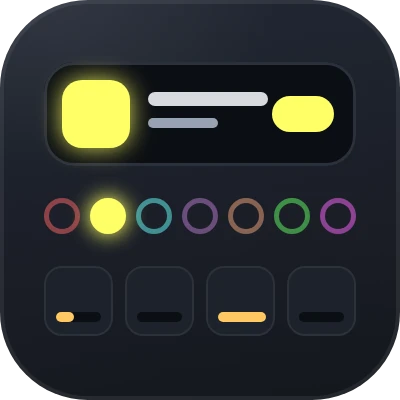

Shows a lv2-hmi notification when a button is turned on or turned off. Useful if you use an external midi controller that doesn't have feedback resources like LED. As an educated gossiper, it will only gossipes if you are looking to it (i.e., an "assignable" parameter is showing on device' screen).

* **New look**: a graphite pedal with an amber accent: a display, a disc per footswitch in its own colour, a meter per knob and the 11 CV jacks on a back plate that is part of the plugin
* 7 footswitches (each mirrored on a `CV Foot - Out N` output) and 4 potentiometers (scaled into a `[Minimum, Maximum]` CV range)
* **Custom footswitch labels**: click on a footswitch label in the plugin GUI and type a name (up to 15 characters). The notification shows this name, and it is saved with the pedalboard/preset
* **A display with the last control used** (`Footswitch 2 - ON`, `Pot 3 - 63%`) on the plugin itself, so devices that cannot show notifications, such as the MOD Duo, still tell which footswitch was pressed
* **A full-screen settings page** with the assignments grouped by purpose (footswitches, potentiometers, screen pop-ups), editable names and Min/Max voltages. It never scrolls vertically: what does not fit goes on another page, to the right (arrows, dots or a swipe)
* Ports organised in groups (footswitches, notifications, each potentiometer, CV outputs), so they are easier to find on the device's assignment screen
* Requires MOD Dwarf firmware v1.13 or newer for the notifications; on older firmware, or on devices without HMI such as the MOD Duo, the plugin still loads and the CV outputs still work (just without notifications)

The pedal, with the controls moved from outside as a MIDI controller would, and its settings page:

<picture>
  <source srcset="./plugins/resources/gossiper.lv2/docs/images/gossiper-demo.webp" type="image/webp">
  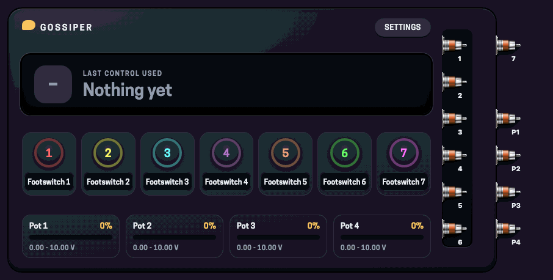
</picture>

<picture>
  <source srcset="./plugins/resources/gossiper.lv2/docs/images/gossiper-settings.webp" type="image/webp">
  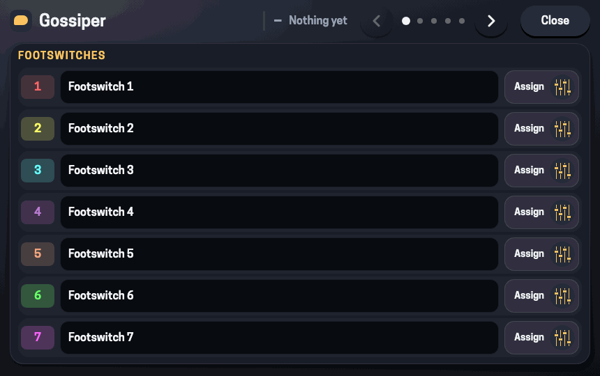
</picture>

[User manual](./plugins/resources/gossiper.lv2/docs/manual.md) ([PDF](./plugins/resources/gossiper.lv2/modgui/manual.pdf)) · [Store page](https://pedalboards.mod.audio/plugins/aHR0cDovL3NybW91cmFzaWx2YS5naXRodWIuaW8vcGx1Z2lucy9nb3NzaXBlcg==) · [Forum thread](https://forum.mod.audio/t/gossiper-plugin-to-say-what-is-happening-when-you-are-looking-it/9660)

## Tetr4 Switch

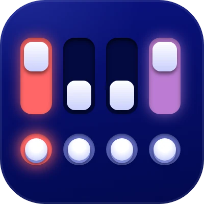

LV2 audio plugin inspired on loop/preset switchers for guitar rigs, but focused on the MOD Devices universe.

With it, is possible to define four presets of active CV and change between them with a footswitch.

<picture>
  <source srcset="./plugins/resources/tetr4-switch.lv2/docs/images/tetr4-switch-demo.webp" type="image/webp">
  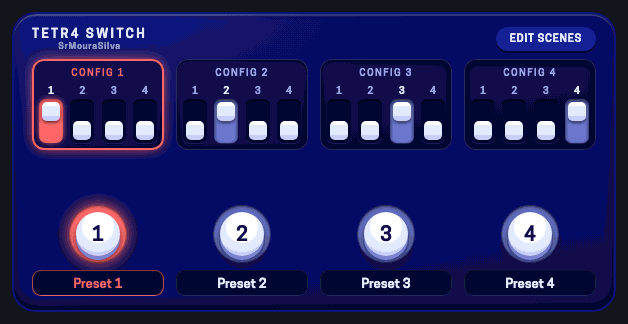
</picture>

<picture>
  <source srcset="./plugins/resources/tetr4-switch.lv2/docs/images/tetr4-switch-settings.webp" type="image/webp">
  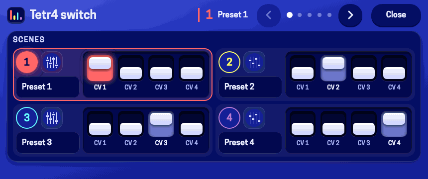
</picture>

* 4 CV outputs, with a dip switch per output in each of the 4 presets, and a footswitch-assignable selector per preset
* **MIDI out**: when the preset changes, a MIDI control change per CV output (127 when the output is on in the new preset, 0 when off). The channel, the CC number of each output and "changes only" are set on the settings page. Started from the work of stiv bennett in [PR #4](https://github.com/SrMouraSilva/plugins-lv2/pull/4). The ports are new (31 to 37), so saved pedalboards keep working
* **New look**: the four banks of mini DIP switches stay, and the bank of the playing preset lights up in the colour of its preset. Each footswitch is a ring that is part of the casing (it is the LED) with a raised cap in the middle: only the cap goes down when it is pressed. The names are edited on the pedal, and *Edit scenes* opens the settings page
* **Full-screen settings page**: instead of MOD UI's generic settings window, the plugin brings its own page (`modgui:settingsTemplate`, see [tetr4-switch-settings.html](./plugins/resources/tetr4-switch.lv2/modgui/tetr4-switch-settings.html)). It is built for touch: one card per preset with its name, its four DIP switches and the button that assigns the preset to a hardware control, the *Current preset* and screen pop-up assignments (the pop-up tiles are disabled on the MOD Duo, which has no widgets on its screen), the MIDI out settings and the saved presets list. What does not fit the screen goes on another page, to the right (arrows, dots or a swipe)
* **Custom preset labels**: each of the four presets can be renamed (instead of `Prst 1`...`Prst 4`) from the plugin GUI. The labels are saved with the pedalboard/preset and are sent back to the GUI after a state restore
* **Custom HMI**: the preset footswitches and the preset selector knob get their own LED colour (preset 1 red, 2 yellow, 3 cyan, 4 magenta; lit while the preset is active, off otherwise), and the label of the active preset is shown as a notification on the device screen (like Gossiper, it needs a page with one of the notify parameters assigned). The HMI `WidgetControl` feature is optional, so the plugin also loads on hosts without it, such as the MOD Duo
* Ports organised in groups (preset selection, MIDI, one group per preset)
* 4 factory presets: *Four-scene guitar rig*, *One-of-four selector*, *Arrangement builder* and *Rhythm / Lead / Ambient / Kill*
* [User manual](./plugins/resources/tetr4-switch.lv2/docs/manual.md) (an HTML page with the same text is what the device opens: [manual.html](./plugins/resources/tetr4-switch.lv2/modgui/manual.html); the original [PDF](./plugins/resources/tetr4-switch.lv2/modgui/manual.pdf) is kept) · [Store page](https://pedalboards.mod.audio/plugins/aHR0cDovL3NybW91cmFzaWx2YS5naXRodWIuaW8vcGx1Z2lucy90ZXRyNC1zd2l0Y2g=) · [Forum thread](https://forum.mod.audio/t/tetr4-switch-plugin-in-beta-store/8998)

### TODO

#### v1.0.0

* [ ] Publish

#### v1.1.0

* [x] Custom preset names - https://pedalboards.moddevices.com/plugins/aHR0cDovL29wZW4tbXVzaWMta29udHJvbGxlcnMuY2gvbHYyL25vdGVzI25vdGVz
* [x] Custom HMI - https://github.com/moddevices/plugin-examples/tree/main/hmi-widgets-individual-tests
   * [x] Led colour
   * [x] Custom label
     * Atom sample 1: https://github.com/moddevices/mod-cv-plugins/blob/master/source/mod-cv-clock/mod-cv-clock.c
     * Atom sample 2: https://lv2plug.in/book/#_state_map_h

## Hept7 Switch

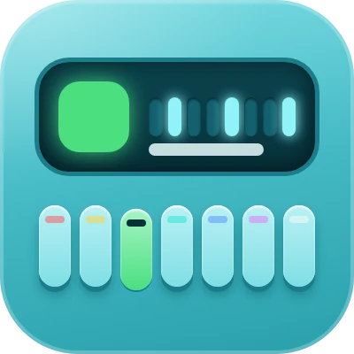

The big sibling of Tetr4 Switch, in turquoise: **7 presets** (one footswitch each, as many as the colours of the HMI footswitch LEDs) and **8 CV outputs**, with a dip switch per output in each preset. Same code base as Tetr4 Switch (the plugins differ only by [config.h](./plugins/src/config.h)).

* **MIDI out**: when the preset changes, a MIDI control change per CV output (127 when the output is on in the new preset, 0 when off), as in Tetr4 Switch. The channel, the CC number of each of the 8 outputs and "changes only" are set on the settings page. The ports are new (86 to 96), so saved pedalboards keep working
* **A display on the pedalboard**: a mini display on top of the plugin shows the active preset, its name (editable right there, it is the text the HMI pop-up shows) and which CV outputs are on (click a square to turn that output on or off in the active preset, without opening the settings page). Every change of preset is announced on it with the colour of the preset, so devices with no screen for plugin pop-ups (MOD Duo) still show which preset a footswitch has just selected. The seven buttons sit side by side below it
* **Full-screen settings page**: instead of MOD UI's generic settings window, the plugin brings its own page (`modgui:settingsTemplate`, see [hept7-switch-settings.html](./plugins/resources/hept7-switch.lv2/modgui/hept7-switch-settings.html)). It is built for touch: a preset x switch matrix with big cells, names edited in place, the button that assigns each preset to a hardware control beside the number of its row, *Current preset* and screen pop-up assignments (the pop-up tiles are disabled on the MOD Duo, which has no widgets on its screen), the MIDI out settings and the saved presets list. It never scrolls vertically: what does not fit the screen goes on another page, to the right (arrows, dots or a swipe), and the number of pages is measured by the script, because MOD UI has no viewport meta tag and media queries cannot tell a phone from a desktop there (see [the guide](./docs/custom-settings-pages.md))
* **Choose which presets *Current preset* goes through**: a *Cycle* switch per preset leaves it out of the cycle of *Current preset* when it is assigned to a footswitch, to the B+C pair or to a knob, so a press goes straight to the next preset you use. The preset buttons and the *Preset 1-7* footswitches still select any preset
* **The host has the last word**: a click on a button is shown at once, and what the plugin reports (a footswitch, MIDI, a knob) wins over answers that arrive late, so fast clicks never leave the display on the wrong preset
* **Custom preset labels**, **custom HMI** (LED colours, active preset pop-up) and the optional HMI `WidgetControl` feature work as in Tetr4 Switch
* The eight CV jacks sit on a back plate that is part of the plugin, in two columns (1-4 and 5-8), instead of floating next to it; the MIDI out jack is under the second column
* 3 factory presets: *One-to-one selector*, *Seven-scene guitar rig* and *Layer builder*
* [User manual](./plugins/resources/hept7-switch.lv2/docs/manual.md) ([PDF](./plugins/resources/hept7-switch.lv2/modgui/manual.pdf)); the device opens the HTML version, [manual.html](./plugins/resources/hept7-switch.lv2/modgui/manual.html) · [Store page](https://pedalboards.mod.audio/plugins/aHR0cDovL3NybW91cmFzaWx2YS5naXRodWIuaW8vcGx1Z2lucy9oZXB0Ny1zd2l0Y2g=)

<picture>
  <source srcset="./plugins/resources/hept7-switch.lv2/docs/images/hept7-switch-demo.webp" type="image/webp">
  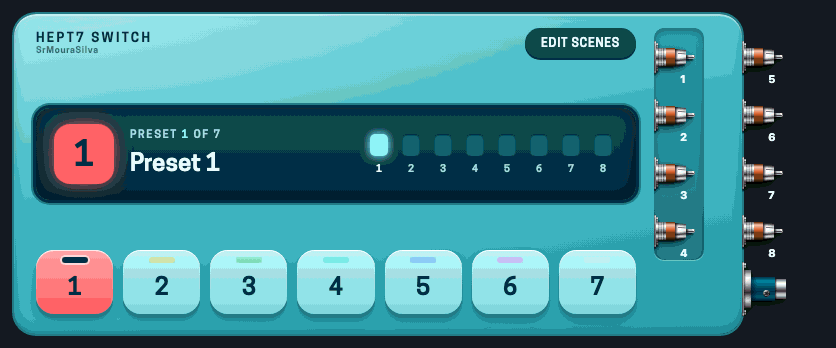
</picture>

<picture>
  <source srcset="./plugins/resources/hept7-switch.lv2/docs/images/hept7-switch-settings.webp" type="image/webp">
  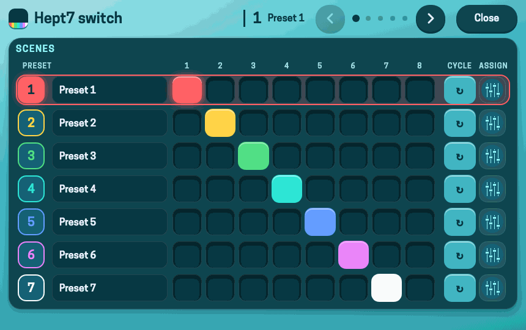
</picture>

## Kill Switch


A rhythmic signal-cut effect, like the momentary kill switch some guitars have: while the plugin is on, a looping step pattern lets the signal through or cuts it, in time with the tempo. Bypassed, the signal is clean. A mono audio effect, in red and charcoal.

* **A settings page with the whole plugin** (`modgui:settingsTemplate`): every pattern to pick with one tap (with a small picture of its steps), tempo, speed, depth and edge, and the on/off switch, with the room the pedal face does not have. Choosing *Custom* opens the editor in place: up to 16 steps, each with **three levels** (cut, half, pass) that a tap goes through in a circle, a length, the steps per beat and *Copy from…* a built-in pattern. The steps are control ports (`custom_step_N`), so the pattern is saved with the pedalboard, the presets and the snapshots. The page also holds the assignment tiles (the bypass included) and the saved presets, spread over pages like the other settings pages
* **10 patterns**: six generic grooves (*Chop 8ths*, *Chop 16ths*, *Triplet chop*, *Machine gun*, *Syncopated 3-3-2*, *Gallop*) and four inspired by guitarists famous for the kill switch (the rhythms are an approximation, not a transcription). Every pattern starts from its first step, a cut, each time the plugin is switched on
* **Tempo** (40-240 BPM) and **Speed** (1/2x, 1x, 2x, 4x) set how fast it plays; **Depth** (how much of the signal a cut removes) and **Edge** (how long a cut takes to close and open, 0.1-20 ms) set how hard it is. The plugin has its own tempo: it does not follow the pedalboard's
* **An interface drawn for touch**: the arrows change the pattern and a row of sixteen squares shows it (lit: the signal passes), a stepper for the tempo, a segmented control for the speed, sliders for depth and edge, and a footswitch that is the bypass of the plugin. The *Edit pattern* button opens the settings page
* **In-plugin bypass** (`lv2:enabled`) with a 10 ms ramp back to the dry signal. Assigned in *Momentary* mode, the effect is on only while the footswitch is held, like the switch on a guitar
* A single C file against LV2's core header, with no dependencies and no allocation after `instantiate`; no latency
* 11 factory presets (they do not touch the custom pattern)
* [User manual](./plugins/resources/kill-switch.lv2/docs/manual.md); the device opens the HTML version, [manual.html](./plugins/resources/kill-switch.lv2/modgui/manual.html) · [Store page](https://pedalboards.mod.audio/plugins/aHR0cDovL3NybW91cmFzaWx2YS5naXRodWIuaW8vcGx1Z2lucy9raWxsLXN3aXRjaA==) (coming soon)

<picture>
  <source srcset="./plugins/resources/kill-switch.lv2/docs/images/kill-switch-demo.webp" type="image/webp">
  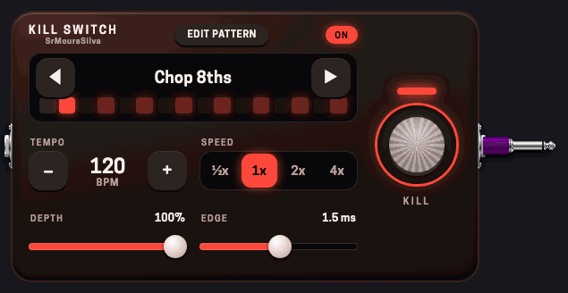
</picture>

## Half Mouco

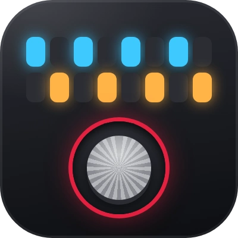

The stereo sibling of [Kill Switch](#kill-switch), in teal, blue and amber: a rhythmic signal-cut effect in which **the left and the right side each have a row of steps**, so the sound changes with the side (a ping-pong, an ear that is chopped while the other is not). *Mouco* is Portuguese for hard of hearing: *half mouco* is half deaf.

* **Two families.** *Patterns* loop for as long as the plugin is on: nine built-in ones (*Ping-pong 8ths* and *16ths*, *Triplet pong*, *Half deaf: left* and *right*, *Gallop sides*, *Stagger*, *Seesaw*, *Syncopated sides*) and one you write. *Endings* play **once** when the plugin is switched on and finish in silence, for the end of a song: *Bouncing ball* (tam---tam--tam-tam-ta-ta-t-t-ttt), *Helicopter* (blades that go from one side to the other, slower and fainter), *Stutter out*, *Side fade* and *Ping-pong out*. The endings are chosen, not drawn: only Ending, Length (in beats), Tempo, Depth and Edge
* **A settings page with the whole plugin** (`modgui:settingsTemplate`): patterns or endings to pick with one tap, what each side does, tempo, speed or length, depth, edge, Mono and the on/off switch. Choosing *Custom* opens **your own pattern** in place: two rows of up to 16 steps (left and right), each step with **three levels** (cut, half, pass) that a tap goes through in a circle, a length, the steps per beat and *Copy from…* a built-in pattern. The steps are control ports (`custom_left_step_N`, `custom_right_step_N`), so the pattern is saved with the pedalboard, the presets and the snapshots. The page also holds the assignment tiles (the bypass has a panel of its own) and the saved presets, spread over pages like the other settings pages; the two rows fit a phone upright or on its side
* **Mono input** switch: the left input feeds both sides, for a single instrument
* **In-plugin bypass** (`lv2:enabled`) with a 10 ms ramp. A pattern or an ending starts from its beginning each time the plugin is switched on. Assigned in *Momentary* mode, the effect is on only while the footswitch is held
* A single C file against LV2's core header, with no dependencies and no allocation after `instantiate`; no latency. The endings are functions of the time since the plugin was switched on, repeated in the modgui script to draw them along their time
* 11 factory presets (they do not touch the custom pattern)
* [User manual](./plugins/resources/half-mouco.lv2/docs/manual.md); the device opens the HTML version, [manual.html](./plugins/resources/half-mouco.lv2/modgui/manual.html) · [Store page](https://pedalboards.mod.audio/plugins/aHR0cDovL3NybW91cmFzaWx2YS5naXRodWIuaW8vcGx1Z2lucy9oYWxmLW1vdWNv) (coming soon)

<picture>
  <source srcset="./plugins/resources/half-mouco.lv2/docs/images/half-mouco-demo.webp" type="image/webp">
  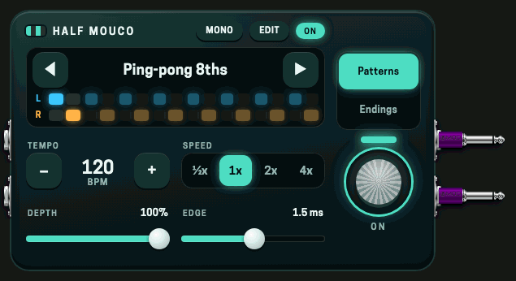
</picture>

<picture>
  <source srcset="./plugins/resources/half-mouco.lv2/docs/images/half-mouco-settings.webp" type="image/webp">
  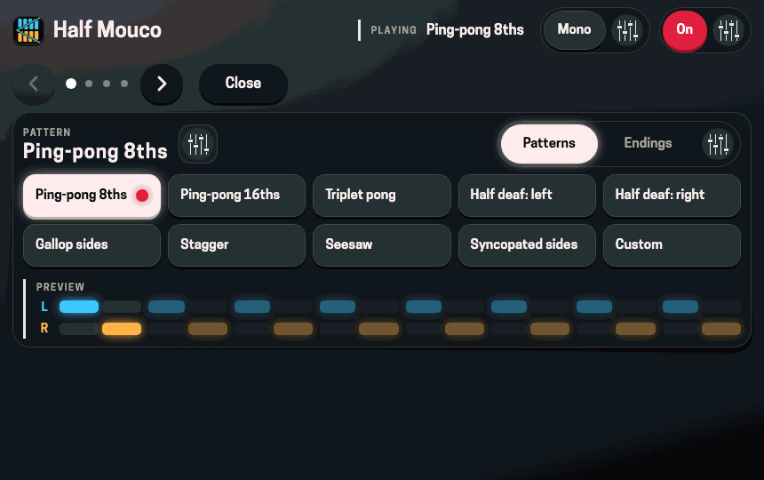
</picture>

## Download

Binaries for **MOD Duo**, **MOD Duo X** and **MOD Dwarf** are built by [GitHub Actions](./.github/workflows/release.yml) on every push and published on the [Releases](../../releases) page. Releases have no version number; they are named after the commit they were built from:

```
<commit date UTC>-<branch>-<commit hash>
20261113-1530-master-87a3e32
```

Each release has one archive per plugin and device (`gossiper-duo.lv2.tar.gz`, `tetr4-switch-duo-x.lv2.tar.gz`, `gossiper-dwarf.lv2.tar.gz`, ...); each one contains the `.lv2` bundle folder.

The release marked **Latest** is the most recent build of `master`. Builds from other branches are published as pre-releases.

### Install on the device

MOD UI has an endpoint that installs a plugin archive, the same one the plugin SDK uses: no SSH, no copying files, no restart. It removes the installed version of the bundle, installs the new one and tells the open MOD UI pages to rescan. Replace the address with your device's (`192.168.51.1` is the MOD Dwarf over USB; the Duo and Duo X answer on `modduo.local`, or on the address of their network).

```bash
DEVICE=192.168.51.1
TAG=20261114-1642-feature-hept7-switch-ffb748d    # the release to install, from the Releases page
for plugin in gossiper tetr4-switch hept7-switch kill-switch half-mouco; do
  curl -sL -o $plugin.tar.gz "https://github.com/SrMouraSilva/plugins-lv2/releases/download/$TAG/$plugin-dwarf.lv2.tar.gz"
  base64 -i $plugin.tar.gz | curl -s -F "package=@-;filename=$plugin.tar.gz" http://$DEVICE/sdk/install
  echo
done
```

For the Duo or Duo X, download `$plugin-duo.lv2.tar.gz` or `$plugin-duo-x.lv2.tar.gz` instead. A successful call answers with the plugins that were removed and installed:

```json
{"ok": true, "installed": ["http://srmourasilva.github.io/plugins/gossiper"], "removed": ["http://srmourasilva.github.io/plugins/gossiper"]}
```

* The archive must go **base64-encoded**, in a multipart field named `package` (that is what `base64 ... | curl -F "package=@-;..."` does). A raw `.tar.gz` (`curl -F package=@file.tar.gz`) is not decoded and fails with `No plugins found in bundle`; `--data-binary` fails with `500` / `KeyError: 'package'`.
* On Linux use `base64 -w0 $plugin.tar.gz` (macOS' `base64 -i` writes a single line already).
* The archive is extracted as it is: the `.lv2` bundle folder must be at its root, as in the release archives. The bundle goes to `~/.lv2` on the device, which is writable (on the Dwarf, `/root/.lv2`).
* The plugin is unloaded while it is replaced, so do not install it while a pedalboard that uses it is playing. After an update of the interface, reload the MOD UI page.
* Tested on a MOD Dwarf; the Duo and Duo X run the same MOD UI endpoint, but this was not tried there.
* Another plugin version in the same folder is replaced by the one installed. To go back, install an older release the same way.

## Development

Requirements
```bash
sudo apt install lv2-dev
```

Compile
```bash
cd plugins
make build
```

Install
```bash
make install-user
# uninstalling
#make uninstall-user
```

On macOS (with `brew install lv2`):
```bash
make build MACOS=true CFLAGS="-I/opt/homebrew/include"
```

Alternatively, compile on docker environment
```bash
docker build . -t builder
```

### Looking at the interface without a device

```bash
python3 tools/modgui-preview/serve.py        # http://localhost:8000/?plugin=hept7-switch
```

[tools/modgui-preview](./tools/modgui-preview/README.md) shows the interface of any plugin in a browser: the pedalboard icon, the settings page at several screen sizes (including a phone or a tablet *as MOD UI shows itself on it*), factory presets, and a simulated host that answers late, as the real one does. It does not replace a test on a device.

* [docs/custom-settings-pages.md](./docs/custom-settings-pages.md): how to build a custom settings page (what MOD UI expects, fitting any screen with pages instead of scrolling, touch and accessibility, the cache)
* [docs/making-animations.md](./docs/making-animations.md), [docs/alternative-thumbnails.md](./docs/alternative-thumbnails.md), [docs/html-manuals.md](./docs/html-manuals.md): animations (animated WebP with a GIF fallback), alternative thumbnails and HTML manuals for your own plugin
* [CLAUDE.md](./CLAUDE.md): the practices of this repository (C and LV2, TTL, modgui, documentation, git)

### Display widgets (MOD Dwarf and Duo X)

Every plugin can draw on the display of a device that implements the [aLabs HMI widgets](https://github.com/sejerpz/alabs-hmi-widgets) extension (the Starless images for the Dwarf and the Duo X; stock firmware does not, and the plugins simply draw nothing there): the pattern of Kill Switch, the two sides of Half Mouco, the active preset of Tetr4 and Hept7 Switch, the footswitches and knobs of Gossiper. Each widget adapts to the area it is given, from a footer to the full screen.

```bash
python3 tools/hmi-preview/preview.py all   # sheets of every widget on every area, and a Dwarf and a Duo X (needs pillow and the .so files)
```

See [tools/hmi-preview](./tools/hmi-preview/README.md).

### Animations and alternative thumbnails

```bash
node tools/media/record.mjs all          # the animations: docs/images/<plugin>-demo and -settings, each as .webp (animated) and .gif (fallback)
node tools/media/shots.mjs all           # the pictures of the manuals, modgui/screenshot.png and thumbnail.png
node tools/media/thumbnails.mjs          # plugins/resources/<plugin>.lv2/docs/alternative-thumbnail.webp
```

The animations (an animated WebP, with a GIF of the same name as its fallback) are recorded from the preview (a script taps the interface; the circle is the finger), so re-record them whenever the interface changes. `alternative-thumbnail.webp` is a simpler, more abstract picture of each plugin (400x400), drawn by `docs/alternative-thumbnail.html`; it is for internal use and is not read by MOD UI. Needs Node 22+, Google Chrome and `pip install pillow`. Guides for doing the same in another plugin: [making animations](./docs/making-animations.md) and [alternative thumbnails](./docs/alternative-thumbnails.md).

### HTML manuals

```bash
python3 tools/manual/build_manual_html.py all     # plugins/resources/<plugin>.lv2/modgui/manual.html, from docs/manual.md
```

Each manual is written once in Markdown and built into one self-contained page (cover, navigation, steps, callouts, video cards, dark theme, print style) that MOD UI can serve as `modgui:documentation`. See [docs/html-manuals.md](./docs/html-manuals.md). Needs `pip install markdown pillow`.

## Build

```bash
docker run --rm -ti --name mpb -p 9000:9000 -v $(pwd)/plugins:/root/mod-plugin-builder/plugins/package/srmourasilva-plugins cbix/mod-plugin-builder:moddwarf
#sudo apt install iputils-ping --yes
# ping alternative
cat > /usr/bin/ping << 'EOF'
#!/bin/bash
host="${@: -1}"
timeout 2 bash -c "echo > /dev/tcp/$host/22" 2>/dev/null && echo "$host is alive" && exit 0
exit 1
EOF
chmod +x /usr/bin/ping

./build moddwarf srmourasilva-plugins
./build moddwarf srmourasilva-plugins-publish

# To force a build without changing the version number into srmourasilva-plugins.mk
rm -r /root/mod-workdir/moddwarf/build/srmourasilva-plugins-*

# Copy files from container (optional, CI already does this - see Releases)
# Note: open a new tab
docker cp mpb:/root/mod-workdir/moddwarf/target/usr/local/lib/lv2/tetr4-switch.lv2/ binaries/dwarf
docker cp mpb:/root/mod-workdir/moddwarf/target/usr/local/lib/lv2/hept7-switch.lv2/ binaries/dwarf
docker cp mpb:/root/mod-workdir/moddwarf/target/usr/local/lib/lv2/gossiper.lv2/ binaries/dwarf
docker cp mpb:/root/mod-workdir/moddwarf/target/usr/local/lib/lv2/kill-switch.lv2/ binaries/dwarf
docker cp mpb:/root/mod-workdir/moddwarf/target/usr/local/lib/lv2/half-mouco.lv2/ binaries/dwarf
```

### One package per plugin, for the MOD store

`plugins/srmourasilva-plugins.mk` builds the four plugins together, which is what the CI and a local `./build` use. The
store (and [builder.mod.audio](https://builder.mod.audio/buildroot)) takes **one bundle per package**, so that a person
installs only the plugin they want: each plugin has its own recipe in [store/](./store), `gossiper.mk`, `tetr4-switch.mk`,
`hept7-switch.mk`, `kill-switch.mk` and `half-mouco.mk`. A recipe clones this repository at a commit, builds `build-<plugin>` and installs
`install-<plugin>` (see [plugins/Makefile](./plugins/Makefile)). The commit has to exist on GitHub:

```bash
git push
python3 tools/store/pin.py        # writes the checked out commit in the four recipes (or: pin.py <commit>)
```

then upload the recipe of the plugin at <https://builder.mod.audio/buildroot>. After a change of any plugin, pin again.

## About 

* https://wiki.mod.audio/wiki/How_To_Build_and_Deploy_LV2_Plugin_to_MOD_Duo
* https://wiki.mod.audio/wiki/Preparing_the_Bundle
* https://wiki.mod.audio/wiki/Creating_the_GUI
* https://wiki.mod.audio/wiki/LV2#Logging

## License

Licensed under the [Apache License, Version 2.0](./LICENSE). See [NOTICE](./NOTICE) for third-party components that keep their original licenses.
