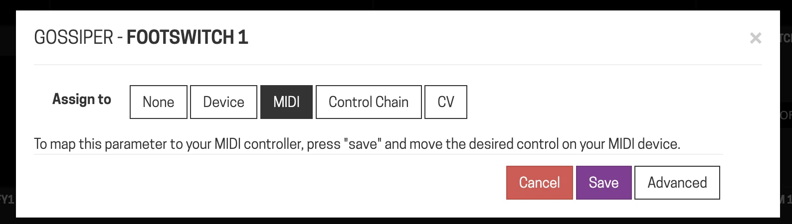
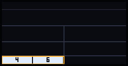
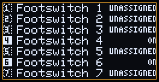
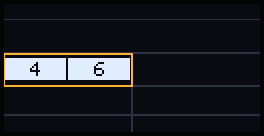
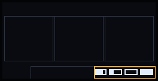
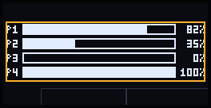
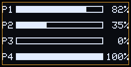
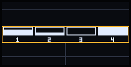
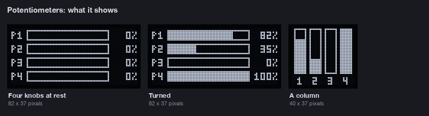
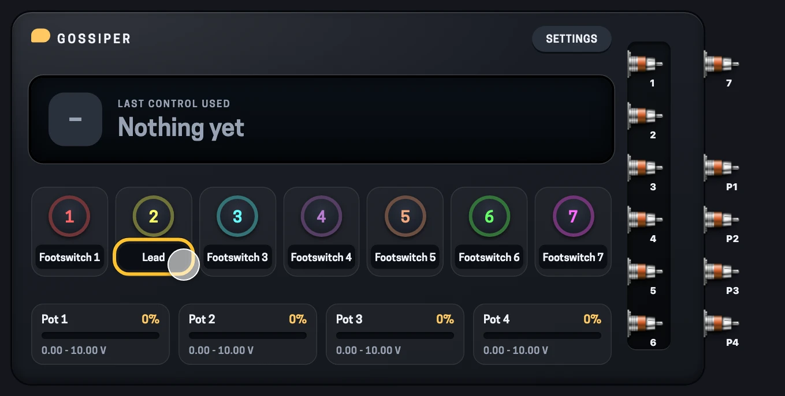

# Gossiper — User Manual

Gossiper gives you screen and CV feedback for controls that don't have any
of their own — typically an external MIDI foot controller or knob box with
no LEDs or display.

Assign one of its parameters to receive the MIDI (or CV, or device control), and Gossiper turns that into a plain CV
signal *and* a pop-up notification on the device screen.

It is an "educated gossiper": it only gossips about a control if you're actually looking at it. A pop-up appears only
on a device screen page that has one of Gossiper's four `Assign to notify` slots addressed to it, because MOD devices
only show a pop-up for a plugin whose parameter is linked to a control (a knob or a footswitch) that is currently
visible on the screen.

> [!NOTE] Good to know
> Gossiper has no audio inputs or outputs, so it doesn't sit in your signal chain. Place it anywhere on the pedalboard.
> The CV outputs, the display on the plugin and the pop-ups are three independent ways of using the same control: you
> can use any of them, and the outputs keep working when the pop-ups cannot (an old firmware, a MOD Duo).

## 1. Plugin GUI overview

| Item | Description | Interactivity |
|---|---|---|
| **A — Display** | Says **which control was used last** and what it did: `Footswitch 2 — ON`, or `Pot 3 — 63%`. It stays on, and lights up for a moment each time a control is used. This is how you see a message on a device that has no screen for plugin pop-ups, such as the MOD Duo. | Only visualization status |
| **B — Footswitch indicator** | A disc in a colour of its own for each footswitch. Lit while the footswitch is ON, and mirrored on `CV Output N` (0 V / 10 V). The one used last is outlined. | Only visualization status. Clicking on it does nothing. |
| **C — Footswitch label** | Click and type a name (up to 15 characters): this is the text the pop-up and the display show for that footswitch. | Editable field |
| **D — Potentiometer** | The position of the knob (0–100 %) as a meter, and the CV range (`Minimum`–`Maximum`, in volts) its 0–10 V output is scaled into. The one used last is outlined. | Only visualization status. To change the range, open the settings. |
| **E — Settings** | Opens the settings page (section 3). The gear icon above the plugin opens it too. | Button |
| **F — CV outputs** | `1`–`7` are the footswitches and `P1`–`P4` the potentiometers. | Jacks |

## 2. What it's for

A MIDI foot controller (say, a cheap "Chocolate"-style box) can send Program
Change or CC messages, but usually has no LED to confirm whether a patch is
currently on or off, and no screen to show a knob's value. Gossiper closes
that loop:

1. **Assign** a `Footswitch N` or `Potentiometer N` parameter to receive
   that MIDI message (or a CV signal, or a device knob/footswitch).
2. **Assign** one of the 4 `Assign to notify N` parameters to a page/knob or
   footswitch slot on the device screen.
3. **Use the CV output.** `CV Foot - Out N` (footswitches) or
   `CV Pot - Out N` (potentiometers) now carries a plain, calibrated CV
   signal you can route into any other plugin's CV-addressable parameter —
   the same way you would with a "Control to CV" utility plugin.

From then on, every time that MIDI controller sends a message, you see it
confirmed on the device screen — without needing to look down at an
unlit external box.

## 3. Setting it up on the device

> [!TIP] The shortest path
> Open the settings page, tap **Assign** next to *Footswitch 1* and press the button of your controller; then tap
> **Assign** next to *Pop-up slot 1* and pick a knob or footswitch of the page you play from. Press the button again:
> its name pops up on the device screen, the disc lights up on the plugin and `CV Foot - Out 1` goes to 10 V. The steps
> below show each tap.

Click **Settings** (or the gear icon above the plugin) to open the settings page. It has one panel for each thing
you can link, and each panel starts with **Hardware assignment**: that is the step where you choose which control of
your device, your MIDI foot controller or your pedal drives that parameter.

On a small screen the page splits into several pages instead of scrolling: use the arrows in the top bar (they
are always there), the dots between them, or swipe sideways on a touch screen.

**Step 1 — Assign the control.** In **Footswitches**, find a row that is not used yet — or, in **Potentiometers**, a
row for a knob — and tap **Assign** next to it.

In the opened modal, select MIDI option in **Assign to**.

Now you must send the MIDI message (or pick the device control) you want to drive it. After it, save.
The button shows a check mark once it is assigned.

**Step 2 — Assign a pop-up slot.** Do the same for one of the four slots in **Screen pop-ups** — this is what decides
*where* the pop-up will show.

**Step 3 — Choose the target.** Pick what the slot is addressed to
— usually **Device**, so it lives on the screen itself.

**Step 4 — Pick the page and control.** Choose which page (and which knob
or footswitch, B/C) the slot sits on. Whenever that page is showing,
that's where the pop-up appears.

Repeat step 1 for as many footswitches/potentiometers as you're feeding in,
and steps 2–4 for as many slots as you want pages covered by — up to
4, so you can get a pop-up whichever of up to 4 pages you're currently on.

The page also lets you type the **name** of each footswitch and the **Min** and **Max** voltage of each
potentiometer, and keeps your own presets (**Saved presets**).

> **No screen for pop-ups?** The MOD Duo (and any device without the HMI) cannot show pop-ups: the display on the
> plugin itself (item A, section 1) is the feedback there. Open the pedalboard and look at it. On the MOD Duo the
> *Screen pop-ups* slots of the settings page are disabled, with a note that says why.

## 4. How the pop-up decides when to appear

* **Footswitches gossip immediately** — the pop-up shows the footswitch's
  custom label the instant it flips, styled *inverted* when turning ON and
  *normal* when turning OFF.
* **Potentiometers gossip once you stop** — the pop-up shows `Pot N — xx%`
  a short moment after the value settles, so sweeping a knob doesn't spam a
  message on every intermediate step.
* **No assignment, no pop-up.** If none of the 4 notify slots is currently
  addressed to a visible page, Gossiper stays silent.

> **Requires MOD Dwarf firmware v1.13 or newer** for the pop-up mechanism.
> On older firmware the CV outputs still work; you just won't get the
> on-screen message.

> **Note from the author:** the pop-up is meant for occasional confirmation,
> not as a live debugging readout — don't expect to use it for something
> that changes every few milliseconds.

### On the screen of the device

With the **aLabs Starless** image (Starless 19 or later) the MOD Dwarf and the MOD Duo X can show *widgets* of a plugin on their screens, drawn by
the plugin itself. The stock MOD firmware does not have this: the plugin works the same there and simply shows nothing. On the MOD Duo there is no
screen to draw on.

A widget **is for looking, not for touching**: nothing on the screen reacts to a finger or to a button of the device. What changes it are the
controls you assigned to the plugin, as always; the widget follows them.

#### Placing a widget

1. Open the **Display** dialog (the Device menu of MOD UI) and choose one of the two widgets (**Footswitches** or **Potentiometers**) in the list of widgets of the pedalboard.
2. **Place** it on an area of the screen: a column above a knob, two or three columns, a footer, both footers or the whole screen on the Dwarf; a
   knob, two knobs, the four knobs, the encoder band, a footer, both footers or the whole screen on each display of the Duo X. The dialog only
   offers the areas that are big enough for it.
3. The dialog offers to assign the seven footswitches (for **Footswitches**) or the four potentiometers (for **Potentiometers**) to controls of the device; you can change any of them or leave it out.
4. **Save**. Each can be placed on more than one area at once (a column and a footer, or one on each display of the Duo X).

Each draws what fits in the area it gets: a footer shows the bare essentials, the whole screen shows everything.

Unlike the pop-up, a widget needs no `Assign to notify` control and does not go away: it stays on the screen where you placed it.

#### Footswitches

Shows **which of the seven footswitches are on**, as numbered boxes (filled: on), under the name *Gossiper* where there is room for it. When a footswitch
changes, its **name and its new state (ON or OFF) appear over the widget for a moment**, like a pop-up, and then the boxes come back. It is offered in every area,
from a footer up.

| MOD Dwarf | MOD Duo X | What you see |
|---|---|---|
| <small>One footer · 51 × 10</small> | <small>One footer · 64 × 8</small> | A row of numbered boxes (filled: on). **Only the footswitches assigned to a control of the device** (all seven when none is). |
| <small>Both footers · 104 × 10</small> | <small>Both footers · 128 × 8</small> | The boxes in a row: **the assigned ones** (seven when none is). |
| <small>One column · 40 × 37</small> | <small>Two knobs, one above the other · 64 × 30</small> | *Gossiper* and the boxes under it, in rows. **Only the assigned ones** (all seven when none is). |
| <small>Two columns · 82 × 37</small> | <small>The four knobs · 128 × 30</small> | *Gossiper* and the boxes in one row: **the assigned ones** (seven when none is). |
| <small>Three columns · 124 × 37</small> | <small>Encoder band and knobs · 128 × 47</small> | The same, with taller boxes. |
| <small>Whole screen · 128 × 64</small> | <small>Whole screen · 128 × 64</small> | A list of **all seven**, each with its name and ON or OFF. A footswitch that is not assigned has a dotted box and says `UNASSIGNED` where the state would be (when none is assigned, all look alike). |
| *No area of this kind* | <small>One knob · 64 × 16</small> | A row of numbered boxes. **Only the assigned footswitches** (all seven when none is). |
| *No area of this kind* | <small>Two knobs side by side · 128 × 16</small> | The boxes in a row: **the assigned ones** (seven when none is). |

The pop-up fills the area (a footer shows it as one light bar: name on the left, state on the right). Changes in the first second after the plugin loads are not
shown, so a pedalboard that comes up with footswitches on does not flash them all.

An area (apart from the whole screen) is not spent on footswitches you do not use: the widget shows only the footswitches that are assigned to a control, in every area. (Until you
assign one, it shows all seven.) The names are the ones you gave them (see *Renaming a footswitch*).

How Gossiper knows which ones are assigned: the device only tells a plugin about its own controls (a footswitch or a knob of the device), not about a MIDI
controller, a CC or a CV, so the settings page does it. Every time you assign or unassign a `Footswitch N` it writes the result into the plugin's hidden
`Footswitch N in use` parameter (`footswitch_in_use_1` to `footswitch_in_use_7`, 1 = in use). They are saved with the pedalboard and are not on the settings page
(nobody assigns them). So the widget works the same without a browser open, and you can set them yourself when you control the plugin from an API: with
all seven at 0 the widget shows all seven. A footswitch assigned to a control of the device itself counts as in use even with its parameter at 0.

#### Potentiometers

Shows **the four potentiometers** (the controls you assigned to *Potentiometer 1 – 4*) as bars, with the value as a percentage where there is room.

| MOD Dwarf | MOD Duo X | What you see |
|---|---|---|
| <small>One footer · 51 × 10</small> | <small>One footer · 64 × 8</small> | Four small bars side by side. |
| <small>Both footers · 104 × 10</small> | <small>Both footers · 128 × 8</small> | The same, wider. |
| <small>One column · 40 × 37</small> | <small>Two knobs, one above the other · 64 × 30</small> | Four upright bars, with their numbers under them. |
| <small>Two columns · 82 × 37</small> | <small>The four knobs · 128 × 30</small> | **Dwarf:** one row for each, **P1 – P4**, with a bar and the value in percent. **Duo X:** four upright bars with their numbers. |
| <small>Three columns · 124 × 37</small> | <small>Encoder band and knobs · 128 × 47</small> | One row for each, **P1 – P4**: a bar and the value in percent. |
| <small>Whole screen · 128 × 64</small> | <small>Whole screen · 128 × 64</small> | The same, taller. |
| *No area of this kind* | <small>One knob · 64 × 16</small> | Four upright bars, with their numbers under them. |
| *No area of this kind* | <small>Two knobs side by side · 128 × 16</small> | The same, wider. |

The value is the position of the knob, from 0 to 100%, not the voltage on the CV output (which also depends on the Minimum and the Maximum).

## 5. Renaming a footswitch

Click a footswitch's label field and type a new name (up to 15 characters).
Allowed characters are letters, digits, spaces and `+ - : _ .`; anything
else is replaced with `_`. The name is what the pop-up shows for that
footswitch, and it's saved with the pedalboard/preset.

## 6. Why bother: one real example

Gossiper can also replace stacks of "Control to CV" utility plugins: one Gossiper with several
footswitches and potentiometers assigned does the job of many single-purpose CV converters, at a fraction of the CPU
cost.

For instance, [a forum user reported that, after replacing those plugins with Gossiper, the Dwarf's CPU usage went down
from 81% to 72%](https://forum.mod.audio/t/gossiper-plugin-to-say-what-is-happening-when-you-are-looking-it/9660/20?u=srmourasilva).

## 7. Tips

### Name the footswitches after what they do

The pop-up shows the label, so `Drive` or `Solo` says more on a screen than `Footswitch 3`. Rename them before you
assign the controller, and you will recognise the message without counting buttons.

### One notify slot per page you play from

A pop-up shows only while the control you addressed to a slot is visible. If you play from two pages of the device,
address a second slot to a control on the other page, and so on up to four.

### Footswitch and CV in one go

A footswitch that Gossiper receives is also `CV Foot - Out N` (0 V off, 10 V on). Address a plugin's On/Off to that
output and a MIDI button turns the plugin on, with the name on the screen. The feedback and the action come from the
same control.

### Tame the range of a knob

A potentiometer reaches its CV output scaled into `Minimum`–`Maximum` volts. Set `Minimum 2` to 2 V and `Maximum 2` to
6 V and the whole sweep of the knob moves a parameter between 20 % and 60 % of a 0–10 V range, without losing
resolution on the knob.

### Do not use it as a meter

The pop-up of a potentiometer waits for the value to settle, so it is for confirming a position, not for watching a
value change continuously. Use the display on the plugin for that.

## 8. Questions & answers

### The pop-up never appears.

Check, in this order: (1) the control that sent the message is assigned to a `Footswitch N` or `Pot N` parameter;
(2) one `Assign to notify` slot is addressed to a control of the device; (3) **that control is visible on the screen**
right now (it is the page the device is showing); (4) the firmware is MOD Dwarf v1.13 or newer. The CV outputs and the
display on the plugin work without any of these.

### Does it work on the MOD Duo and the MOD Duo X?

The plugin loads and the CV outputs work on both. The MOD Duo has no screen for plugin pop-ups, so the **display on the
plugin** (open the pedalboard in the browser) is where you see the last control used, and the *Screen pop-ups* slots of
the settings page are disabled there. Pop-ups need the HMI of the Dwarf.

### Is it stereo? Does it add latency?

Neither question applies: Gossiper has no audio ports. It only turns what it receives into control voltages.

### Can I invert a knob with Min and Max?

No. The two values are put in order, so `Minimum` 8 V and `Maximum` 2 V give the same range as 2 V and 8 V. To invert a
control, use a plugin that does it on the CV.

### Why can't I turn the footswitch indicator on by clicking it?

The disc only shows what the footswitch received. Gossiper reports on a control that lives elsewhere; to change it, use
the controller, or the parameter in the plugin's own addressing.

### Are the names saved?

Yes. The label of each footswitch is saved with the pedalboard and with the plugin presets.

## 9. Port reference

| Port | Type | Description |
|---|---|---|
| `CV Foot - Out 1`–`4`, `CV Output 5`–`7` | CV output | 0 V / 10 V, mirrors `Footswitch N` (the first four have the longer name). |
| `Footswitch 1`–`7` | Control input (toggle) | Assign this to receive MIDI/CV/device input. |
| `Assign to notify 1`–`4` | Control input | No audio/CV effect; assign to a device page/control so pop-ups show there. |
| `Pot 1`–`4` | Control input (0–1) | Assign this to receive MIDI/CV/device input. |
| `Minimum N` / `Maximum N` | Control input (volts) | The CV range `Potentiometer N`'s 0–1 value is scaled into. |
| `CV Pot - Out 1`–`4` | CV output | `Potentiometer N` scaled into `[Minimum N, Maximum N]` volts. |
| Footswitch label 1–7 | Plugin property (patch) | The custom name for each footswitch, edited from the GUI text field. |

## 10. Specifications

| Field | Value |
|---|---|
| Plugin name | Gossiper |
| Version | 1.1.17 (the version of the plugin this manual is for) |
| Category | Control Voltage · Utility |
| Format | LV2 · URI `http://srmourasilva.github.io/plugins/gossiper` |
| Audio I/O | None |
| CV outputs | 7 × footswitch (0 V off / 10 V on) · 4 × potentiometer (scaled into `Minimum`–`Maximum`, 0–10 V) |
| MIDI | None (the controller's messages arrive through the device's assignment) |
| Assignable parameters | Footswitch 1–7 (toggle) · Pot 1–4 · Minimum / Maximum 1–4 · Assign to notify 1–4 |
| Device feedback | Pop-up notifications (MOD HMI, Dwarf firmware v1.13 or newer) · display and indicators on the plugin |
| Platforms | MOD Dwarf · MOD Duo X · MOD Duo |
| Developer | Paulo Mateus (SrMouraSilva) |
| License | Apache-2.0 |
| Source code | [github.com/SrMouraSilva/plugins-lv2](https://github.com/SrMouraSilva/plugins-lv2) |
| Store page | [Gossiper](https://pedalboards.mod.audio/plugins/aHR0cDovL3NybW91cmFzaWx2YS5naXRodWIuaW8vcGx1Z2lucy9nb3NzaXBlcg==) |
| Forum thread | [forum.mod.audio – Gossiper](https://forum.mod.audio/t/gossiper-plugin-to-say-what-is-happening-when-you-are-looking-it/9660) |

Gossiper is a community plugin. Feedback, bug reports and pull requests are welcome in the forum thread and on GitHub.
