# Gossiper — User Manual

Gossiper gives you screen and CV feedback for controls that don't have any
of their own — typically an external MIDI foot controller or knob box with
no LEDs or display.


Assign one of its parameters to receive the MIDI (or CV, or device control), and Gossiper turns that into a plain CV
signal *and* a pop-up notification on the device screen.

It is an "educated gossiper": it only gossips about a control if you're actually looking at it. A pop-up appears only
on a device screen page that has one of Gossiper's four **pop-up slots** linked to a control of it (a knob or a footswitch),
because MOD devices only show a pop-up for a plugin whose parameter is linked to a control that is currently visible on the
screen. (The settings page calls them *Pop-up slot 1–4*; the parameters behind them are named `Assign to notify 1–4`, as MOD
UI lists them.)

> [!NOTE] Good to know
> Gossiper has no audio inputs or outputs, so it doesn't sit in your signal chain. Place it anywhere on the pedalboard.
> The CV outputs, the display on the plugin and the pop-ups are three independent ways of using the same control: you
> can use any of them, and the outputs keep working when the pop-ups cannot (an old firmware, a MOD Duo).

[](https://youtu.be/iV262pY_yZE)

## 1. Plugin GUI overview


<figure class="annotated">
<div class="stage">
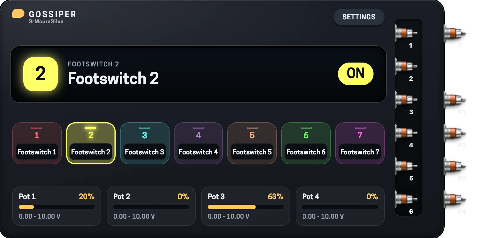
<span class="pin" style="--x:78.0%;--y:19.5%">1</span>
<span class="pin" style="--x:12.6%;--y:51.4%">2</span>
<span class="pin" style="--x:12.4%;--y:70.3%">3</span>
<span class="pin" style="--x:21.6%;--y:77.3%">4</span>
<span class="pin" style="--x:79.4%;--y:4.7%">5</span>
<span class="pin" style="--x:86.6%;--y:90.7%">6</span>
</div>
<figcaption>The Gossiper panel: Footswitch 2 was used last and is on, Pot 1 is at 20% and Pot 3 at 63%.</figcaption>
</figure>

| Item | Description | Interactivity |
|---|---|---|
| <span class="num">1</span>**Display** | Says **which control was used last** and what it did: the name of the footswitch and `ON` or `OFF`, or `Pot 3` and its percentage. It stays on, and lights up for a moment each time a control is used. This is how you see a message on a device that has no screen for plugin pop-ups, such as the MOD Duo. | Only visualization status |
| <span class="num">2</span>**Footswitch indicator** | A disc in a colour of its own for each footswitch. Lit while the footswitch is ON, and mirrored on its CV jack (0 V / 10 V). The one used last is outlined. | Only visualization status. Clicking on it does nothing. |
| <span class="num">3</span>**Footswitch label** | Click and type a name (up to 15 characters): this is the text the pop-up and the display show for that footswitch. | Editable field |
| <span class="num">4</span>**Potentiometer** | The position of the knob (0–100 %) as a meter, and the CV range (`Minimum`–`Maximum`, in volts) its 0–10 V output is scaled into. The one used last is outlined. | Only visualization status. To change the range, open the settings. |
| <span class="num">5</span>**Settings** | Opens the settings page (section 4). The gear icon above the plugin opens it too. | Button |
| <span class="num">6</span>**CV outputs** | `1`–`7` are the footswitches and `P1`–`P4` the potentiometers. | Jacks |

## 2. Interactive manual

Here the plugin is **the real one**: the same interface, the same script, running inside the manual. Press **Open the interactive manual**
under the picture to open it **full screen** (Esc or **Close** brings you back). Nothing you do is saved or sent anywhere, and **Reset** puts it
back the way it starts.

* **Explore**: tap any part of the plugin to read what it is for, or pick it from the list under the picture. **Show areas** outlines
  everything that can be tapped. Use the buttons at the top to switch between the plugin **on the pedalboard** and its **settings page**.
* **Guided tours**: step-by-step walkthroughs of the common tasks. A finger shows where to tap.
  Go forward and back with **Next** and **Back**: every step says what is happening and shows it in the plugin.

> [!NOTE] The box under the plugin is your controller
> Gossiper only shows what a control did **from outside**, so there is nothing to press on the plugin itself. The box drawn under it stands
> for your MIDI foot controller: press its buttons and turn its knobs, and watch the display, the discs and the CV follow. It is
> not part of the plugin.

```interactive
```

## 3. What it's for

A MIDI foot controller (say, a cheap "Chocolate"-style box) can send Program
Change or CC messages, but usually has no LED to confirm whether a patch is
currently on or off, and no screen to show a knob's value. Gossiper closes
that loop:

1. **Assign** a `Footswitch N` or `Potentiometer N` parameter to receive
   that MIDI message (or a CV signal, or a device knob/footswitch).
2. **Link** one of the 4 **pop-up slots** (*Screen pop-ups* on the settings page) to a knob or
   footswitch of the device page you play from.
3. **Use the CV output.** `CV Foot - Out N` (footswitches) or
   `CV Pot - Out N` (potentiometers) now carries a plain, calibrated CV
   signal you can route into any other plugin's CV-addressable parameter —
   the same way you would with a "Control to CV" utility plugin.

From then on, every time that MIDI controller sends a message, you see it
confirmed on the device screen — without needing to look down at an
unlit external box.

## 4. Setting it up on the device

> [!TIP] The shortest path
> Open the settings page, tap **Assign** next to *Footswitch 1* and press the button of your controller; then tap
> **Assign** next to *Pop-up slot 1* and pick a knob or footswitch of the page you play from. Press the button again:
> its name pops up on the device screen, the disc lights up on the plugin and `CV Foot - Out 1` goes to 10 V. The steps
> below show each tap.

Click **Settings** (or the gear icon above the plugin) to open the settings page. It has one panel for each thing
you can link, and each panel starts with **Hardware assignment**: that is the step where you choose which control of
your device, your MIDI foot controller or your pedal drives that parameter.


On a small screen the page splits into several pages instead of scrolling: use the arrows in the top bar (they
are always there), the dots between them, or swipe sideways on a touch screen.

**Step 1 — Assign the control.** In **Footswitches**, find a row that is not used yet — or, in **Potentiometers**, a
row for a knob — and tap **Assign** next to it.


In the opened modal, select MIDI option in **Assign to**.


Now you must send the MIDI message (or pick the device control) you want to drive it. After it, save.
The button shows a check mark once it is assigned.

**Step 2 — Assign a pop-up slot.** Do the same for one of the four slots in **Screen pop-ups** — this is what decides
*where* the pop-up will show.


**Step 3 — Choose the target.** Pick what the slot is addressed to
— usually **Device**, so it lives on the screen itself.


**Step 4 — Pick the page and control.** Choose which page (and which knob
or footswitch, B/C) the slot sits on. Whenever that page is showing,
that's where the pop-up appears.

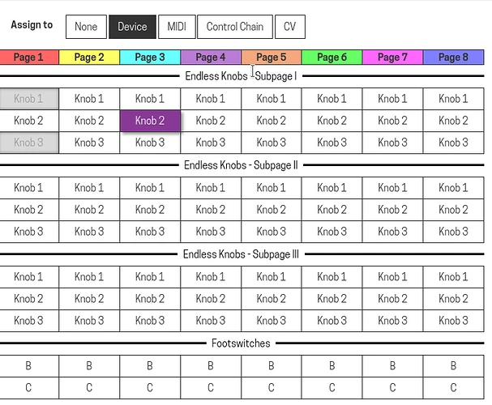

Repeat step 1 for as many footswitches/potentiometers as you're feeding in,
and steps 2–4 for as many slots as you want pages covered by — up to
4, so you can get a pop-up whichever of up to 4 pages you're currently on.

The page also lets you type the **name** of each footswitch and the **Min** and **Max** voltage of each
potentiometer, and keeps your own presets (**Saved presets**).

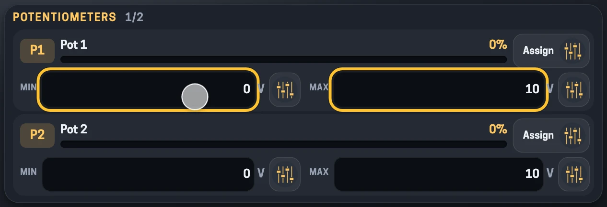

> **No screen for pop-ups?** The MOD Duo (and any device without the HMI) cannot show pop-ups: the display on the
> plugin itself (item 1, section 1) is the feedback there. Open the pedalboard and look at it. On the MOD Duo the
> *Screen pop-ups* slots of the settings page are disabled, with a note that says why.

## 5. How the pop-up decides when to appear

```embed:notification-flow.html
```

* **Footswitches gossip immediately** — the pop-up is titled *Gossiper* and shows the footswitch's
  custom label the instant it flips, styled *inverted* when turning ON and
  *normal* when turning OFF. If two footswitches flip in the very same instant, only the lowest-numbered one gets its pop-up.
* **Potentiometers gossip once you stop** — the pop-up is titled `Gossiper - Pot N` and shows the position, like `63.00%`,
  a short moment after the value settles, so sweeping a knob doesn't spam a
  message on every intermediate step.
* **No linked slot, no pop-up.** If none of the 4 pop-up slots is linked to a control of the page showing on the screen,
  Gossiper stays silent. The disc, the display and the CV outputs of the plugin do not depend on it.

> **Requires MOD Dwarf firmware v1.13 or newer** for the pop-up mechanism.
> On older firmware the CV outputs still work; you just won't get the
> on-screen message.

> **Note from the author:** the pop-up is meant for occasional confirmation,
> not as a live debugging readout — don't expect to use it for something
> that changes every few milliseconds.

### On the screen of the device

With the **aLabs Starless** image (Starless 19 or later) the MOD Dwarf and the MOD Duo X can show *widgets* of a plugin on their screens, drawn by
the plugin itself. The stock MOD firmware does not have this: the plugin works the same there and simply shows nothing. On the MOD Duo there is no
screen to draw on.

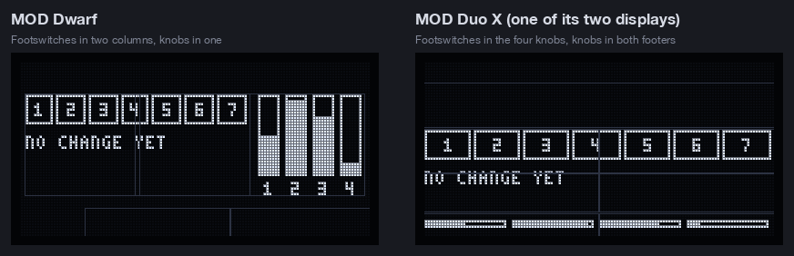

A widget **is for looking, not for touching**: nothing on the screen reacts to a finger or to a button of the device. What changes it are the
controls you assigned to the plugin, as always; the widget follows them.

#### Placing a widget

1. Open the **Display** dialog (the Device menu of MOD UI) and choose one of the two widgets (**Footswitches** or **Potentiometers**) in the list of widgets of the pedalboard.
2. **Place** it on an area of the screen: a column above a knob, two or three columns, a footer, both footers or the whole screen on the Dwarf; a
   knob, two knobs, the four knobs, the encoder band, a footer, both footers or the whole screen on each display of the Duo X. The dialog only
   offers the areas that are big enough for it.
3. The dialog offers to assign the seven footswitches (for **Footswitches**) or the four potentiometers (for **Potentiometers**) to controls of the device; you can change any of them or leave it out.
4. **Save**. Each can be placed on more than one area at once (a column and a footer, or one on each display of the Duo X).

Each draws what fits in the area it gets: a footer shows the bare essentials, the whole screen shows everything.

Unlike the pop-up, a widget needs no pop-up slot linked to a control and does not go away: it stays on the screen where you placed it.

#### Footswitches

Shows **which of the seven footswitches are on**, as numbered boxes (filled: on), under the name *Gossiper* where there is room for it. When a footswitch
changes, its **name and its new state (ON or OFF) appear over the widget for a moment**, like a pop-up, and then the boxes come back. It is offered in every area,
from a footer up.

| MOD Dwarf | MOD Duo X | What you see |
|---|---|---|
| 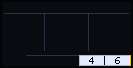<small>One footer · 51 × 10</small> | <small>One footer · 64 × 8</small> | A row of numbered boxes (filled: on). **Only the footswitches assigned to a control of the device** (all seven when none is). |
| 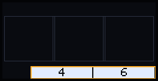<small>Both footers · 104 × 10</small> | 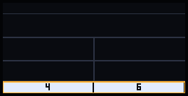<small>Both footers · 128 × 8</small> | The boxes in a row: **the assigned ones** (seven when none is). |
| 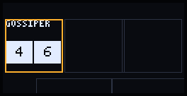<small>One column · 40 × 37</small> | 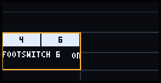<small>Two knobs, one above the other · 64 × 30</small> | *Gossiper* and the boxes under it, in rows. **Only the assigned ones** (all seven when none is). |
| <small>Two columns · 82 × 37</small> | 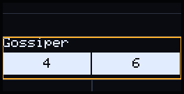<small>The four knobs · 128 × 30</small> | *Gossiper* and the boxes in one row: **the assigned ones** (seven when none is). |
| 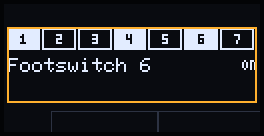<small>Three columns · 124 × 37</small> | 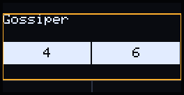<small>Encoder band and knobs · 128 × 47</small> | The same, with taller boxes. |
| <small>Whole screen · 128 × 64</small> | <small>Whole screen · 128 × 64</small> | A list of **all seven**, each with its name and ON or OFF. A footswitch that is not assigned has a dotted box and says `UNASSIGNED` where the state would be (when none is assigned, all look alike). |
| *No area of this kind* | <small>One knob · 64 × 16</small> | A row of numbered boxes. **Only the assigned footswitches** (all seven when none is). |
| *No area of this kind* | 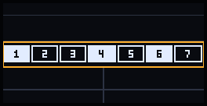<small>Two knobs side by side · 128 × 16</small> | The boxes in a row: **the assigned ones** (seven when none is). |

The pop-up fills the area (a footer shows it as one light bar: name on the left, state on the right). Changes in the first second after the plugin loads are not
shown, so a pedalboard that comes up with footswitches on does not flash them all.

An area (apart from the whole screen) is not spent on footswitches you do not use: the widget shows only the footswitches that are assigned to a control, in every area. (Until you
assign one, it shows all seven.) The names are the ones you gave them (see *Renaming a footswitch*).

How Gossiper knows which ones are assigned: the device only tells a plugin about its own controls (a footswitch or a knob of the device), not about a MIDI
controller, a CC or a CV, so the settings page does it. Every time you assign or unassign a `Footswitch N` it writes the result into the plugin's hidden
`Footswitch N in use` parameter (`footswitch_in_use_1` to `footswitch_in_use_7`, 1 = in use). They are saved with the pedalboard and are not on the settings page
(nobody assigns them). So the widget works the same without a browser open, and you can set them yourself when you control the plugin from an API: with
all seven at 0 the widget shows all seven. A footswitch assigned to a control of the device itself counts as in use even with its parameter at 0.

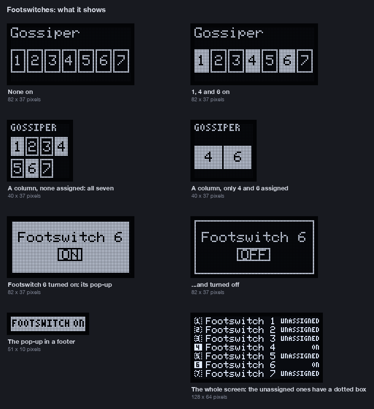

#### Potentiometers

Shows **the four potentiometers** (the controls you assigned to *Potentiometer 1 – 4*) as bars, with the value as a percentage where there is room.

| MOD Dwarf | MOD Duo X | What you see |
|---|---|---|
| <small>One footer · 51 × 10</small> | 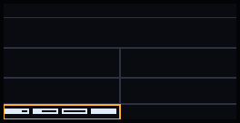<small>One footer · 64 × 8</small> | Four small bars side by side. |
| 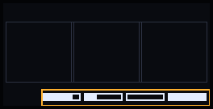<small>Both footers · 104 × 10</small> | 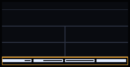<small>Both footers · 128 × 8</small> | The same, wider. |
| 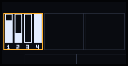<small>One column · 40 × 37</small> | 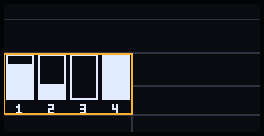<small>Two knobs, one above the other · 64 × 30</small> | Four upright bars, with their numbers under them. |
| 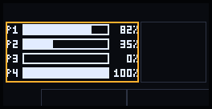<small>Two columns · 82 × 37</small> | 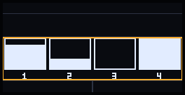<small>The four knobs · 128 × 30</small> | **Dwarf:** one row for each, **P1 – P4**, with a bar and the value in percent. **Duo X:** four upright bars with their numbers. |
| <small>Three columns · 124 × 37</small> | 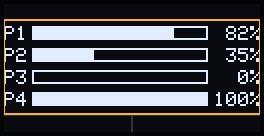<small>Encoder band and knobs · 128 × 47</small> | One row for each, **P1 – P4**: a bar and the value in percent. |
| <small>Whole screen · 128 × 64</small> | <small>Whole screen · 128 × 64</small> | The same, taller. |
| *No area of this kind* | 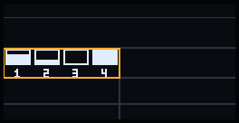<small>One knob · 64 × 16</small> | Four upright bars, with their numbers under them. |
| *No area of this kind* | <small>Two knobs side by side · 128 × 16</small> | The same, wider. |

The value is the position of the knob, from 0 to 100%, not the voltage on the CV output (which also depends on the Minimum and the Maximum).


## 6. Renaming a footswitch

Click a footswitch's label field and type a new name (up to 15 characters).
Allowed characters are letters, digits, spaces and `+ - : _ .`; anything
else is replaced with `_`. The name is what the pop-up shows for that
footswitch, and it's saved with the pedalboard/preset.


## 7. Recipes

Each recipe says which Gossiper control your MIDI controller drives, what to type in the settings page and where the CV output goes. Do the steps of
section 4 first (assign the control, link a **Pop-up slot**). Then, on the pedalboard, click **Manage CV ports** (Pedalboard actions bar of MOD UI) and check the Gossiper
outputs you use, so they can be chosen as a CV source. There is no cable to draw: you open the addressing of each parameter you want to control, choose **CV** and pick the
Gossiper output in the list. A potentiometer's voltage is its **Min** – **Max** range.

### Four-switch controller

| Gossiper control | Name (type it) | CV output → |
|---|---|---|
| <span class="dot" style="--c:#ff6667"></span>**Footswitch 1** | Drive | On/Off of the drive |
| <span class="dot" style="--c:#ffff67"></span>**Footswitch 2** | Chorus | On/Off of the chorus |
| <span class="dot" style="--c:#66ffff"></span>**Footswitch 3** | Delay | On/Off of the delay |
| <span class="dot" style="--c:#bb7cd2"></span>**Footswitch 4** | Reverb | On/Off of the reverb |

The classic use. A four-switch controller, like the M-VAVE Chocolate, turns effects on and off, and the device tells you which one just changed, **by name**.
Link **Pop-up slot 1** to a control of the page you play from, so the news is always in view.

*Setup: controller switches A–D → Footswitch 1–4 (MIDI) · on each effect, address its On/Off to **CV** and pick `CV Foot - Out 1`–`4`.*

### Expression pedal with a readout

| Gossiper control | Range | CV output → |
|---|---|---|
| **Pot 1** | 0 V – 10 V | position of a wah, or the volume |

A MIDI expression pedal on **Pot 1** drives a wah or a volume plugin. When you stop moving the pedal, the device shows where you left it, `Gossiper - Pot 1` and
`63.00%`, which helps when the pedal has no markings. The display on the plugin follows it while you move.

*Setup: expression pedal → Pot 1 (MIDI) · on the wah (or the volume), address the knob to **CV** and pick `CV Pot - Out 1`.*

### Safe-range sweep

| Gossiper control | Range | CV output → |
|---|---|---|
| **Pot 2** | 3 V – 7 V | feedback of a delay |

The whole sweep of the pedal now covers only the middle of the target knob (30% to 70% of a 0–10 V range), so you can stomp it all the way down without the delay
running away into endless feedback. Set **Min** to 3 and **Max** to 7 on the settings page, and adjust them until the extremes sound right (see *Tame the range of a knob*, section 8).

*Setup: second pedal or knob → Pot 2 (MIDI) · on the delay, address the feedback knob to **CV** and pick `CV Pot - Out 2`.*

### One plugin instead of many

| Gossiper control | Replaces |
|---|---|
| **Footswitch 1**–**7** | Seven on/off "Control to CV" plugins |
| **Pot 1**–**4** | Four continuous "Control to CV" plugins |

If your pedalboard uses many "Control to CV" plugins to turn MIDI into CV, move them into one Gossiper: it does the job of all of them, at a fraction of the CPU cost,
and you get the pop-ups and the display for free. For instance, [a forum user reported that, after replacing those plugins with Gossiper, the Dwarf's CPU usage went down
from 81% to 72%](https://forum.mod.audio/t/gossiper-plugin-to-say-what-is-happening-when-you-are-looking-it/9660/20?u=srmourasilva).

*Setup: re-address each MIDI mapping to a Gossiper footswitch or pot · on each parameter that was controlled by a "Control to CV" plugin, change its CV addressing to the matching Gossiper output.*

## 8. Tips

### Name the footswitches after what they do

The pop-up shows the label, so `Drive` or `Solo` says more on a screen than `Footswitch 3`. Rename them before you
assign the controller, and you will recognise the message without counting buttons.

### One pop-up slot per page you play from

A pop-up shows only while the control you linked to a slot is visible. If you play from two pages of the device,
link a second slot to a control on the other page, and so on up to four.

### Footswitch and CV in one go

A footswitch that Gossiper receives is also `CV Foot - Out N` (0 V off, 10 V on). Address a plugin's On/Off to that
output and a MIDI button turns the plugin on, with the name on the screen. The feedback and the action come from the
same control.

### Tame the range of a knob

A potentiometer reaches its CV output scaled into `Minimum`–`Maximum` volts. Set `Minimum 2` to 2 V and `Maximum 2` to
6 V and the whole sweep of the knob moves a parameter between 20 % and 60 % of a 0–10 V range, without losing
resolution on the knob.

### Do not use it as a meter

The pop-up of a potentiometer waits for the value to settle, so it is for confirming a position, not for watching a
value change continuously. Use the display on the plugin for that.

## 9. Questions & answers

### I move my controller but no pop-up appears.

Check, in this order:

1. The control that sends the message is linked to a `Footswitch N` or `Pot N` parameter (the **Assign** tile of its row on the settings page shows a check mark).
2. One of the four **pop-up slots** (*Screen pop-ups* on the settings page) is linked to a control of the device: a knob or a footswitch.
3. **That control is visible on the screen right now.** It is the page the device is showing; on another page, Gossiper stays silent (see section 5).
4. The device is a MOD Dwarf with firmware v1.13 or newer.
5. For a potentiometer, you stopped moving it: its pop-up comes a moment after the value settles, not during the sweep.

The disc and the display on the plugin and the CV outputs work without any of these. If they react, only the pop-up setup is missing.

### I move my controller but the plugin I want to control does not react.

The parameter you want to control has to be addressed to **CV**. Click **Manage CV ports** on the Pedalboard actions bar and check the Gossiper outputs you use, then open the
addressing of the On/Off parameter (or the knob), choose **CV** and pick the matching Gossiper output in the list (`CV Foot - Out N` / `CV Output N` for a footswitch,
`CV Pot - Out N` for a potentiometer). There is no cable to draw. Also check that
your controller is MIDI-learned to the right Gossiper row: the **Assign** tile of `Footswitch N` on the settings page has a check mark when it is.

### I press the pop-up slot control on my device and nothing happens.

That is by design. The pop-up slots (the parameters `Assign to notify 1–4`) are placeholders: they only give Gossiper a control of the device to show its messages
on. They do not switch anything.

### The settings page says "Pop-up slot" and I also see "Assign to notify". Is it the same?

Yes. The settings page names the four tiles *Pop-up slot 1–4*, in the panel *Screen pop-ups*. The parameter behind each one is `Assign to notify N`, which is the
name MOD UI lists in its own assignment dialog and the port reference of this manual uses. A *Footswitch N* row is the parameter `Footswitch N`, and a *Potentiometer* row is
`Pot N`; the **Min** and **Max** fields are `Minimum N` and `Maximum N`.

### How many pages can show a pop-up?

As many as you link slots: one slot for each page you play from, up to four. A slot is linked to **one** control; if two pages need it, use two slots.

### Does it work on the MOD Duo and the MOD Duo X?

The plugin loads and the CV outputs work on both. The MOD Duo has no screen for plugin pop-ups, so the **display on the
plugin** (open the pedalboard in the browser) is where you see the last control used, and the *Screen pop-ups* slots of
the settings page are disabled there. Pop-ups need the HMI of the Dwarf. The Dwarf and the Duo X can also show Gossiper as a **widget** that stays on the screen
(see *On the screen of the device*, in section 5).

### Can I have it on the screen all the time instead of a pop-up?

Yes, with the display widgets: **Footswitches** shows which of the seven are on, and **Potentiometers** shows the four bars. They need the aLabs Starless image
(Starless 19 or later), and no pop-up slot. On the stock firmware there are no widgets: the plugin works the same, without them.

### Does it process audio? Is it stereo? Does it add latency?

No to all three: Gossiper has no audio ports. It only reads its parameters and sends control voltages, so you can put it anywhere on the pedalboard.

### Can I control the same effect from a device footswitch and from my MIDI controller?

Not directly: a parameter can only have one addressing. A workaround shared on the forum is to send both signals as CV to a CV logic plugin set to XOR, and
connect its output to the effect.

### Can the potentiometer pop-up show a custom name?

No. Custom names are for footswitches. The pop-up of a potentiometer is always `Gossiper - Pot N` with the position of the knob, from 0 to 100%
(not the voltage, which also depends on **Min** and **Max**).

### Why does the potentiometer pop-up appear late?

Gossiper waits until the value stops changing for a short moment, so a sweep of a knob gives one message at the end instead of dozens on the way. For the same
reason the pop-up is for confirming a position, not for watching a value change: use the display on the plugin for that.

### I changed two footswitches at the same time and only one pop-up appeared.

If two footswitches flip in the very same instant, Gossiper shows the pop-up of the lowest-numbered one. The disc, the display and the CV output of each
one still follow.

### Why do some characters in my label turn into "_"?

A name accepts letters, digits, spaces and `+ - : _ .` only, up to 15 characters. Anything else is replaced with an underscore.

### Are the names saved?

Yes. The name of each footswitch is saved with the pedalboard and with the plugin presets.

### Can I invert a knob with Min and Max?

No. The two values are put in order, so a **Min** of 8 V and a **Max** of 2 V give the same range as 2 V and 8 V. To invert a control, use a plugin that does it
on the CV.

### Why can't I turn the footswitch indicator on by clicking it?

The disc only shows what the footswitch received. Gossiper reports on a control that lives elsewhere; to change it, use the controller, or the parameter in the
plugin's own addressing.

## 10. Port reference

| Port | Type | Description |
|---|---|---|
| `CV Foot - Out 1`–`4`, `CV Output 5`–`7` | CV output | 0 V / 10 V, mirrors `Footswitch N` (the first four have the longer name). |
| `Footswitch 1`–`7` | Control input (toggle) | Assign this to receive MIDI/CV/device input. |
| `Assign to notify 1`–`4` | Control input | The **Pop-up slot 1–4** of the settings page. No audio/CV effect; link it to a control of a device page so pop-ups show there. |
| `Pot 1`–`4` | Control input (0–1) | Assign this to receive MIDI/CV/device input. |
| `Minimum N` / `Maximum N` | Control input (volts) | The CV range `Potentiometer N`'s 0–1 value is scaled into. |
| `CV Pot - Out 1`–`4` | CV output | `Potentiometer N` scaled into `[Minimum N, Maximum N]` volts. |
| Footswitch label 1–7 | Plugin property (patch) | The custom name for each footswitch, edited from the GUI text field. |

## 11. Specifications

| Field | Value |
|---|---|
| Plugin name | Gossiper |
| Version | 1.1.21 (the version of the plugin this manual is for) |
| Category | Control Voltage · Utility |
| Format | LV2 · URI `http://srmourasilva.github.io/plugins/gossiper` |
| Audio I/O | None |
| CV outputs | 7 × footswitch (0 V off / 10 V on) · 4 × potentiometer (scaled into `Minimum`–`Maximum`, 0–10 V) |
| MIDI | None (the controller's messages arrive through the device's assignment) |
| Assignable parameters | Footswitch 1–7 (toggle) · Pot 1–4 · Minimum / Maximum 1–4 · Assign to notify 1–4 (the pop-up slots) |
| Device feedback | Pop-up notifications (MOD HMI, Dwarf firmware v1.13 or newer) · display and indicators on the plugin |
| Additional features | Display widgets with the [Starless HMI Widget Extensions](https://forum.mod.audio/t/starless-hmi-widgets-extension-for-plugins/13703) (MOD Dwarf and Duo X) |
| Platforms | MOD Dwarf · MOD Duo X · MOD Duo |
| Developer | Paulo Mateus (SrMouraSilva) |
| License | Apache-2.0 |
| Source code | [github.com/SrMouraSilva/plugins-lv2](https://github.com/SrMouraSilva/plugins-lv2) |
| Store page | [Gossiper](https://pedalboards.mod.audio/plugins/aHR0cDovL3NybW91cmFzaWx2YS5naXRodWIuaW8vcGx1Z2lucy9nb3NzaXBlcg==) |
| Forum thread | [forum.mod.audio – Gossiper](https://forum.mod.audio/t/gossiper-plugin-to-say-what-is-happening-when-you-are-looking-it/9660) |

Gossiper is a community plugin. Feedback, bug reports and pull requests are welcome in the [forum thread](https://forum.mod.audio/t/gossiper-plugin-to-say-what-is-happening-when-you-are-looking-it/9660) and on [GitHub](https://github.com/SrMouraSilva/plugins-lv2).
