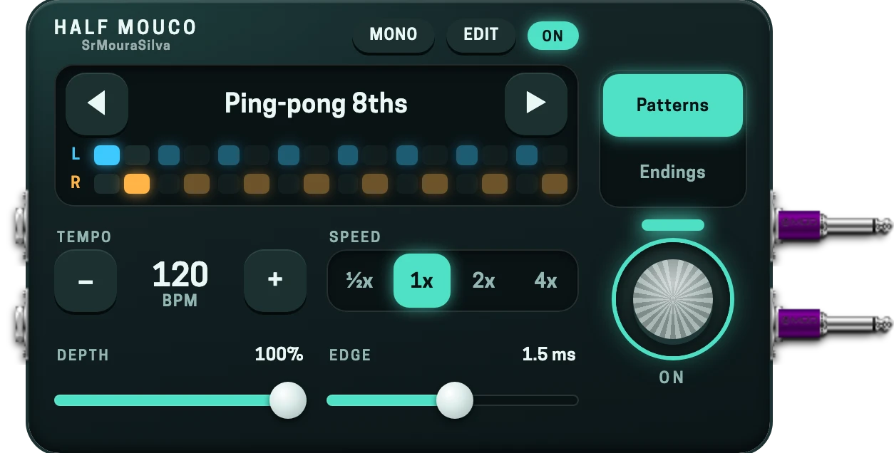
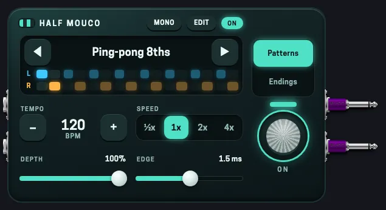
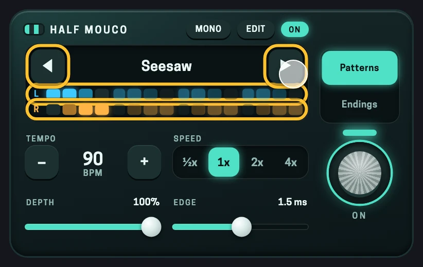
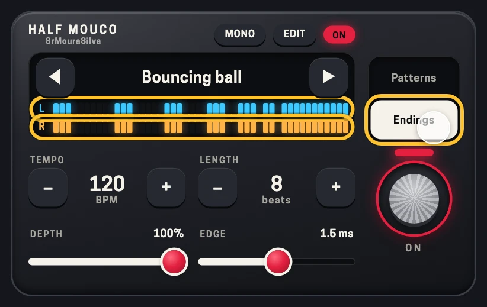
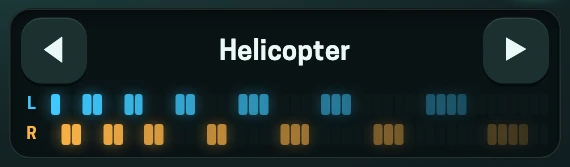
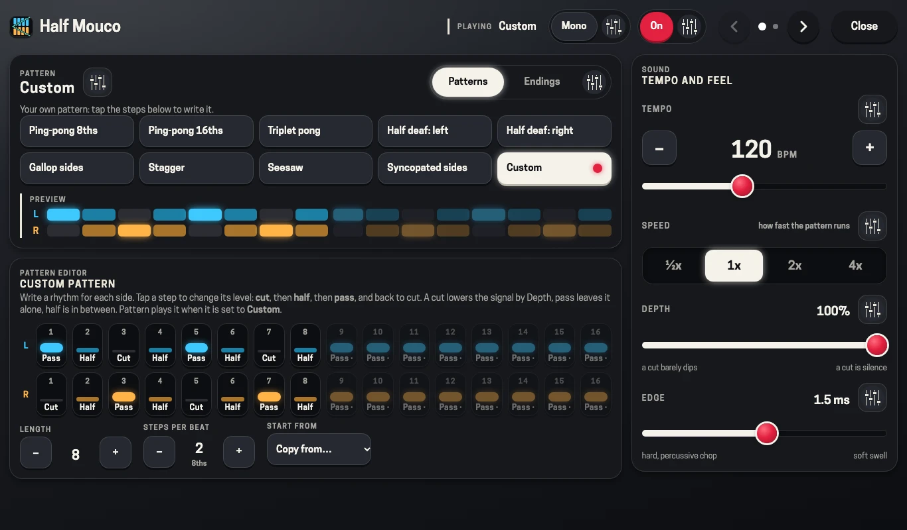
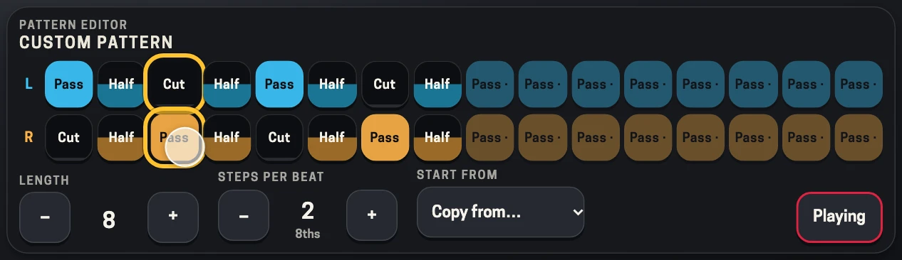
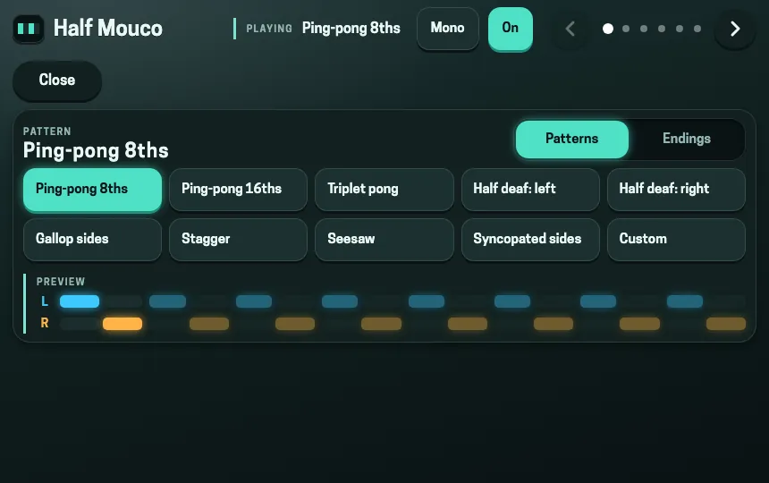

# Half Mouco — User Manual

Half Mouco is the **stereo** sibling of Kill Switch: a rhythmic signal-cut effect, like the momentary kill switch some guitars
have, in which **the left and the right side each have a row of steps of their own**. The sound changes with the side: a
ping-pong from ear to ear, one ear chopped while the other one stays, a swell that moves across. (*Mouco* is Portuguese for hard
of hearing: *half mouco* is half deaf.)

It has two families of effects:

* **Patterns** loop for as long as the plugin is on. Nine to choose from, and **your own**, written on a settings page, with three
  levels per step.
* **Endings** are for the end of a song. They play **once** when you switch the plugin on and finish in silence: a bouncing ball, a
  helicopter that lands, a stutter that dies away. You choose them; you do not draw them.





## 1. Quick start

You need a pedalboard with an audio input and an output, and a guitar (or any sound) going through it.

1. **Add Half Mouco** to your pedalboard and put it **between your guitar input and the rest of the chain** (or between the amp and the
   output). It has two audio inputs and two audio outputs, one pair for each side.
2. **Feed both sides.** A single instrument is mono: turn on **Mono** on the plugin, and the left input feeds both sides. With a
   stereo source (a stereo pedal before it, an amp with a stereo send), leave Mono off and connect each side to its own input.
3. **Turn it on.** The plugin starts on (the light over the footswitch is lit and the label says *On*): play a note and it is
   chopped at once. Click the footswitch to bypass it: the sound is clean again.
4. **Choose a pattern** with the arrows on each side of its name. Under the name there is a row for the **L**eft side (blue) and
   one for the **R**ight side (amber): a bright square lets the signal through, a dark one cuts it.

    

5. **Set the tempo** with **−** and **+** (hold one to go on) and pick the **speed**. **Depth** is how much of the signal a cut
   removes (100% is silence) and **Edge** is how long a cut takes to close and open.
6. **Try an ending.** Tap **Endings** under the name, pick one with the arrows and set its **length**, then switch the plugin off and on
   again: the ending plays once, from the start.

    

7. **Put it under your foot.** Assign the plugin's footswitch (its **Bypass**) to a device footswitch, in *Momentary* mode if you
   want the effect on only while you hold it ([section 6](#playing-it-live)).

> [!TIP] Everything starts the moment you switch the plugin on
> A pattern **starts again from its first step**, and an ending **starts from its beginning**, every time the plugin goes from
> bypassed to on. Press the footswitch in time with the beat and the chops fall where you want them; press it as the last chord
> rings and the ending falls on it.

## 2. The plugin on the pedalboard

| Item | What it does |
|---|---|
| **Patterns / Endings** | The family that plays. The tabs are in the column of the footswitch. |
| **The arrows and the name** | Choose the pattern (section 3) or, in Endings, the ending (section 4). The arrows go round. In Patterns the last one is **Custom**, the one you write. |
| **The two rows, L and R** | What each side does. In Patterns, a bright square lets the signal through, a dark one cuts it, a darker colour is the middle level; a pattern shorter than sixteen steps is repeated, the first run bright and the repetitions dimmer. In Endings, the whole ending along its time: the brighter the column, the more open the side. They go dim when the plugin is bypassed. |
| **Tempo: − and +** | From 40 to 240 BPM. Hold a button to keep going. Endings use it too: their length is counted in beats. |
| **Speed** (Patterns) | ½x, 1x, 2x or 4x: multiplies the speed of the pattern without changing the tempo. |
| **Length** (Endings) | How long the ending lasts, in beats, from 2 to 32. At 120 BPM, 8 beats are 4 seconds. |
| **Depth** | From 0% to 100%: how much of the signal a cut removes. 100% is silence; lower values only dip the level. |
| **Edge** | From 0.1 ms to 20 ms, on a logarithmic scale: how long a cut takes to close and to open again. |
| **Mono** | On: the left input feeds both sides. Off: each side has its own input. |
| **Edit** | Opens the settings page: everything on the plugin with more room, the editor of your own pattern and the controls to assign (section 5). |
| **The footswitch and its light** | The **bypass** of the plugin. The ring and the light above it are lit while the effect is on, and the label at the top says *On* or *Bypassed*. |
| **Audio jacks** | `In L` and `In R` on the left, `Out L` and `Out R` on the right. |

## 3. The patterns

Each pattern is a loop of steps, and **each side has its own row**. In every step a side is either **let through** or **cut**
(or, in the middle level, half); the plugin goes from one step to the next in time with the tempo, and from the last step back to
the first. The grids show every pattern as sixteen steps (the shorter ones repeat), the **left** row in blue and the **right** row in amber.
A lit square is a step that lets the signal through (the middle level of *Seesaw* is shown as lit too).

```recipe
Ping-pong: the sound goes from ear to ear
cols: 1 2 3 4 5 6 7 8 9 10 11 12 13 14 15 16
Ping-pong 8ths · L: 1010101010101010
Ping-pong 8ths · R: 0101010101010101
Ping-pong 16ths · L: 1010101010101010
Ping-pong 16ths · R: 0101010101010101
Triplet pong · L: 1001001001001001
Triplet pong · R: 0100100100100100
---
The classic: while the left ear is cut, the right one plays, and the other way round. *Ping-pong 8ths* and *Ping-pong 16ths* use those note values, *Triplet pong* does it in threes (the third step is cut on both sides).
assign: **Steps per beat:** Ping-pong 8ths 2 · Ping-pong 16ths 4 · Triplet pong 3
```

```recipe
Half deaf: one ear is chopped, the other is not
cols: 1 2 3 4 5 6 7 8 9 10 11 12 13 14 15 16
Half deaf: left · L: 0101010101010101
Half deaf: left · R: 1111111111111111
Half deaf: right · L: 1111111111111111
Half deaf: right · R: 0101010101010101
---
One side chops while the other stays as it is. *Half deaf: left* chops the left ear, *Half deaf: right* the right one: the plugin is named after them.
assign: **Steps per beat:** Half deaf: left 2 · Half deaf: right 2
```

```recipe
Sides that answer each other
cols: 1 2 3 4 5 6 7 8 9 10 11 12 13 14 15 16
Gallop sides · L: 1100110011001100
Gallop sides · R: 0011001100110011
Stagger · L: 1001100110011001
Stagger · R: 0110011001100110
Seesaw · L: 1110111011101110
Seesaw · R: 0111011101110111
Syncopated sides · L: 1001001010010010
Syncopated sides · R: 0100100101001001
---
*Gallop sides* gallops from one side to the other; *Stagger* is a syncopated answer between the two; *Seesaw* uses the middle level, so that one side fades out while the other one swells in, like a seesaw; *Syncopated sides* is the 3-3-2 grouping of eight steps, a step apart on the two sides.
assign: **Steps per beat:** Gallop sides 4 · Stagger 4 · Seesaw 2 · Syncopated sides 2
```

The length of a step is `60 / (tempo × steps per beat × speed)` seconds. At 120 BPM, *Ping-pong 8ths* has a step of 250 ms.

> [!NOTE] The tempo is the plugin's own
> Half Mouco does not follow the tempo of the pedalboard or of a MIDI clock: set the tempo here, or assign it to a knob or to an
> expression pedal.

## 4. The endings

An ending is a one-time effect for the end of a song. It plays **once**, from the moment you switch the plugin on, lasts **Length**
beats at the **Tempo**, and then everything is cut: the sound **ends**, and stays silent until you bypass the plugin and switch it on again. The five
endings are chosen, not drawn: you pick one, and set its length, the tempo, the depth and the edge. (With **Depth** below 100% the end is not fully silent:
the cut only goes down to that level.)



| Ending | What it does |
|---|---|
| **Bouncing ball** | *tam------tam-----tam---tam--tam-tam-ta-ta-t-t-t-ttttt*: the first hit is at once and every gap is 78% of the one before, so the hits pile up towards the end and turn into a buzz, on both sides. The hits get shorter with their gaps. |
| **Helicopter** | The blades go to the left, then to the right, one after the other, starting at the pace of sixteenth notes; the gap between them grows by 12% each time and the sound fades out, like a helicopter landing. |
| **Stutter out** | Sixteenth notes that stay open less and less, from 92% of each to almost nothing, until they stop. The right side is half a note behind the left one. |
| **Side fade** | Eighth notes, half open. The left side fades out first (by 60% of the ending) and the right one is the last to go. |
| **Ping-pong out** | Eighth notes, one to each side in turn, starting on the left, and every one quieter than the one before. |

Changing the ending or the family while the plugin is on starts the new one from its beginning, so you can try them without switching off.

## 5. Your own pattern

The tenth pattern, **Custom**, is yours. Click **Edit** on the plugin (or open its settings with the gear icon). The settings page has
everything the plugin has, with more room, and its first page is where you play and write:

* **The choice**: **Patterns** or **Endings**, and under it every pattern (or ending) to pick with one tap, and a **Preview** of what
  each side does (it only shows: it is not a control). Choosing **Custom** opens the editor right there, under the preview.
* **Tempo and feel**, beside it: the tempo (with its buttons and a slider), **Speed** (or **Length**, in Endings), **Depth** and **Edge**.
* **In the top bar**, on every page: **Mono**, and **On** / **Bypassed**, the footswitch of the plugin.

On a small screen there is no room for all of it on one page: the editor then has a page of its own, and a button under the list,
**Edit the custom pattern →**, takes you there.



A step has **three levels**, and a tap on it goes to the next one, round and round:

| Level | What the step does |
|---|---|
| **Cut** | Lowers the signal by **Depth**: silence at 100%. |
| **Half** | Halfway between a cut and the whole signal: at Depth 100% half the level, at 50% three quarters of it. |
| **Pass** | Lets the signal through as it is. |

1. **Tap the steps** of the **L** row (blue) and of the **R** row (amber). The bar of a step says its level, and so does its label, so
   you do not have to rely on the colour.

    

2. **Set the length** with **−** and **+**: from 1 to 16 steps, the same for both sides. Only the first steps are played; the dimmer ones after
   them are kept, so you can shorten a pattern and bring its end back.
3. **Set the steps per beat**, from 1 to 8: with 2 a step is an eighth note, 4 a sixteenth, 3 a triplet, 1 a quarter note.
4. **Listen to it.** Choosing **Custom** in the list plays it, and so does the first change you make to a step: the plugin goes to
   **Patterns**, on **Custom**, so what you write is what you hear. Where the editor has a page of its own, the **Play this pattern**
   button does the same without changing anything.

> [!TIP] Start from a built-in pattern
> **Copy from…** copies one of the nine built-in patterns (both rows, length and steps per beat) into your own, ready to be changed.

Your pattern is made of controls of the plugin, so it is saved with the **pedalboard**, with your own **saved presets** and with
**snapshots**. The factory presets do not touch it. The settings have more than one page: use the arrows of the top bar (or swipe
sideways) to go to the assignments (**On / off** and **Controls**) and to the **Saved presets**.



## 6. Playing it live

Every control of the plugin can be assigned to a device control (a footswitch, a knob, an expression pedal), the way you assign any
parameter: open the settings of the plugin (the gear icon, or **Edit**) and click the tile of the control to assign. The bypass has a
panel of its own, **On / off**, and the rest is in **Controls**.

| Control | Good to assign it to |
|---|---|
| **Bypass** | A footswitch. In the dialog choose **Momentary On** to have the effect on only while you hold the footswitch, or leave it as a toggle. For an ending, a press is the end of the song. |
| `Mode` | A footswitch: patterns for the song, endings for its last bar. |
| `Pattern`, `Ending` | A knob, or a footswitch that goes through them. |
| `Tempo` | A knob, or an expression pedal. |
| `Speed` | A footswitch: hold it for double speed, let go for normal. |
| `Length` | A knob. |
| `Depth` | A knob or an expression pedal: from a gentle tremolo to a full cut. |
| `Edge` | A knob: from a hard chop to a soft swell. |

The plugin shows nothing on the device screen, so there is no pop-up to set up.

## 7. Factory presets

Open **Saved presets** in the settings of the plugin to pick one. Each one sets the mode, the pattern, the ending, the tempo, the
speed, the length, the depth and the edge; the bypass, the mono input and your custom pattern are not part of a preset.

| Preset | Family | What | Tempo | Edge |
|---|---|---|---|---|
| Ping-pong 8ths | Patterns | Ping-pong 8ths | 120 BPM | 1.5 ms |
| Ping-pong 16ths | Patterns | Ping-pong 16ths | 120 BPM | 1.5 ms |
| Half deaf: left | Patterns | Half deaf: left | 120 BPM | 1.5 ms |
| Half deaf: right | Patterns | Half deaf: right | 120 BPM | 1.5 ms |
| Seesaw swell | Patterns | Seesaw | 90 BPM | 6 ms |
| Stagger | Patterns | Stagger | 100 BPM | 1.5 ms |
| Bouncing ball | Endings | Bouncing ball, 8 beats | 120 BPM | 0.5 ms |
| Helicopter landing | Endings | Helicopter, 12 beats | 100 BPM | 3 ms |
| Stutter out | Endings | Stutter out, 8 beats | 140 BPM | 0.5 ms |
| Side fade | Endings | Side fade, 8 beats | 90 BPM | 6 ms |
| Ping-pong out | Endings | Ping-pong out, 8 beats | 110 BPM | 3 ms |

All of them have the speed at 1x and the depth at 100%.

## 8. Tips

### Set the tempo to the song, then leave it

The patterns are in time with the tempo you set, not with the band. Adjust the number until the chops sit with the drums. For an
ending, the tempo and the length together say how long it lasts: leave it a little longer than the last chord.

### Use Mono for a single guitar

With one instrument, turn Mono on: both sides get the signal, and the patterns show their sides. With Mono off and only the left input
connected, the right side is silent, and a ping-pong has only one ear to play.

### Half deaf for a wide stereo

*Half deaf* keeps one ear steady and chops the other, which makes a stereo sound feel as if it moved around while it stays in place. Put it
after a stereo reverb or chorus.

### Edge changes the character

Short edges (below 1 ms) are percussive: the sound is stopped as if a switch were flicked. Long edges (10 ms and more) turn the chop into a
soft swell. On an ending, a long edge smooths the buzz at the end of the *Bouncing ball*.

### Build your own from a built-in pattern

Pick the built-in pattern that is closest, **Copy from…** it into the custom pattern and change a step or two. Use the middle level for a ghost
note: a step that is there, but soft.

## 9. Questions & answers

### Nothing is cut, I hear my guitar as it is.

Check that the label at the top of the plugin says *On* and the light above the footswitch is lit. If it says *Bypassed*, click the footswitch.

### I hear the left side only.

Turn **Mono** on, or connect your source to both inputs: with only the left input connected, the right side has nothing to play.

### The ending is over and I hear nothing.

That is the end: an ending finishes in silence. Bypass the plugin and switch it on again to hear it from the beginning. To get your sound back as it was, bypass it.

### The chops are not on the beat of my song.

The tempo is the plugin's own (section 3): set it by ear, or assign it to a knob. And switch the effect on on the beat: the pattern starts again
from the beginning each time.

### Does it add latency?

No: the signal is only multiplied by a number that goes up and down.

### I edited my pattern and it did not change what I hear.

Check that the family is **Patterns** and the pattern is **Custom** (the name on the plugin says so). The first edit switches both, but if you then chose
another one, choose **Custom** again in the list (or press **Play this pattern**). And the step must be inside the **length**: the dimmer steps after it are not played.

### Is my pattern saved?

Yes, with the pedalboard, your saved presets and the snapshots. It is not in the factory presets, and it is not shared between pedalboards.

### What is the difference from Kill Switch?

Kill Switch is mono, with one row of steps. Half Mouco is stereo, with a row for each side, and it has the endings. They are separate plugins and can
share a pedalboard.

*This manual is for version 1.0.3 of Half Mouco.*
