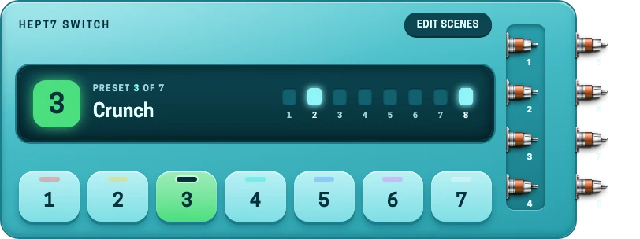
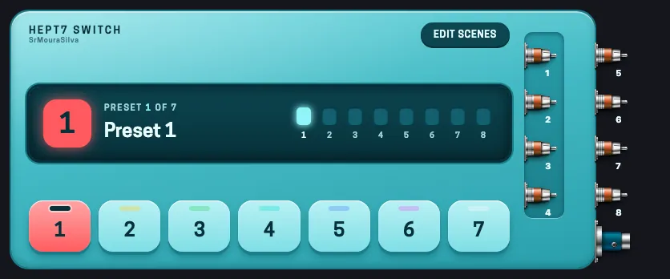
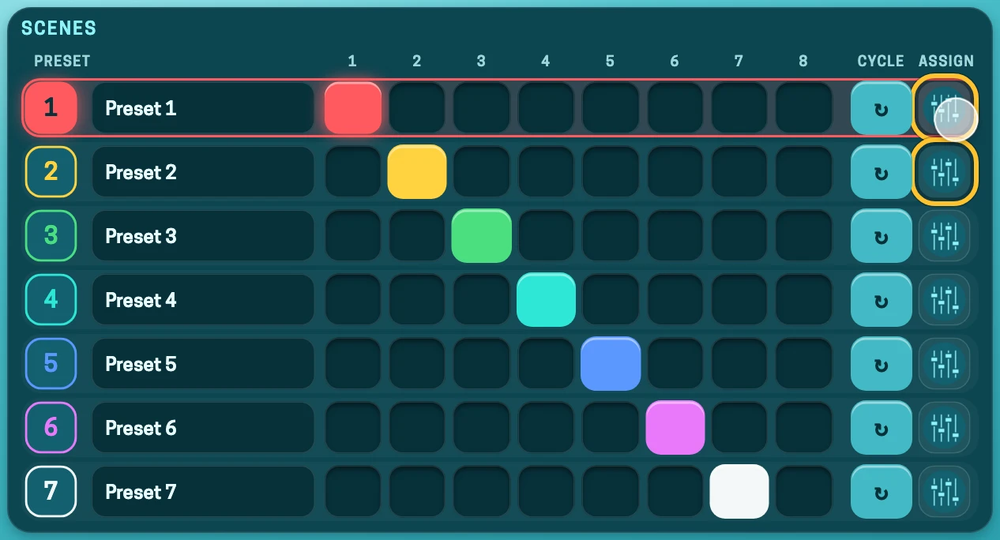
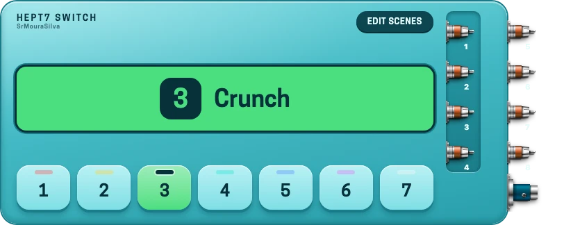
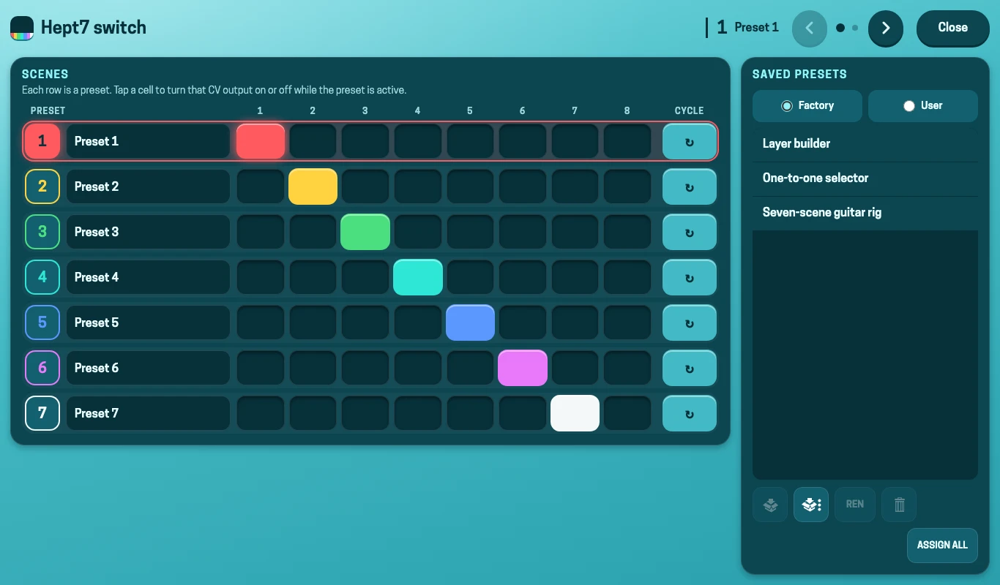
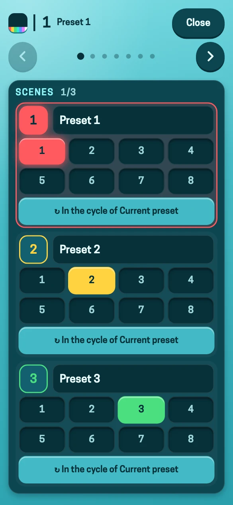
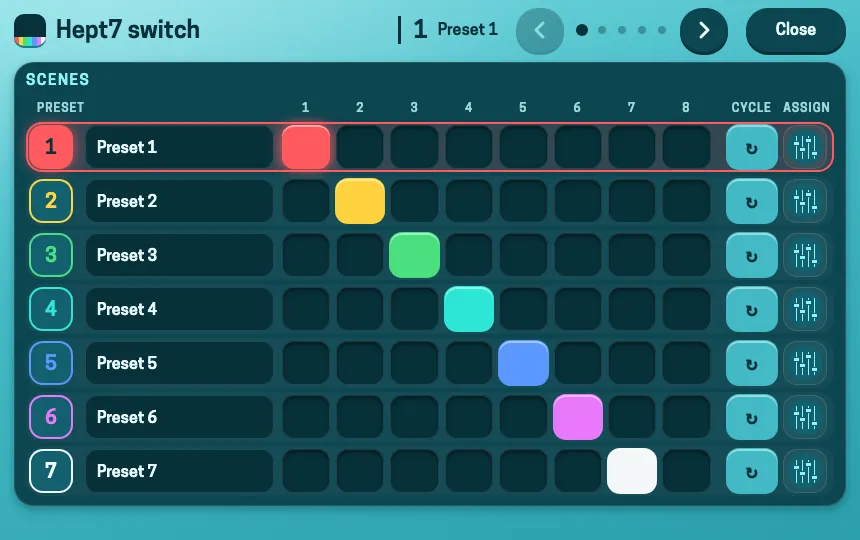
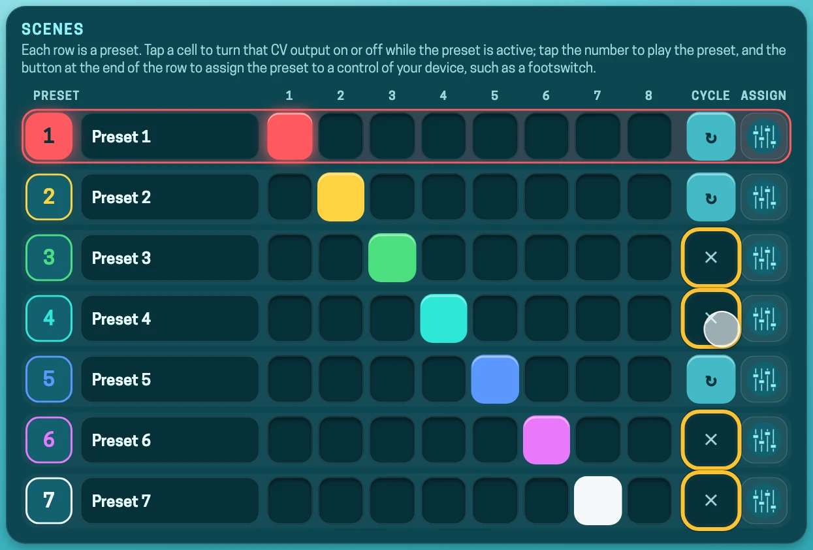
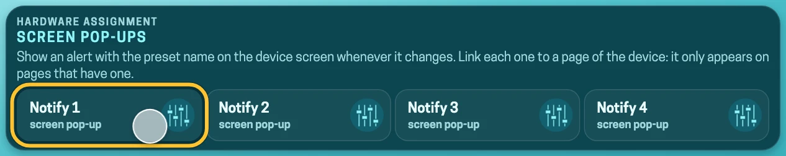

# Hept7 Switch — User Manual

Hept7 Switch turns **one footswitch press into eight CV signals at once**. You
choose, for each of its **7 presets**, which of its **8 CV outputs** are on
(10 V) or off (0 V), and then change between presets with a footswitch, a
knob or the screen. Route the CV outputs to the on/off (or any CV-addressable)
parameters of your plugins and a single press can turn a whole scene on.

It is the bigger sibling of Tetr4 Switch, and it has two things of its own:
a **display** that shows the preset (and announces every change of it), and a
**full-screen settings page** made for touch screens.





## 1. Quick start

This example gives you two scenes: a clean sound and a lead sound with a drive and a delay. You need a pedalboard with
any drive plugin and any delay plugin in the chain.

1. **Add Hept7 Switch** to your pedalboard. You can find it among the Utility plugins. Put it anywhere; it has no audio
   connections.
2. Click on **"Manage CV ports"** on the Pedalboard actions bar (top of Constructor window on the MOD WebGUI) and check
   the boxes that appear next to the outputs of the Hept7 Switch.
3. **Give your drive and your delay an on/off CV input.** Click the gear icon of the drive, open the addressing for its
   On/Off (bypass) parameter and choose **CV**; select `CV Output 1`. Do the same for the delay with `CV Output 2`.
4. **Set the scenes.** Click **Edit scenes**. In the factory setting preset *N* turns on output *N* only, so turn off the
   lit cell of the row of preset 1 (the clean scene: everything off) and turn on output 1 in the row of preset 2 (the
   lead scene: drive and delay).
5. **Click the buttons 1 and 2** of the plugin. The drive and the delay turn on and off together, and the display
   announces the preset in its colour.
6. **Put it under your feet.** Assign `Preset 1` and `Preset 2` to two device footswitches. Their LEDs light up in the
   colour of the preset while it is active. On the settings page ([section 3](#the-settings-page)) the tiles of the
   *Hardware* section do this in one tap.

    

> [!TIP] The one trick to learn
> **Plan your outputs before your presets.** Each output is one "loop": a group of plugins that always switch on and off
> together. Decide those eight groups first. After that, each preset is just a matter of choosing which loops are on.
> Plugins that are always on, like your amp and cab, don't get a CV addressing at all.

## 2. The plugin on the pedalboard

| Item | What it does |
|---|---|
| **Display, big number and name** | The active preset. **The name is editable**: click it and type (up to 15 characters). It is also the text the device screen pop-up shows (see section 5). |
| **Display, eight squares** | The CV outputs that are on in the active preset. **They are buttons**: click one to turn that output on or off in the active preset, without opening the settings page (the other presets are edited on the settings page). |
| **Seven buttons** | Select the preset. The button of the active preset lights up in its colour. There are seven because the device footswitch LEDs have seven colours (red, yellow, green, cyan, blue, magenta, white): each preset has its own, here and on the device. A button with its number **crossed out** is a preset left out of the cycle of `Current preset` (section 4); the button still selects it. |
| **Edit scenes** | Opens the settings page (section 3). The gear icon above the plugin opens it too. |
| **Eight CV jacks** | `CV Output 1`–`8`, on the back plate at the right, in two columns (1–4 and 5–8). |

### The display announces every change of preset

Whenever the preset changes — from a footswitch, a knob, the buttons or a
MIDI controller — the whole display takes the colour of the new preset for a
moment, showing its number and name big:



This works on every device, including the **MOD Duo**, which has no screen
for plugin pop-ups: it is how you see which preset a footswitch has just
selected.

## 3. The settings page

Click **Edit scenes** (or the gear icon) to open a page that takes the whole
screen and is made for touch: big cells, nothing smaller than a fingertip.



* **Scenes**: one row per preset. The round button on the left makes that
  preset the active one; the field next to it is its name; then one cell per
  CV output. A lit cell means that output is **on** while that preset is active.
  The row of the active preset is highlighted, and its lit cells are the CV
  signals actually leaving the plugin right now.
* **Cycle**: the last cell of each row, set apart from the CV outputs. On (↻,
  turquoise), the preset is one of those `Current preset` goes through when it
  is assigned to a footswitch, to the B+C pair or to a knob; off (✕), they skip
  it. See section 4.
* **Hardware**: tiles to assign a footswitch, a knob or a device screen page to
  the plugin's controls (section 4), told apart by purpose: the *preset
  buttons* (1 to 7), *Current preset* and the *screen pop-ups*. A tile shows a
  check mark once it is assigned.
* **Saved presets**: the factory presets (section 6) and your own presets.

The page never scrolls up and down. What does not fit the screen goes on
another **page**, to the right: the arrows in the top bar (always there) and the
dots between them show and change the page, and on a touch screen you can
**swipe** sideways too. A large screen shows more on each page; a phone shows
fewer presets per page (it says *Scenes 2/3*), and each purpose of the *Hardware*
section gets a page of its own.





## 4. Switching presets with hardware

Assign one of the plugin's controls (the *Hardware* tiles, or the usual
assignment dialog) to the control you want to use:

| Control | Use |
|---|---|
| `Preset 1`–`7` | One footswitch per preset. Turning one on turns the others off. |
| `Current preset` | One control that goes through the presets: a footswitch (each press goes to the next preset), the B+C pair of footswitches (previous / next), or a knob. Also a CV or MIDI value. |

On the settings page, tap the tile of the preset and choose the control in the dialog that opens:


### Choosing which presets `Current preset` goes through

Seven presets may be more than a song needs. Turn off the **Cycle** cell of the
presets you do not use (settings page, section 3) and `Current preset` skips
them: with presets 1, 2 and 5 in the cycle, a footswitch assigned to it goes
1 → 2 → 5 → 1 → ..., and the B+C pair goes forwards and backwards through the
same three.



* The cycle always starts from the **active preset**. If a `Preset N`
  footswitch or a button of the plugin has just selected preset 5, the next
  press of `Current preset` goes to the preset after 5 in the cycle.
* Presets out of the cycle can still be selected: the plugin buttons and the
  `Preset 1`–`7` footswitches select any preset. Only `Current preset` skips them.
* With every preset in the cycle (the default), `Current preset` goes through
  all seven, also counting from the active preset.

> **How it works, and its limit.** The device keeps its own position for
> `Current preset` and sends the option after (or before) it on each press;
> nobody tells the device when the plugin changes the preset. The plugin
> therefore takes a move of one option as "next" (or "previous") and counts
> from the active preset, wherever the device's position is (a MIDI or CV
> value that moves it by exactly one option is a step too). So the value of
> `Current preset` (in the assignment and snapshot screens) may be the
> device's position instead of the active preset; the display, the buttons,
> the `Preset` footswitches and the name on the device screen always show the
> active preset. On a B+C pair that stops at the first and last options
> instead of going around, a press at an end does nothing until a press in the
> other direction.

## 5. The pop-up on the device screen

On devices with a screen that can show plugin pop-ups (MOD Dwarf), the name of
the active preset is shown in a pop-up whenever the preset changes. As with
Gossiper, the device only allows a pop-up on a page that has a control addressed
to the plugin, so:

1. Assign one of `Assign to notify 1`–`4` to a control of the device page where
   you want to see the pop-up (use a second, third or fourth one for other pages).

    

2. Every change of preset now shows the name of the preset on that page.

The footswitch LEDs and the preset knob follow the preset as well, with the
colour of each preset.

> The pop-up needs a firmware with the HMI feature. Without it (older firmware, or
> a MOD Duo) the plugin works the same, only without the pop-up and the LEDs: the
> display of the plugin is your feedback.

## 6. Recipes

Each recipe shows the preset x output matrix as a grid: rows are presets and columns are CV outputs 1–8. A coloured
square means the output is on (10 V) and a grey square means it is off (0 V). Each one is also a factory preset of the
plugin (open **Saved presets** on the settings page).

```recipe
Seven-scene guitar rig
cols: 1 2 3 4 5 6 7 8
Clean: 10000101
Chorus: 10010101
Crunch: 01000001
Lead: 01001011
Solo: 00101111
Ambient: 10011100
Kill: 00000000
---
A complete rig on one pedal. The outputs are loops: **1** Compressor, **2** Overdrive, **3** Distortion, **4** Chorus, **5** Delay, **6** Reverb, **7** Boost and **8** Noise gate. *Clean* is the compressor with a touch of reverb, *Chorus* adds the chorus, *Crunch* and *Lead* use the overdrive (the lead adds delay and boost), *Solo* swaps it for the distortion with delay, reverb and boost, *Ambient* is a clean wash of chorus, delay and reverb, and *Kill* turns everything off between songs.
assign: **Assigning the Hept7 Switch:** Out 1 → Compressor · Out 2 → Overdrive · Out 3 → Distortion · Out 4 → Chorus · Out 5 → Delay · Out 6 → Reverb · Out 7 → Boost · Out 8 → Noise gate
```

```recipe
One-to-one selector
cols: 1 2 3 4 5 6 7 8
Preset 1: 10000000
Preset 2: 01000000
Preset 3: 00100000
Preset 4: 00010000
Preset 5: 00001000
Preset 6: 00000100
Preset 7: 00000010
---
This is the factory setting. Each preset turns on exactly one output (output 8 stays off), so only one of up to seven plugins is active at a time. Use it to choose between amps, cabinets or reverbs placed in parallel, without ever having two of them on at once.
assign: **Assigning the Hept7 Switch:** Out 1–7 → the bypass of each of the alternatives
```

```recipe
Layer builder
cols: 1 2 3 4 5 6 7 8
Layer 1: 10000000
Layer 2: 11000000
Layer 3: 11100000
Layer 4: 11110000
Layer 5: 11111000
Layer 6: 11111100
Layer 7: 11111110
---
Each preset adds one more layer to the previous one, so you move through the song from sparse to full: a pad, a shimmer, a harmony, a doubler, or anything with an on/off switch that you want to bring in step by step. Assign `Current preset` to a footswitch and every press stacks one more layer; step backwards to strip the sound down again.
assign: **Assigning the Hept7 Switch:** Out 1 → base layer · Out 2 → second layer · ... · Out 7 → seventh layer
```

## 7. Tips

### One output, many plugins

A CV output can feed any number of inputs. Assign one output to a delay and a reverb, and they become a single loop that
always switches together. Eight outputs go a long way this way.

### Leave always-on plugins alone

Your amp, cab, tuner or compressor don't need an assignment from Hept7 Switch. Save the eight outputs for the plugins
you actually switch.

### You do not have to use seven presets

Turn off the **Cycle** cell of the presets you leave unused, and `Current preset` goes only through the others. Give the
unused ones the pattern of a preset you play, or all outputs off, in case a finger lands on them.

### Keep a "nothing on" preset

Pressing the active preset again does nothing, so there is no toggle-off. If you want a dry reset, keep one preset with
every output off (the *Kill* scene of the guitar rig).

### Name your scenes

Click the name on the display and type what the scene does: *Clean*, *Crunch*, *Solo*. It is also the text of the pop-up
on the device, so on stage you pick a scene by its sound, not by a number.

### Colour-code your feet

The colours are fixed: red, yellow, green, cyan, blue, magenta and white, from preset 1 to 7, on the buttons and on the
device LEDs. Assign the footswitches in the same order and your feet learn them.

### Edit live

The squares of the display turn the outputs of the active preset on and off while you play, and the outputs follow
immediately: a quick way to try a combination before you commit it on the settings page.

### Combine with snapshots

Use snapshots for song-level changes, like tempo or amp voicing, and Hept7 for the scene changes inside the song. A
snapshot also recalls which preset is active, so each song can start on the right scene.

### Tweak sounds freely

Hept7 only stores which loops are on. Change your delay time or drive gain whenever you like, and every preset uses the
new setting.

## 8. Questions & answers

### I switch presets but nothing happens to my plugins.

The target plugins need a CV address. Open the addressing for each plugin's On/Off parameter, choose **CV**, and then
select one of the Hept7 outputs. Also check that the active preset really has lit cells (settings page or display).

### Why can't I turn a plugin on or off by hand anymore?

Once a parameter is controlled by CV, the CV signal decides its value, so you can no longer switch it directly in the web
interface. If you need one plugin on its own, give it a dedicated output, or leave it out of Hept7 completely.

### Why seven presets and eight outputs?

Seven is the number of colours the footswitch LEDs of the device have, so every preset gets a colour of its own. The
number of outputs does not depend on the number of presets: each preset is any combination of the eight.

### What is the difference from Tetr4 Switch?

Tetr4 Switch has 4 presets and 4 outputs and is smaller on the pedalboard. Hept7 has 7 presets, 8 outputs, a display that
announces every change, a settings page with a matrix and the **Cycle** setting of `Current preset`. They are separate
plugins and can share a pedalboard.

### `Current preset` shows a different preset from the display.

The device keeps its own position for `Current preset` and nobody tells it when the plugin changes the preset from
somewhere else (a button, a `Preset N` footswitch, MIDI). The display, the buttons and the pop-up always show the active
preset; see the note in [section 4](#switching-presets-with-hardware).

### I set up the pop-up, but nothing appears.

The pop-up only appears while the control you assigned to an **Assign to notify** parameter is visible on the device
screen. Move it to the page you play from. On a MOD Duo there are no plugin pop-ups at all: use the display of the
plugin.

### Is it stereo? Does it add latency?

Neither question applies: Hept7 Switch has no audio ports. It only sends eight steady control voltages.

### Can it send MIDI instead of CV?

No. As a workaround, route a CV output into a plugin that turns CV into MIDI messages.

## 9. Port reference

| Port | Type | Description |
|---|---|---|
| `CV Output 1`–`8` | CV output | 10 V while on in the active preset, 0 V otherwise. |
| `Preset 1`–`7` | Control input (toggle) | Footswitch selectors. |
| `Current preset` | Control input (enumeration) | Shows and selects the active preset; goes through the presets that are in the cycle (section 4). |
| `Assign to notify 1`–`4` | Control input | Assign to a device page so the pop-up shows there. No audio or CV effect. |
| `Preset N - Output M` | Control input (toggle) | Dip switch: is CV output M on while preset N is active? |
| `Preset N - In the cycle` | Control input (toggle) | Is preset N one of the presets `Current preset` goes through? On by default. |
| `Active preset` | Control output | The active preset (0 is preset 1), whatever selected it. Used by the interface of the plugin. |
| Preset label 1–7 | Plugin property (patch) | The name of each preset. Edited on the display or on the settings page. |

Names use letters, digits, spaces and `+ - : _ .`; anything else is replaced with `_`.
They are saved with the pedalboard and with the plugin presets.

## 10. Specifications

| Field | Value |
|---|---|
| Plugin name | Hept7 switch |
| Category | Control Voltage · Utility |
| Format | LV2 · URI `http://srmourasilva.github.io/plugins/hept7-switch` |
| Audio I/O | None |
| CV outputs | 8 × CV, 0 V (off) / 10 V (on) |
| MIDI | None |
| Presets × outputs | 7 × 8 (56 toggle switches) |
| Assignable parameters | Preset 1–7 (toggle) · Current preset (list) · Assign to notify 1–4 (toggle) · 56 dip switches · 7 Cycle switches |
| Device feedback | Footswitch LED colour + label, pop-up notifications (MOD HMI) · display on the plugin |
| Platforms | MOD Dwarf · MOD Duo X · MOD Duo |
| Developer | Paulo Mateus (SrMouraSilva) |
| License | Apache-2.0 |
| Source code | [github.com/SrMouraSilva/plugins-lv2](https://github.com/SrMouraSilva/plugins-lv2) |
| Store page | [Hept7 switch](https://pedalboards.mod.audio/plugins/aHR0cDovL3NybW91cmFzaWx2YS5naXRodWIuaW8vcGx1Z2lucy9oZXB0Ny1zd2l0Y2g=) |

Hept7 Switch is a community plugin. Feedback, bug reports and pull requests are welcome on GitHub.
