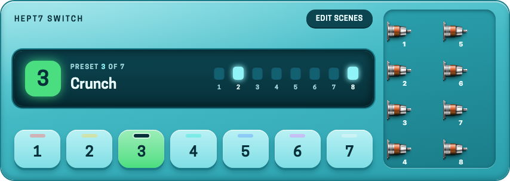
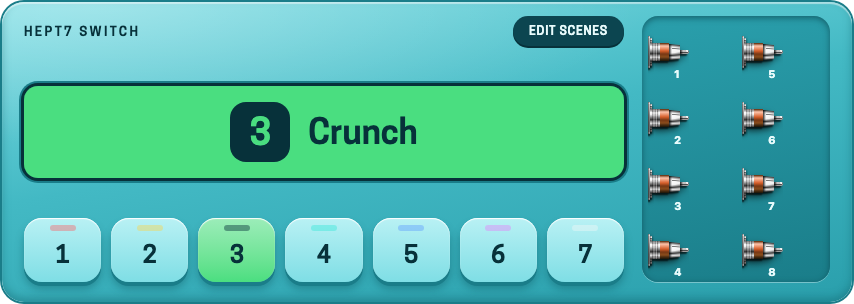
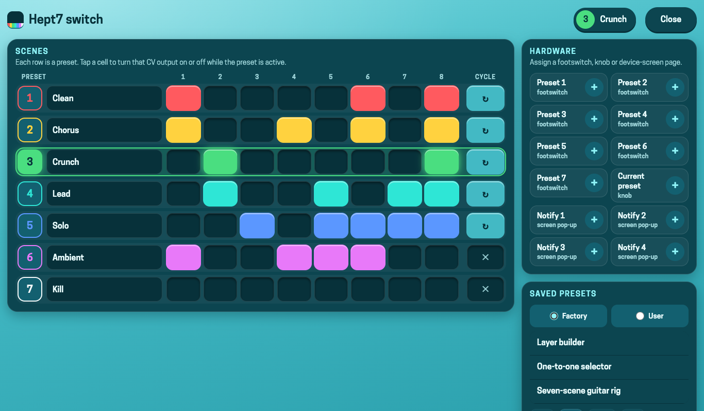
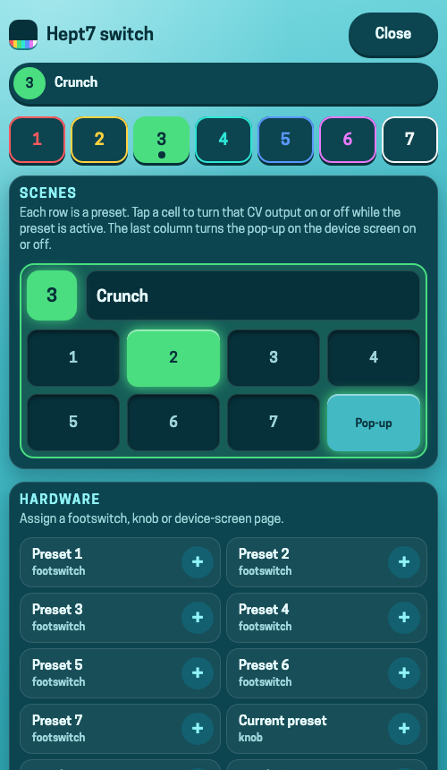

# Hept7 Switch — User Manual

Hept7 Switch turns **one footswitch press into seven CV signals at once**. You
choose, for each of its **7 presets**, which of its **7 CV outputs** are on
(10 V) or off (0 V), and then change between presets with a footswitch, a
knob or the screen. Route the CV outputs to the on/off (or any CV-addressable)
parameters of your plugins and a single press can turn a whole scene on.

It is the bigger sibling of Tetr4 Switch, and it has two things of its own:
a **display** that shows the preset (and announces every change of it), and a
**full-screen settings page** made for touch screens.

## 1. The plugin on the pedalboard

| Item | What it does |
|---|---|
| **Display, big number and name** | The active preset. **The name is editable**: click it and type (up to 15 characters). It is also the text the device screen pop-up shows (see section 4). |
| **Display, seven squares** | The CV outputs that are on in the active preset. **They are buttons**: click one to turn that output on or off in the active preset, without opening the settings page (the other presets are edited on the settings page). |
| **Seven buttons** | Select the preset. The button of the active preset lights up in its colour; each preset has the same colour as its footswitch LED on the device (red, yellow, green, cyan, blue, magenta, white). |
| **Edit scenes** | Opens the settings page (section 2). The gear icon above the plugin opens it too. |
| **Seven CV jacks** | `CV Output 1`–`7`, in two columns. |

### The display announces every change of preset

Whenever the preset changes — from a footswitch, a knob, the buttons or a
MIDI controller — the whole display takes the colour of the new preset for a
moment, showing its number and name big:

This works on every device, including the **MOD Duo**, which has no screen
for plugin pop-ups: it is how you see which preset a footswitch has just
selected.

## 2. The settings page

Click **Edit scenes** (or the gear icon) to open a page that takes the whole
screen and is made for touch: big cells, nothing smaller than a fingertip.

* **Scenes**: one row per preset. The round button on the left makes that
  preset the active one; the field next to it is its name; then one cell per
  CV output. A lit cell means that output is **on** while that preset is active.
  The row of the active preset is highlighted, and its lit cells are the CV
  signals actually leaving the plugin right now.
* **Pop-up** (last column): turns the device screen pop-up on or off for that
  preset (see section 4). It is on by default.
* **Hardware**: tiles to assign a footswitch, a knob or a device screen page to
  the plugin's controls (section 3). A tile shows a check mark once it is assigned.
* **Saved presets**: the factory presets (section 5) and your own presets.

On a **phone** the page shows one preset at a time: pick it on the numbered
strip, edit its eight cells, and use *Switch to preset N* to make it play.

## 3. Switching presets with hardware

Assign one of the plugin's controls (the *Hardware* tiles, or the usual
assignment dialog) to the control you want to use:

| Control | Use |
|---|---|
| `Preset 1`–`7` | One footswitch per preset. Turning one on turns the others off. |
| `Current preset` | One knob (or CV/MIDI value) that selects among the seven presets. |

## 4. The pop-up on the device screen

On devices with a screen that can show plugin pop-ups (MOD Dwarf), the name of
the active preset is shown in a pop-up whenever the preset changes. As with
Gossiper, the device only allows a pop-up on a page that has a control addressed
to the plugin, so:

1. Assign one of `Assign to notify 1`–`4` to a control of the device page where
   you want to see the pop-up (use a second, third or fourth one for other pages).
2. Every change of preset now shows the name of the preset on that page.

The **Pop-up** cell of each preset turns it off for that preset only. The
footswitch LEDs and the preset knob follow the preset as well, with the colour
of each preset.

> The pop-up needs a firmware with the HMI feature. Without it (older firmware, or
> a MOD Duo) the plugin works the same, only without the pop-up and the LEDs: the
> display of the plugin is your feedback.

## 5. Factory presets

| Preset | Idea |
|---|---|
| **One-of-seven selector** | Exactly one CV output is on at a time: preset N turns on output N. A 7-way selector. |
| **Seven-scene guitar rig** | Outputs 1 Compressor, 2 Overdrive, 3 Distortion, 4 Chorus, 5 Delay, 6 Reverb, 7 Boost, and the presets *Clean, Chorus, Crunch, Lead, Solo, Ambient, Kill* (everything off). |
| **Layer builder** | Preset N turns on outputs 1 to N: stack one more layer on every press. |

## 6. Port reference

| Port | Type | Description |
|---|---|---|
| `CV Output 1`–`7` | CV output | 10 V while on in the active preset, 0 V otherwise. |
| `Preset 1`–`7` | Control input (toggle) | Footswitch selectors. |
| `Current preset` | Control input (enumeration) | Shows and selects the active preset. |
| `Assign to notify 1`–`4` | Control input | Assign to a device page so the pop-up shows there. No audio or CV effect. |
| `Preset N - Output M` | Control input (toggle) | Dip switch: is CV output M on while preset N is active? |
| `Preset N - Pop-up` | Control input (toggle) | Show the pop-up when preset N is selected? |
| Preset label 1–7 | Plugin property (patch) | The name of each preset. Edited on the display or on the settings page. |

Names use letters, digits, spaces and `+ - : _ .`; anything else is replaced with `_`.
They are saved with the pedalboard and with the plugin presets.

## 7. Credits

Hept7 Switch is developed by Paulo Mateus (SrMouraSilva), see the
[plugins-lv2 repository](https://github.com/SrMouraSilva/plugins-lv2).
