# Kill Switch — User Manual

Kill Switch **chops your signal in a rhythm**, like the momentary kill switch some guitars have: while the effect is on, a looping
pattern lets the sound through or cuts it, in time with the tempo you set. It is **stereo**: **the left and the right side each have
a row of steps of their own**, so the sound can change with the side: a ping-pong from ear to ear, one ear chopped while the other
one stays, a swell that moves across. Played from a single guitar, with **Mono** on, it is the plain kill switch.

It has two families of effects:

* **Patterns** loop for as long as the effect is on. **Twenty** to choose from (ten with the same row on both sides, ten for a
  stereo sound), and **your own**, written on the settings page, with three levels per step.
* **Endings** are for the end of a song. They play **once** when you switch the effect on and finish in silence: a bouncing ball, a
  helicopter that lands, a stutter that dies away. You choose them; you do not draw them.

The effect is on while **Kill** is: a footswitch that is **momentary** by default, so it chops only while you hold it.


## 1. Quick start

You need a pedalboard with an audio input and an output, and a guitar (or any sound) going through it.

1. **Add Kill Switch** to your pedalboard and put it **between your guitar input and the rest of the chain** (or between the amp and the
   output). It has two audio inputs and two audio outputs, one pair for each side.
2. **Feed both sides.** A single instrument is mono: turn on **Mono** on the plugin, and the left input feeds both sides. With a
   stereo source (a stereo pedal before it, an amp with a stereo send), leave Mono off and connect each side to its own input.
3. **Turn it on.** The plugin starts **off**: your sound passes clean, and the label over the footswitch says *Kill*. Tap the footswitch on
   the screen and the light over it turns red: play a note and it is chopped at once. Tap again to go back to clean. (From step 7 on,
   your device's footswitch does it.)
4. **Choose a pattern** with the arrows on each side of its name. Under the name there is a row for the **L**eft side (white) and
   one for the **R**ight side (red): a bright square lets the signal through, a dark one cuts it. The first ten patterns have the same row
   on both sides.

    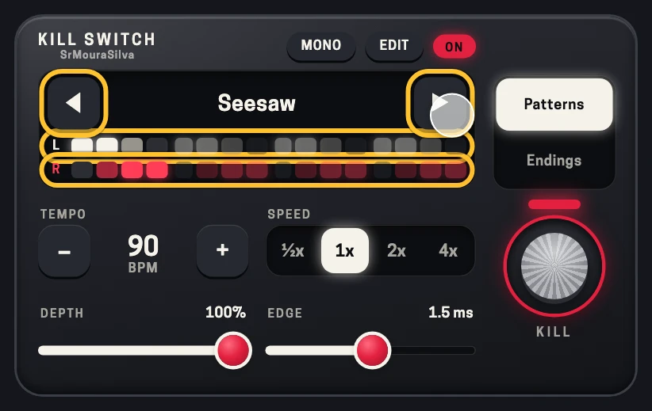

5. **Set the tempo** with **−** and **+** (hold one to go on) and pick the **speed**. **Depth** is how much of the signal a cut
   removes (100% is silence) and **Edge** is how long a cut takes to close and open.

    

6. **Try an ending.** Tap **Endings** under the name, pick one with the arrows and set its **length**, then switch the effect off and on
   again: the ending plays once, from the start.

    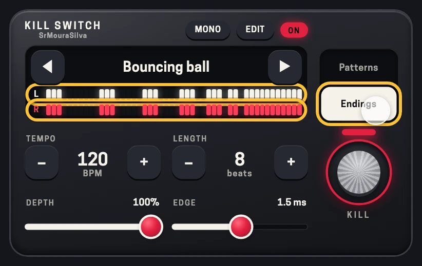

7. **Put it under your foot.** Open the settings (**Edit**) and press the small button beside **Kill** in the top bar to assign it to a device
   footswitch. The dialog comes with **Momentary** already chosen: the effect is on only while you hold the footswitch ([section 7](#playing-it-live)).

    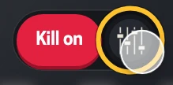

> [!TIP] Everything starts the moment you switch the effect on
> A pattern **starts again from its first step**, and an ending **starts from its beginning**, every time Kill goes from off to on. Press
> the footswitch in time with the beat and the chops fall where you want them; press it as the last chord rings and the ending falls on it.

## 2. The plugin on the pedalboard

| Item | What it does |
|---|---|
| **Patterns / Endings** | The family that plays. The tabs are in the column of the footswitch. |
| **The arrows and the name** | Choose the pattern (section 4) or, in Endings, the ending (section 5). The arrows go round. In Patterns the last one is **Custom**, the one you write. |
| **The two rows, L and R** | What each side does. In Patterns, a bright square lets the signal through, a dark one cuts it, a darker colour is the middle level; a pattern shorter than sixteen steps is repeated, the first run bright and the repetitions dimmer. In Endings, the whole ending along its time: the brighter the column, the more open the side. They go dim while Kill is off. |
| **Tempo: − and +** | From 40 to 240 BPM. Hold a button to keep going. Endings use it too: their length is counted in beats. |
| **Speed** (Patterns) | ½x, 1x, 2x or 4x: multiplies the speed of the pattern without changing the tempo. |
| **Length** (Endings) | How long the ending lasts, in beats, from 2 to 32. At 120 BPM, 8 beats are 4 seconds. |
| **Depth** | From 0% to 100%: how much of the signal a cut removes. 100% is silence; lower values only dip the level. |
| **Edge** | From 0.1 ms to 20 ms, on a logarithmic scale: how long a cut takes to close and to open again. |
| **Mono** | On: the left input feeds both sides. Off: each side has its own input. |
| **Edit** | Opens the settings page: everything on the plugin with more room, the steps of your own pattern and the controls to assign (section 6). |
| **The footswitch and its light** | **Kill**. The ring and the light above it are red while the effect is on, and the label at the top says *On* or *Off*. A tap on it on the screen toggles it; a device footswitch assigned to it is momentary by default. |
| **Audio jacks** | `In L` and `In R` on the left, `Out L` and `Out R` on the right. |

## 3. Interactive manual

Here the plugin is **the real one**: the same interface, the same script, running inside the manual. Press **Open the interactive manual**
under the picture to open it **full screen** (Esc or **Close** brings you back). Nothing you do is saved or sent anywhere, and **Reset** puts it
back the way it starts.

* **Explore**: tap any part of the plugin to read what it is for, or pick it from the list under the picture. **Show areas** outlines
  everything that can be tapped. Use the buttons at the top to switch between the plugin **on the pedalboard** and its **settings page**.
* **Guided tours**: step-by-step walkthroughs of the common tasks. A finger shows where to tap.
  Go forward and back with **Next** and **Back**: every step says what is happening and shows it in the plugin.

```interactive
```

## 4. The patterns

Each pattern is a loop of steps, and **each side has its own row**. In every step a side is either **let through** or **cut**
(or, in the middle level, half); the plugin goes from one step to the next in time with the tempo, and from the last step back to
the first. The grids show every pattern as sixteen steps (the shorter ones repeat), the **left** row in white and the **right** row in red.
A lit square is a step that lets the signal through (the middle level of *Seesaw* is shown as lit too).

### The same row on both sides

The first ten patterns are the single-channel kill switch: both sides do the same, so they are what you want from one guitar with **Mono** on.

```recipe
Generic grooves
cols: 1 2 3 4 5 6 7 8 9 10 11 12 13 14 15 16
Chop 8ths: 0101010101010101
Chop 16ths: 0101010101010101
Triplet chop: 0101010101010101
Machine gun: 0101010101010101
Syncopated 3-3-2: 0110110101101101
Gallop: 0110011001100110
---
Six patterns that fit any style. *Chop 8ths* and *Chop 16ths* are the plain on-off chop at those note values, *Triplet chop* does it in triplets, *Machine gun* is the same at thirty-second notes, *Syncopated 3-3-2* is the Latin-flavoured grouping of eight steps (three, three and two) and *Gallop* is a short-short-long figure of four.
assign: **Steps per beat:** Chop 8ths 2 · Chop 16ths 4 · Triplet chop 3 · Machine gun 8 · Syncopated 3-3-2 2 · Gallop 4
```

```recipe
Inspired by guitarists famous for the kill switch
cols: 1 2 3 4 5 6 7 8 9 10 11 12 13 14 15 16
Morello solo chop: 0101011001011011
Morello toggle solo: 0111010100110101
Greenwood chunk: 0111011101110111
Buckethead burst: 0101010111111111
---
Four longer, busier patterns named after players known for the kill switch. The rhythms are our **approximation**, not a transcription of anyone's playing: use them as a starting point and change the tempo, the speed, the depth and the edge until it fits your song.
assign: **Steps per beat:** Morello solo chop 4 · Morello toggle solo 4 · Greenwood chunk 2 · Buckethead burst 8
```

### A row for each side

The next nine have **a different row for each side**. They need a stereo sound: connect both inputs, or turn Mono on to give both sides the same signal.

```recipe
Ping-pong: the sound goes from ear to ear
cols: 1 2 3 4 5 6 7 8 9 10 11 12 13 14 15 16
Ping-pong 8ths · L: 1010101010101010
Ping-pong 8ths · R: 0101010101010101
Ping-pong 16ths · L: 1010101010101010
Ping-pong 16ths · R: 0101010101010101
Triplet pong · L: 1001001001001001
Triplet pong · R: 0100100100100100
---
The classic: while the left ear is cut, the right one plays, and the other way round. *Ping-pong 8ths* and *Ping-pong 16ths* use those note values, *Triplet pong* does it in threes (the third step is cut on both sides).
assign: **Steps per beat:** Ping-pong 8ths 2 · Ping-pong 16ths 4 · Triplet pong 3
```

```recipe
Half deaf: one ear is chopped, the other is not
cols: 1 2 3 4 5 6 7 8 9 10 11 12 13 14 15 16
Half deaf: left · L: 0101010101010101
Half deaf: left · R: 1111111111111111
Half deaf: right · L: 1111111111111111
Half deaf: right · R: 0101010101010101
---
One side chops while the other stays as it is. *Half deaf: left* chops the left ear, *Half deaf: right* the right one: the plugin is named after them.
assign: **Steps per beat:** Half deaf: left 2 · Half deaf: right 2
```

```recipe
Sides that answer each other
cols: 1 2 3 4 5 6 7 8 9 10 11 12 13 14 15 16
Gallop sides · L: 1100110011001100
Gallop sides · R: 0011001100110011
Stagger · L: 1001100110011001
Stagger · R: 0110011001100110
Seesaw · L: 1110111011101110
Seesaw · R: 0111011101110111
Syncopated sides · L: 1001001010010010
Syncopated sides · R: 0100100101001001
---
*Gallop sides* gallops from one side to the other; *Stagger* is a syncopated answer between the two; *Seesaw* uses the middle level, so that one side fades out while the other one swells in, like a seesaw; *Syncopated sides* is the 3-3-2 grouping of eight steps, a step apart on the two sides.
assign: **Steps per beat:** Gallop sides 4 · Stagger 4 · Seesaw 2 · Syncopated sides 2
```

The length of a step is `60 / (tempo × steps per beat × speed)` seconds. At 120 BPM, *Chop 8ths* has a step of 250 ms, *Ping-pong 8ths* the same, and *Machine gun* a step of 62.5 ms.

> [!NOTE] The tempo is the plugin's own
> Kill Switch does not follow the tempo of the pedalboard or of a MIDI clock: set the tempo here, or assign it to a knob or to an
> expression pedal.

## 5. The endings

An ending is a one-time effect for the end of a song. It plays **once**, from the moment you switch the effect on (Kill), lasts **Length**
beats at the **Tempo**, and then everything is cut: the sound **ends**, and stays silent until you switch the effect off and on again. The five
endings are chosen, not drawn: you pick one, and set its length, the tempo, the depth and the edge. (With **Depth** below 100% the end is not fully silent:
the cut only goes down to that level.)

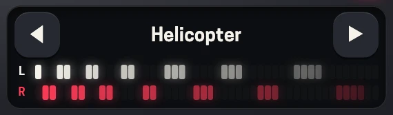

| Ending | What it does |
|---|---|
| **Bouncing ball** | *tam------tam-----tam---tam--tam-tam-ta-ta-t-t-t-ttttt*: the first hit is at once and every gap is 78% of the one before, so the hits pile up towards the end and turn into a buzz, on both sides. The hits get shorter with their gaps. |
| **Helicopter** | The blades go to the left, then to the right, one after the other, starting at the pace of sixteenth notes; the gap between them grows by 12% each time and the sound fades out, like a helicopter landing. |
| **Stutter out** | Sixteenth notes that stay open less and less, from 92% of each to almost nothing, until they stop. The right side is half a note behind the left one. |
| **Side fade** | Eighth notes, half open. The left side fades out first (by 60% of the ending) and the right one is the last to go. |
| **Ping-pong out** | Eighth notes, one to each side in turn, starting on the left, and every one quieter than the one before. |

Changing the ending or the family while the effect is on starts the new one from its beginning, so you can try them without switching off.

## 6. Your own pattern

The last pattern, **Custom**, is yours. Click **Edit** on the plugin (or open its settings with the gear icon). The settings page has
everything the plugin has, with more room. At the top, on every page, there are **Mono**, **Kill** (the footswitch of the effect) and the
arrows that go from page to page; under them, a small strip with **what plays**: its name and the two rows of steps, only to look at.


The pages are:

* **Pattern**: **Patterns** or **Endings**, and under it every pattern (or ending) to pick with one tap. On a small screen they come one at a
  time, as **‹ name ›**, with the arrows on each side of the name. Right under the choice, **what each side does, as LEDs**, with the **length** and the
  **steps per beat** of your own pattern: the steps are always together with the choice.
* **Tempo and feel**: the tempo (with its buttons and a slider), **Speed** (or **Length**, in Endings), **Depth** and **Edge**.
* **Saved presets**.

On a screen with room, the pages share the screen; on a small one each has its own. The strip under the top bar tells what plays on all of them.

The LEDs show a **white** row for the left side and a **red** row for the right side. A step is dark when it **cuts**, lit up to half its height
when it is at the **middle level**, and fully lit when it **passes** the signal; the number of a step is brighter when a beat begins there.
The LEDs show the pattern twice (at most sixteen steps): the second run, drawn as outlines, is the pattern coming round again. Beside the name *Preview* is the note value of a step (8ths, 16ths, triplets...): it is what tells *Chop 8ths*, *Chop 16ths*, *Triplet chop* and *Machine gun* apart, since they have the same steps at different speeds.

**To write your own pattern:**

1. **Pick any pattern** and **tap one of its steps**. A built-in pattern cannot be changed, so the plugin asks: *Make your own pattern?*
   Tap **Define custom pattern**: it becomes **Custom** and starts as a copy of the pattern you were on, with its length and its steps
   per beat. (**Not now** leaves everything as it was.) Choosing **Custom** in the list plays what Custom holds (its starting steps the first time, then what you wrote last) without the question.

    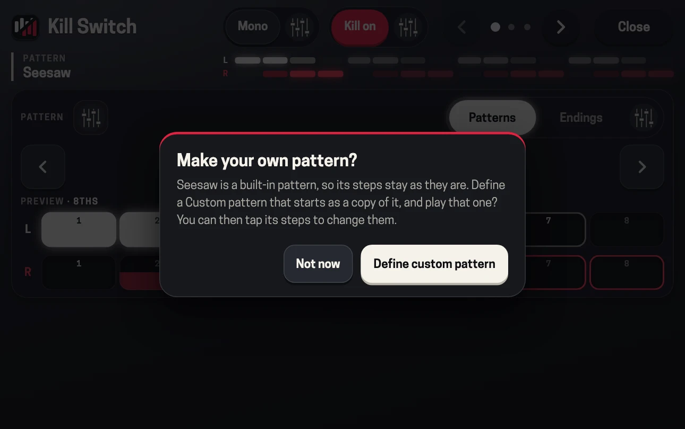

2. **Tap the steps** of the **L** row (white) and of the **R** row (red). A tap goes to the next level, round and round:

    | Level | What the step does |
    |---|---|
    | **Cut** | Lowers the signal by **Depth**: silence at 100%. |
    | **Half** | Halfway between a cut and the whole signal: at Depth 100% half the level, at 50% three quarters of it. |
    | **Pass** | Lets the signal through as it is. |

    

3. **Set the length** with **−** and **+**, from 1 to 16 steps, the same for both sides. They appear under the LEDs while Custom plays. Only the first steps are
   played, and a tap on an outlined step changes the step it repeats; the steps after the length are kept, so you can shorten a pattern and bring its end back.
4. **Set the steps per beat**, from 1 to 8: with 2 a step is an eighth note, 4 a sixteenth, 3 a triplet, 1 a quarter note.
5. **Listen to it.** Your pattern plays as soon as you define it, and it plays while **Custom** is the pattern chosen.

> [!TIP] Start from a built-in pattern
> To change a pattern of the list a little, pick it, tap a step and define the Custom pattern: you get the whole pattern (both rows, length and steps
> per beat) ready to be changed.

Your pattern is made of controls of the plugin, so it is saved with the **pedalboard**, with your own **saved presets** and with
**snapshots**. The factory presets do not touch it. Use the arrows of the top bar (or swipe sideways) to go to the **Saved presets**.
Next to each control, a small button (the faders icon) assigns it to a device control.


## 7. Playing it live

Every control of the plugin can be assigned to a device control (a footswitch, a knob, an expression pedal), the way you assign any
parameter: open the settings of the plugin (the gear icon, or **Edit**) and click the small button (the faders icon) next to the control to
assign: **Mono** and **Kill** in the top bar, **Pattern** or **Ending** (the one that matches what plays) beside the name, **Mode** beside
*Patterns* and *Endings*, and **Tempo**, **Speed**, **Length**, **Depth** and **Edge** beside their names. The button fills in once the
control is assigned.

| Control | Good to assign it to |
|---|---|
| **Kill** | A footswitch. It comes as **Momentary**: the effect is on only while you hold the footswitch (the kill switch of a guitar: you press, it chops; you let go, it is clean). Choose **Toggle** in the dialog to turn it on and off with each press. For an ending, a press is the end of the song. |
| `Mode` | A footswitch: patterns for the song, endings for its last bar. |
| `Pattern`, `Ending` | A knob, or a footswitch that goes through them. |
| `Tempo` | A knob, or an expression pedal. |
| `Speed` | A footswitch: hold it for double speed, let go for normal. |
| `Length` | A knob. |
| `Depth` | A knob or an expression pedal: from a gentle tremolo to a full cut. |
| `Edge` | A knob: from a hard chop to a soft swell. |

> [!NOTE] Kill is not the bypass of the pedal
> MOD UI's own bypass of the plugin is still there and works as for any plugin. The footswitch of Kill Switch is a control of its own, **Kill**, because
> MOD UI offers a toggle (not a momentary switch) when you assign its bypass, and a kill switch is meant to be held.

### On the screen of the device

With the **aLabs Starless** image (Starless 19 or later) the MOD Dwarf and the MOD Duo X can show *widgets* of a plugin on their screens, drawn by
the plugin itself. The stock MOD firmware does not have this: the plugin works the same there and simply shows nothing. On the MOD Duo there is no
screen to draw on.

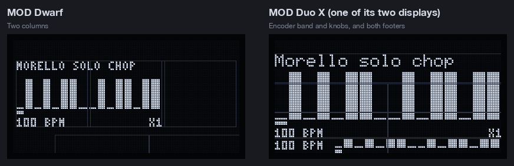

A widget **is for looking, not for touching**: nothing on the screen reacts to a finger or to a button of the device. What changes it are the
controls you assigned to the plugin, as always; the widget follows them.

#### Placing the widget

1. Open the **Display** dialog (the Device menu of MOD UI) and choose **Stereo pattern** in the list of widgets of the pedalboard.
2. **Place** it on an area of the screen: a column above a knob, two or three columns, a footer, both footers or the whole screen on the Dwarf; a
   knob, two knobs, the four knobs, the encoder band, a footer, both footers or the whole screen on each display of the Duo X. The dialog only
   offers the areas that are big enough for it.
3. The dialog offers to assign **Mode**, **Pattern** and **Tempo** to controls of the device (you can change them or leave them out), so you can change them from the same page.
4. **Save**. It can be placed on more than one area at once (a column and a footer, or one on each display of the Duo X).

It draws what fits in the area it gets: a footer shows the bare essentials, the whole screen shows everything.

#### Stereo pattern

Shows **the two sides, left (L) and right (R)**, one above the other, so you see what each ear is getting (with a pattern that is the same on both sides, two equal rows). It needs an area at least 14 pixels high: a
footer of the Dwarf (10) or of the Duo X (8) is too small for two rows, and the dialog does not offer it there.

| MOD Dwarf | MOD Duo X | What you see |
|---|---|---|
| 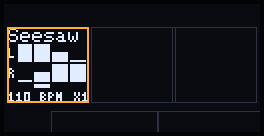<small>One column · 40 × 37</small> | 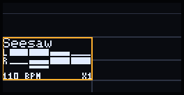<small>Two knobs, one above the other · 64 × 30</small> | The **name** of the pattern (or of the ending), the two rows **L** and **R** with the mark under the step that plays, and at the bottom the tempo and the Speed (or the length in beats and the word ENDING). What does not fit is left out. |
| 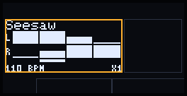<small>Two columns · 82 × 37</small> | 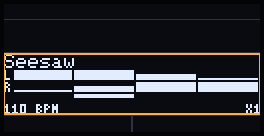<small>The four knobs · 128 × 30</small> | The same, with more room. |
| 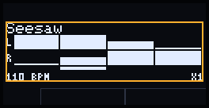<small>Three columns · 124 × 37</small> | 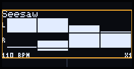<small>Encoder band and knobs · 128 × 47</small> | The same, with taller rows. |
| 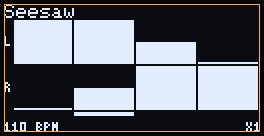<small>Whole screen · 128 × 64</small> | <small>Whole screen · 128 × 64</small> | The same, as big as the screen allows. |
| *No area of this kind* | 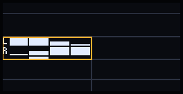<small>One knob · 64 × 16</small> | Only the two rows, **L** and **R**, with the mark. |
| *No area of this kind* | 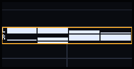<small>Two knobs side by side · 128 × 16</small> | Only the two rows, wider. |

In the **Patterns** mode each row is the steps of that side (tall bar: the signal passes; half-height bar: middle level; line: a cut) and the mark moves
with the tempo. In the **Endings** mode each row is the **curve of the ending along its time**, from the moment the plugin is switched on to its end, and a
dotted line moves across it: you see how much is left.

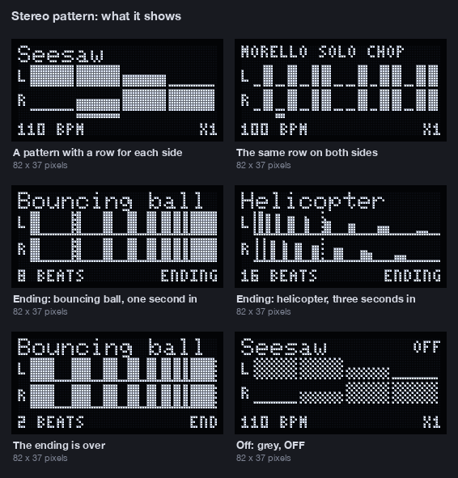

* **A pattern:** the rows are different on each side; that is the point of the plugin.
* **An ending:** a bouncing ball, a helicopter, a stutter... each draws its own curve; the dotted line is where the ending is now.
* **The ending is over:** the line reaches the end and the widget says **END** (on a tall area); after that everything is cut until you switch the plugin off and on.
* **Off:** the rows go grey and the widget says **OFF** (where there is room for the word).

## 8. Factory presets

Open **Saved presets** in the settings of the plugin (or use the presets of the pedalboard) to pick one. Each one sets the mode, the pattern, the ending, the tempo, the
speed, the length, the depth and the edge; Kill, the mono input and your custom pattern are not part of a preset.

| Preset | Family | What | Tempo | Depth | Edge |
|---|---|---|---|---|---|
| Killing in the Name - solo chop | Patterns | Morello solo chop | 89 BPM | 100% | 1.5 ms |
| Bulls on Parade - toggle solo | Patterns | Morello toggle solo | 85 BPM | 100% | 1.5 ms |
| Creep - pre-chorus chunk | Patterns | Greenwood chunk | 92 BPM | 100% | 1.5 ms |
| Buckethead - machine-gun burst | Patterns | Buckethead burst | 120 BPM | 100% | 0.8 ms |
| Chop 8ths | Patterns | Chop 8ths | 120 BPM | 100% | 1.5 ms |
| Chop 16ths | Patterns | Chop 16ths | 120 BPM | 100% | 1.5 ms |
| Triplet chop | Patterns | Triplet chop | 120 BPM | 100% | 1.5 ms |
| Machine gun | Patterns | Machine gun | 120 BPM | 100% | 0.8 ms |
| Syncopated 3-3-2 | Patterns | Syncopated 3-3-2 | 120 BPM | 100% | 1.5 ms |
| Gallop | Patterns | Gallop | 120 BPM | 100% | 1.5 ms |
| Soft chop (half depth) | Patterns | Chop 8ths | 120 BPM | 50% | 8 ms |
| Ping-pong 8ths | Patterns | Ping-pong 8ths | 120 BPM | 100% | 1.5 ms |
| Ping-pong 16ths | Patterns | Ping-pong 16ths | 120 BPM | 100% | 1.5 ms |
| Half deaf: left | Patterns | Half deaf: left | 120 BPM | 100% | 1.5 ms |
| Half deaf: right | Patterns | Half deaf: right | 120 BPM | 100% | 1.5 ms |
| Seesaw swell | Patterns | Seesaw | 90 BPM | 100% | 6 ms |
| Stagger | Patterns | Stagger | 100 BPM | 100% | 1.5 ms |
| Bouncing ball | Endings | Bouncing ball, 8 beats | 120 BPM | 100% | 0.5 ms |
| Helicopter landing | Endings | Helicopter, 12 beats | 100 BPM | 100% | 3 ms |
| Stutter out | Endings | Stutter out, 8 beats | 140 BPM | 100% | 0.5 ms |
| Side fade | Endings | Side fade, 8 beats | 90 BPM | 100% | 6 ms |
| Ping-pong out | Endings | Ping-pong out, 8 beats | 110 BPM | 100% | 3 ms |

All of them have the speed at 1x. The first four are named after a song and use a pattern in the style of its guitar part, at about its tempo; they are a
starting point, not a copy.

## 9. Tips

### Set the tempo to the song, then leave it

The patterns are in time with the tempo you set, not with the band. Adjust the number until the chops sit with the drums: a difference of one or two BPM is
enough to drift off the beat over a bar. For an ending, the tempo and the length together say how long it lasts: leave it a little longer than the last chord.

### Switch it on on the beat

The pattern restarts from its first step every time Kill goes on, and the first ten patterns start with a cut. Press the footswitch on the beat (or just before
it) and the first chop lands exactly there.

### Use Mono for a single guitar

With one instrument, turn Mono on: both sides get the signal, and the patterns show their sides. With Mono off and only the left input connected, the right
side is silent, and a ping-pong has only one ear to play.

### Half deaf for a wide stereo

*Half deaf* keeps one ear steady and chops the other, which makes a stereo sound feel as if it moved around while it stays in place. Put it after a stereo reverb or chorus.

### Soften it with Depth

At 100% a cut is silence. At 40 to 60% the signal only dips, which sounds like a sharp tremolo, and fits a sound that should stay present (an ambient pad, a drive that
you do not want to disappear).

### Edge changes the character

Short edges (below 1 ms) are percussive: the sound is stopped as if a switch were flicked. Long edges (10 ms and more) turn the chop into a soft swell. On an ending, a
long edge smooths the buzz at the end of the *Bouncing ball*.

### Put it where you want the cut

Before a delay, the cut chops what goes into the delay and the repeats go on ringing; after the delay, the repeats are chopped too. Try both places.

### Build your own from a built-in pattern

Pick the built-in pattern that is closest, tap one of its steps and define the Custom pattern: you get a copy to change a step or two. Use the middle level for a ghost
note: a step that is there, but soft.

## 10. Questions & answers

### Nothing is cut, I hear my guitar as it is.

Check that the label at the top of the plugin says *On* and the light above the footswitch is red: the plugin starts off. If the footswitch is assigned to a device control in
*Momentary* mode, the effect is on only while you hold it.

### I hear the left side only.

Turn **Mono** on, or connect your source to both inputs: with only the left input connected, the right side has nothing to play.

### The ending is over and I hear nothing.

That is the end: an ending finishes in silence. Switch the effect off and on again to hear it from the beginning. To get your sound back as it was, switch it off.

### The chops are not on the beat of my song.

The tempo is the plugin's own (section 4): set it by ear, or assign it to a knob. And switch the effect on on the beat: the pattern starts again from the beginning each time.

### Does it add latency? Is it stereo?

No latency: the signal is only multiplied by a number that goes up and down. It is stereo: two inputs and two outputs. For a single guitar, turn Mono on.

### I hear a click at each cut.

Make **Edge** longer. At 0.1 ms the signal is stopped almost at once, which can click on a low note.

### How many steps and how many levels can my own pattern have?

Up to 16 steps for each side, each with three levels (cut, half and pass), at 1 to 8 steps per beat.

### I tapped a step and nothing changed.

On a built-in pattern a tap asks first (*Make your own pattern?*): confirm (**Define custom pattern**) to get a Custom pattern whose steps you can change.

### I edited my pattern and it did not change what I hear.

Check that the family is **Patterns** and the pattern is **Custom** (the name on the plugin says so). The first change you make switches both, but if you then chose another one
(or a controller did), choose **Custom** again in the list.

### Is my pattern saved?

Yes, with the pedalboard, your saved presets and the snapshots. It is not in the factory presets, and it is not shared between pedalboards: each plugin on each pedalboard has its own.

### Does it change the level of my sound when it is on?

Not while a step lets the signal through (it passes unchanged): the level only goes down in the cuts (and, a little, in the half steps). So there is nothing to compensate with a volume
control.

### Why are some patterns named after guitarists?

They are inspired by guitarists known for the kill switch, as a way to find the rhythm: the steps are our approximation of the style, not a transcription, and the plugin has no connection with
the players or with their songs.

## 11. Specifications

| Field | Value |
|---|---|
| Plugin name | Kill Switch |
| Version | 1.0.26 (the version of the plugin this manual is for) |
| Category | Dynamics · Gate |
| Format | LV2 · URI `http://srmourasilva.github.io/plugins/kill-switch` |
| Audio I/O | Stereo: 2 inputs, 2 outputs (no latency) |
| Effects | 19 built-in patterns and Custom (your own) · 5 endings |
| Device feedback | Display widget "Stereo pattern" (MOD Dwarf and Duo X with the aLabs HMI widgets) · the pedal itself |
| Platforms | MOD Dwarf · MOD Duo X · MOD Duo |
| Developer | Paulo Mateus (SrMouraSilva) |
| License | Apache-2.0 |
| Source code | [github.com/SrMouraSilva/plugins-lv2](https://github.com/SrMouraSilva/plugins-lv2) |
| Store page | [Kill Switch](https://pedalboards.mod.audio/plugins/aHR0cDovL3NybW91cmFzaWx2YS5naXRodWIuaW8vcGx1Z2lucy9raWxsLXN3aXRjaA==) |

Kill Switch is a community plugin. Feedback, bug reports and pull requests are welcome on GitHub.
