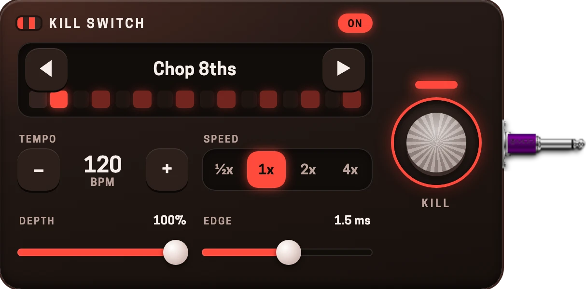
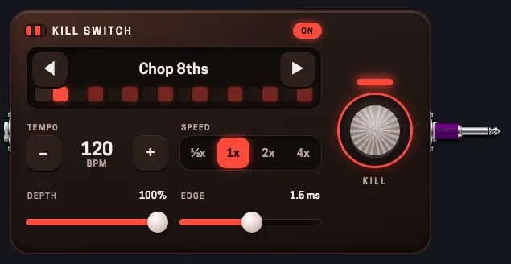
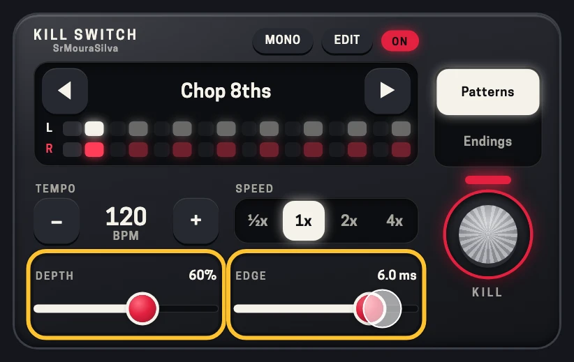
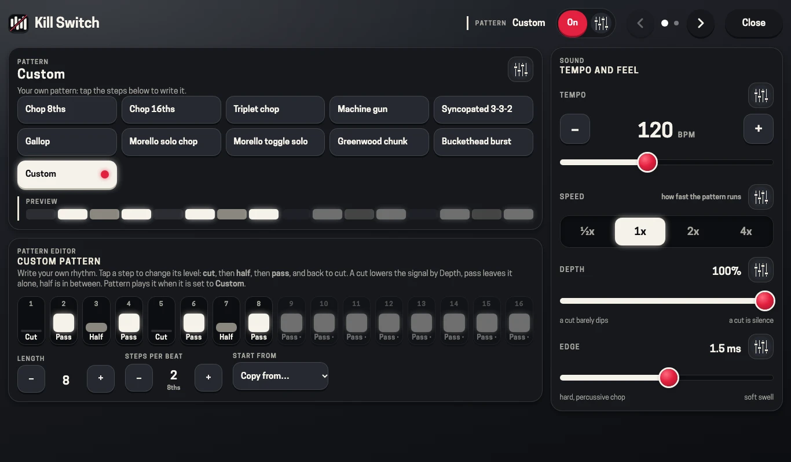
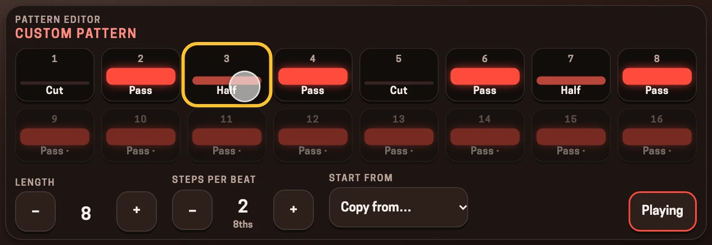
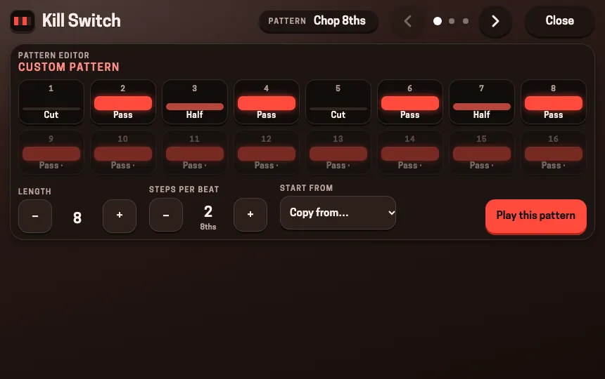

# Kill Switch — User Manual

Kill Switch **chops your signal in a rhythm**, like the momentary kill switch some guitars have: while the plugin is on,
a looping pattern lets the sound through or cuts it, in time with the tempo you set. Bypassed, your signal is clean.

You pick one of **10 patterns** (from a plain chop to a machine gun) or **write your own**, set the **tempo** and the
**speed**, and then use **Depth** and **Edge** to decide how deep and how hard the cuts are. It is one mono audio effect,
with a footswitch on the plugin that is also its bypass.





## 1. Quick start

You need a pedalboard with an audio input and an output, and a guitar (or any sound) going through it.

1. **Add Kill Switch** to your pedalboard and connect it **between your guitar input and the rest of the chain** (or
   between the amp and the output). It has one audio input and one audio output.
2. **Turn it on.** The plugin starts on (the red light over the footswitch is lit and the label says *On*): play a note
   and it is chopped at once. Click the footswitch to bypass it: the sound is clean again.
3. **Choose a pattern.** Use the arrows on each side of its name. The squares under the name show the pattern: a lit square
   lets the signal through, a dark one cuts it.

    

4. **Set the tempo** with **−** and **+** (hold one to go on), and pick the **speed** (½x, 1x, 2x, 4x): the same pattern at
   half, normal, double or four times its speed, without touching the tempo.
5. **Shape the cut.** **Depth** is how much of the signal a cut removes (100% is silence) and **Edge** is how long it takes
   to close and open (short is a hard, percussive chop; long is a soft swell).

    

6. **Put it under your foot.** Assign the plugin's footswitch (its **Bypass**) to a device footswitch, in *Momentary*
   mode if you want the effect on only while you hold it, as with the switch on a guitar ([section 5](#playing-it-live)).

> [!TIP] Every pattern starts the moment you switch the plugin on
> Whenever the plugin goes from bypassed to on, the pattern **starts again from its first step**. The ten built-in
> patterns all begin with a cut, as if you had pressed the kill switch right then (in your own pattern, the first
> step is whatever you set). Press the footswitch in time with the beat and the chops fall where you want them.

## 2. The plugin on the pedalboard

| Item | What it does |
|---|---|
| **Pattern: the arrows and the name** | Choose the pattern (section 3). The arrows go round: after the last pattern comes the first, and the last one is **Custom**, the pattern you write. |
| **The sixteen squares** | The pattern. A bright red square lets the signal through, a dark one cuts it, and a darker red one is the middle level (only in your own patterns). A pattern shorter than sixteen steps is repeated; the first run is bright and the repetitions are dimmer, so you can see where it starts again. The squares go dim when the plugin is bypassed. |
| **Edit pattern** | Opens the settings page: everything on the plugin with more room, the editor of your own pattern and the buttons that assign each control to a device control (section 4). |
| **Tempo: − and +** | The speed of the pattern, from 40 to 240 BPM. Hold a button to keep going. |
| **Speed** | ½x, 1x, 2x or 4x: multiplies the speed of the pattern without changing the tempo. |
| **Depth** | From 0% to 100%: how much of the signal a cut removes. 100% is silence; lower values only dip the level, like a tremolo with sharp edges. |
| **Edge** | From 0.1 ms to 20 ms, on a logarithmic scale: how long a cut takes to close and to open again. |
| **The footswitch and its light** | The **bypass** of the plugin. The ring and the light above it are red while the effect is on, and the label at the top says *On* or *Bypassed*. |
| **Audio jacks** | `In` on the left, `Out` on the right. |

All five controls (and the bypass) can be assigned to a device control: see [section 5](#playing-it-live).

## 3. The patterns

Each pattern is a loop of steps. In every step the signal is either **let through** or **cut**; the plugin goes from one
step to the next in time with the tempo, and from the last step back to the first. The grids show every pattern as sixteen
steps (the shorter ones repeat): a coloured square lets the signal through and a grey one cuts it.

```recipe
Generic grooves
cols: 1 2 3 4 5 6 7 8 9 10 11 12 13 14 15 16
Chop 8ths: 0101010101010101
Chop 16ths: 0101010101010101
Triplet chop: 0101010101010101
Machine gun: 0101010101010101
Syncopated 3-3-2: 0110110101101101
Gallop: 0110011001100110
---
Six patterns that fit any style. *Chop 8ths* and *Chop 16ths* are the plain on-off chop at those note values, *Triplet chop* does it in triplets, *Machine gun* is the same at thirty-second notes, *Syncopated 3-3-2* is the Latin-flavoured grouping of eight steps (three, three and two) and *Gallop* is a short-short-long figure of four.
assign: **Steps per beat:** Chop 8ths 2 · Chop 16ths 4 · Triplet chop 3 · Machine gun 8 · Syncopated 3-3-2 2 · Gallop 4
```

```recipe
Inspired by guitarists famous for the kill switch
cols: 1 2 3 4 5 6 7 8 9 10 11 12 13 14 15 16
Morello solo chop: 0101011001011011
Morello toggle solo: 0111010100110101
Greenwood chunk: 0111011101110111
Buckethead burst: 0101010111111111
---
Four longer, busier patterns named after players known for the kill switch. The rhythms are our **approximation**, not a transcription of anyone's playing: use them as a starting point and change the tempo, the speed, the depth and the edge until it fits your song.
assign: **Steps per beat:** Morello solo chop 4 · Morello toggle solo 4 · Greenwood chunk 2 · Buckethead burst 8
```

The **tempo** says how many beats there are in a minute, and every pattern has its own number of steps per beat (the line
under each grid), so the length of a step is `60 / (tempo × steps per beat × speed)` seconds. At 120 BPM, *Chop 8ths* has a
step of 250 ms and *Machine gun* a step of 62.5 ms.

> [!NOTE] The tempo is the plugin's own
> Kill Switch does not follow the tempo of the pedalboard or of a MIDI clock: set the tempo here, or assign it to a knob
> or to an expression pedal.

## 4. Your own pattern

The eleventh pattern, **Custom**, is yours. Click **Edit pattern** on the plugin (or open its settings with the gear icon). The
settings page has everything the plugin has, with more room, and its first page is where you play and write:

* **The choice**: every pattern to pick with one tap, and a **Preview** of its steps (it only shows: it is not a control). Choosing
  **Custom** opens the editor right there, under the preview.
* **Tempo and feel**, beside it: the tempo (with its buttons and a slider), **Speed**, **Depth** and **Edge**.
* **In the top bar**, on every page: **On** / **Bypassed**, the footswitch of the plugin.

On a small screen there is no room for all of it on one page: the editor then has a page of its own, and a button under the list,
**Edit the custom pattern →**, takes you there.



A step has **three levels**, and a tap on it goes to the next one, round and round:

| Level | What the step does |
|---|---|
| **Cut** | Lowers the signal by **Depth**: silence at 100%. |
| **Half** | Halfway between a cut and the whole signal: at Depth 100% half the level, at 50% three quarters of it. |
| **Pass** | Lets the signal through as it is. |

Cut, half, pass, and back to cut: keep tapping a step until it shows the level you want.

1. **Tap the steps** of the first row to set their levels. The bar of a step says its level, and so does its label, so you
   do not have to rely on the colour.

    

2. **Set the length** with **−** and **+**: from 1 to 16 steps. Only the first steps are played; the dimmer ones after them
   are kept, so you can shorten a pattern and bring its end back.
3. **Set the steps per beat**, from 1 to 8: with 2 a step is an eighth note, 4 a sixteenth, 3 a triplet, 1 a quarter note.
   The step then lasts `60 / (tempo × steps per beat × speed)` seconds, as in the other patterns.
4. **Listen to it.** Choosing **Custom** in the list plays it, and so does the first change you make to a step: **Pattern** goes
   to **Custom**, so what you write is what you hear. Where the editor has a page of its own, the **Play this pattern** button
   does the same without changing anything, and the arrows of the plugin and a device control assigned to Pattern also reach it.

> [!TIP] Start from a built-in pattern
> **Copy from…** copies one of the ten built-in patterns (steps, length and steps per beat) into your own, ready to be
> changed: the quickest way to get *Gallop, but with a half step on the last note*.

Your pattern is made of controls of the plugin, so it is saved with the **pedalboard**, with your own **saved presets** and
with **snapshots**. The factory presets do not touch it. The settings have more than one page: use the arrows of the top bar
(or swipe sideways) to go to the **Saved presets**. The settings page has everything the pedal has, and next to each control, a small button (the faders icon) that assigns it to a device control.



## 5. Playing it live

Every control of the plugin can be assigned to a device control (a footswitch, a knob, an expression pedal), the way you
assign any parameter: open the settings of the plugin (the gear icon, or **Edit pattern**) and click the small button
(the faders icon) next to the control to assign: **On / off** in the top bar, and **Pattern**, **Tempo**, **Speed**, **Depth**
and **Edge** beside their names. The button fills in once the control is assigned.

| Control | Good to assign it to |
|---|---|
| **Bypass** | A footswitch. In the dialog choose **Momentary On** to have the effect on only while you hold the footswitch (the kill switch of a guitar: you press, it chops; you let go, it is clean), or leave it as a toggle to turn it on and off with each press. |
| `Pattern` | A knob, or a footswitch that goes through the patterns. |
| `Tempo` | A knob, or an expression pedal. |
| `Speed` | A footswitch: hold it for double speed, let go for normal. |
| `Depth` | A knob or an expression pedal: from a gentle tremolo to a full cut. |
| `Edge` | A knob: from a hard chop to a soft swell. |

The plugin shows nothing on the device screen, so there is no pop-up to set up.

## 6. Factory presets

Open **Saved presets** in the settings of the plugin (or use the presets of the pedalboard) to pick one. Each one sets the
pattern, the tempo, the speed, the depth and the edge; the bypass is not part of a preset.

| Preset | Pattern | Tempo | Depth | Edge |
|---|---|---|---|---|
| Killing in the Name - solo chop | Morello solo chop | 89 BPM | 100% | 1.5 ms |
| Bulls on Parade - toggle solo | Morello toggle solo | 85 BPM | 100% | 1.5 ms |
| Creep - pre-chorus chunk | Greenwood chunk | 92 BPM | 100% | 1.5 ms |
| Buckethead - machine-gun burst | Buckethead burst | 120 BPM | 100% | 0.8 ms |
| Chop 8ths | Chop 8ths | 120 BPM | 100% | 1.5 ms |
| Chop 16ths | Chop 16ths | 120 BPM | 100% | 1.5 ms |
| Triplet chop | Triplet chop | 120 BPM | 100% | 1.5 ms |
| Machine gun | Machine gun | 120 BPM | 100% | 0.8 ms |
| Syncopated 3-3-2 | Syncopated 3-3-2 | 120 BPM | 100% | 1.5 ms |
| Gallop | Gallop | 120 BPM | 100% | 1.5 ms |
| Soft chop (half depth) | Chop 8ths | 120 BPM | 50% | 8 ms |

All of them have the speed at 1x. The first four are named after a song and use a pattern in the style of its guitar part,
at about its tempo; they are a starting point, not a copy.

## 7. Tips

### Build your own from a built-in pattern

Pick the built-in pattern that is closest, **Copy from…** it into the custom pattern and change a step or two. Use the middle
level for a ghost note: a step that is there, but soft.

### Set the tempo to the song, then leave it

The patterns are in time with the tempo you set, not with the band. Adjust the number until the chops sit with the drums:
a difference of one or two BPM is enough to drift off the beat over a bar.

### Switch it on on the beat

The pattern restarts from its first step every time you switch the plugin on, and the built-in patterns start with a cut.
Press the footswitch on the beat (or just before it) and the first chop lands exactly there.

### Soften it with Depth

At 100% a cut is silence. At 40 to 60% the signal only dips, which sounds like a sharp tremolo, and fits a sound that
should stay present (an ambient pad, a drive that you do not want to disappear).

### Use Edge to change the character

Short edges (below 1 ms) are percussive: the sound is stopped as if a switch were flicked. Long edges (10 ms and more) turn
the chop into a soft swell.

### Put it where you want the cut

Before a delay, the cut chops what goes into the delay and the repeats go on ringing; after the delay, the repeats are
chopped too. Try both places.

## 8. Questions & answers

### Nothing is cut, I hear my guitar as it is.

Check that the label at the top of the plugin says *On* and the red light above the footswitch is lit. If it says
*Bypassed*, click the footswitch. If the footswitch is assigned to a device control in *Momentary* mode, the effect is on
only while you hold it.

### The chops are not on the beat of my song.

The tempo is the plugin's own (section 3): set it by ear, or assign it to a knob. And switch the effect on on the beat: the
pattern starts again from the beginning each time.

### Does it add latency? Is it stereo?

No latency: the signal is only multiplied by a number that goes up and down. The plugin is mono: one audio input and one
output. On a stereo pedalboard, put one on each side with the same pattern and tempo.

### I hear a click at each cut.

Make **Edge** longer. At 0.1 ms the signal is stopped almost at once, which can click on a low note.

### How many steps and how many levels can my own pattern have?

Up to 16 steps, each with three levels (cut, half and pass), at 1 to 8 steps per beat.

### I edited my pattern and it did not change what I hear.

Check that **Pattern** is on **Custom** (the name on the plugin says so). The first edit switches it, but if you then chose
another pattern with the arrows, or a controller did, choose **Custom** again in the list (or press **Play this pattern**). And the step must be inside the
**length**: the dimmer steps after it are not played.

### Is my pattern saved?

Yes, with the pedalboard, your saved presets and the snapshots. It is not in the factory presets, and it is not shared
between pedalboards: each plugin on each pedalboard has its own.

### Does it change the level of my sound when it is on?

Not while a step lets the signal through (it passes unchanged): the level only goes down in the cuts (and, a little, in the half steps). So there is nothing
to compensate with a volume control.

### Why are the patterns named after guitarists?

They are inspired by guitarists known for the kill switch, as a way to find the rhythm: the steps are our approximation of
the style, not a transcription, and the plugin has no connection with the players or with their songs.

*This manual is for version 1.0.9 of Kill Switch.*
