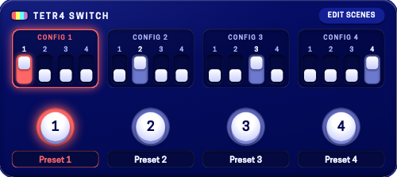
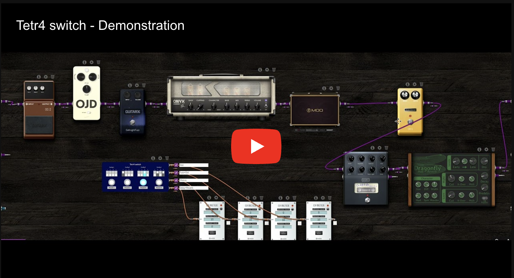
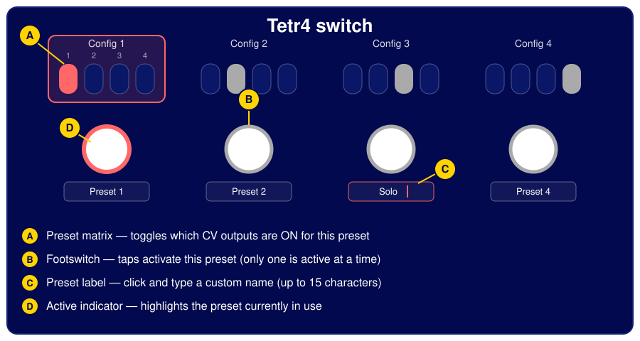
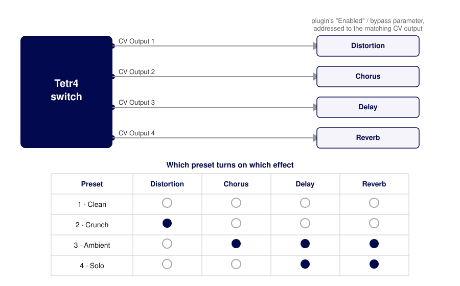
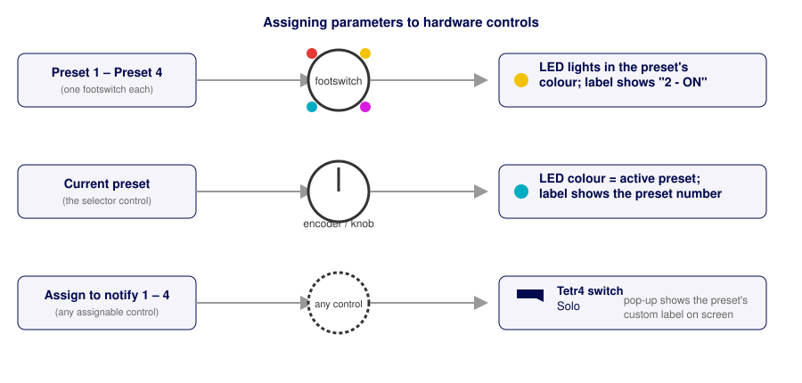

# Tetr4 Switch — User Manual

Tetr4 Switch is a 4-preset CV switcher for the MOD Devices ecosystem, inspired by
hardware preset switchers like the Pedrone Penta Switch, Pedrone Yet and the
Carl Martin Octa Switch.

With a single tap you recall one of 4 presets, each of which drives 4 CV
outputs. Wire those outputs into the CV-addressable parameters of other
plugins (most commonly their "Enabled"/bypass control) and one footswitch
tap turns a whole group of effects on or off together — like recalling an
amp channel or a pedalboard "scene".

## 1. Overview

| | |
|---|---|
| **A — Preset matrix** | 4 toggles per preset. Each one decides whether the matching CV output is ON (10 V) or OFF (0 V) *when that preset is active*. |
| **B — Footswitch** | Tap to make that preset the active one. Only one preset is active at a time. |
| **C — Preset label** | Click the text field and type a name (up to 15 characters) so the preset reads "Clean", "Solo", etc. instead of "Preset N". |
| **D — Active indicator** | The active preset's footswitch and matrix are highlighted. The same state is mirrored on any hardware control you assign (see "Assigning hardware footswitches and controls", below). |

## 2. Presets and CV outputs

The plugin has 4 CV outputs and 4 presets. Each preset stores its own on/off
state for all 4 outputs — that's the matrix in the plugin's GUI: 4 presets ×
4 outputs.

* An output that's **ON** for the active preset sends **10 V**.
* An output that's **OFF** for the active preset sends **0 V**.

Only the matrix row of the *currently active* preset reaches the outputs;
switching presets swaps which row is "live" without touching the other
three, so you can keep re-configuring presets you're not using without any
audible/CV glitch.

By default the plugin ships with an "identity" mapping to make the concept
obvious: preset 1 turns on output 1 only, preset 2 turns on output 2 only,
and so on. Rewire the matrix to whatever combination your rig needs.

## 3. Using it on the pedalboard screen

* **Switch preset** — click a footswitch (B). The matrix for that preset is
  highlighted and its footswitch glows.
* **Edit a preset's outputs** — click the individual toggles (A) in any of
  the 4 matrix columns, active or not. Changes apply immediately the next
  time that preset becomes active (or immediately, if it already is).
* **Rename a preset** — click the label field (C) under a footswitch and
  type. Allowed characters are letters, digits, spaces and `+ - : _ .`;
  anything else is replaced with `_` and the name is capped at 15
  characters. The name is saved with the pedalboard/preset, so it survives a
  reload.
* **Current preset control** — a fifth control, "Current preset", exposes
  the active preset (0–3) as a regular parameter. Automating or MIDI-mapping
  it selects a preset the same way a footswitch tap does, which is handy for
  scene-recall setups or an external controller.

## 4. Wiring CV outputs to your other plugins

Any plugin parameter that can be addressed by CV can be one of Tetr4
Switch's targets — in practice this is almost always another plugin's
**Enabled**/bypass parameter. Address it to the matching `CV Output N`
and it will follow that output's 0 V/10 V state.

A concrete example with a rig of Distortion, Chorus, Delay and Reverb:

* **1 · Clean** — everything bypassed.
* **2 · Crunch** — only Distortion.
* **3 · Ambient** — Chorus, Delay and Reverb together.
* **4 · Solo** — Delay and Reverb, for a bit of extra sustain and tail.

Each preset is recalled with a single footswitch tap instead of turning
four pedals on and off by hand.

> **Tip.** You aren't limited to one destination per output — a single CV
> output can be connected to several plugins at once. If two effects should
> always switch together (say, an octaver and a fuzz that only ever run as a
> pair), address both of their bypass parameters to the same `CV Output N`
> and they'll always move together, freeing up the other three outputs for
> independent effects.

## 5. Assigning hardware footswitches and controls

Beyond the touchscreen, every relevant parameter can be assigned to a
physical control on the device (footswitch, encoder, or an assignable
screen slot), with feedback coming back through the device's LEDs and
display.

* **Preset 1 – Preset 4** — assign each to a physical footswitch (e.g. `B`,
  `C`, or `B+C` on a Dwarf-class device) to switch presets without touching
  the screen. The footswitch's LED lights up in the preset's colour
  (Red / Yellow / Cyan / Magenta for presets 1–4) and its label shows
  `N - ON` or `N - OFF`.
* **Current preset** — assign it to an encoder, knob or footswitch to get a
  single control whose LED colour always matches the active preset and
  whose label shows the preset number.
* **Assign to notify 1 – 4** — assign any of these four to any assignable
  control to get a pop-up on the device screen with the active preset's
  custom label every time you switch. This is useful when you want a
  readable confirmation ("Solo", "Clean", …) rather than just a number or an
  LED colour — pair it with a control you rarely touch, since it exists only
  to receive the notification.

## 6. Saving your setup

Preset labels are stored in the plugin's LV2 state, so they're saved and
restored with the pedalboard/preset like any other plugin setting — no
extra step needed. The matrix (which outputs are on for which preset) is
saved the same way, as regular plugin parameters.

## 7. Port reference

| Port | Type | Description |
|---|---|---|
| `CV Output 1`–`4` | CV output | 0 V/10 V, driven by the active preset's matrix row. |
| `Preset 1`–`4` | Control input (footswitch) | Momentary trigger: selects that preset. |
| `Current preset` | Control input (enumeration) | The active preset, 0–3. Can be read or set directly. |
| `Assign to notify 1`–`4` | Control input | No audio/CV effect; exists only to be assigned to a hardware control that should show the preset-change pop-up. |
| `Preset N - Output M` | Control input (toggle) | The matrix cell: is output `M` ON when preset `N` is active? |
| Preset label 1–4 | Plugin property (patch) | The custom name for each preset, edited from the GUI text field. |

## 8. Credits

Tetr4 Switch is developed by Paulo Mateus (SrMouraSilva). Discuss the plugin,
report issues or follow its progress on the
[MOD Audio forum thread](https://forum.mod.audio/t/tetr4-switch-plugin-in-beta-store/8998)
or the [plugins-lv2 repository](https://github.com/SrMouraSilva/plugins-lv2).
