# Tetr4 Switch — User Manual

## 1. What Tetr4 Switch does

Picture a hardware loop switcher on a pedalboard, the kind of box with a row of footswitches and a bank of tiny DIP
switches above each one. You set the DIP switches once to decide which pedals each footswitch should turn on. On stage,
one stomp swaps your whole rig from "clean" to "lead", without tap-dancing across five pedals.

Tetr4 Switch is that loop switcher, built for your MOD pedalboard. It has **four presets** (the footswitches) and
**four outputs** (the loops). For each preset, you flip four DIP switches to choose which outputs are on. Only one preset
is active at a time. When you select a preset, all four outputs jump to the pattern you stored for it.

The outputs are **control voltage (CV)** signals. CV is the MOD way of letting one plugin control another: a cable that
carries a value instead of sound. An output that is "on" sends 10 V and one that is "off" sends 0 V. Pair an output to
the on/off (bypass) switch of one or more plugins, and that output becomes a loop on your switcher.

> [!NOTE] Good to know
> Tetr4 Switch has no audio inputs or outputs, so it doesn't sit in your signal chain. Place it anywhere on the pedalboard
> and map its CV outputs to the plugins you want it to switch.

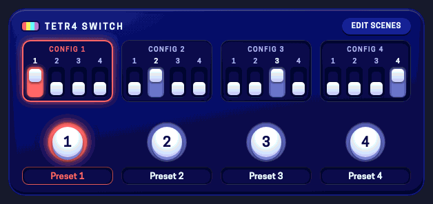

[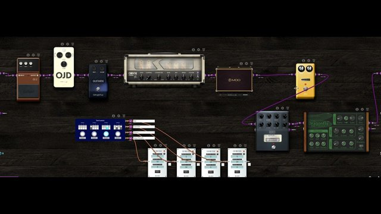](https://youtu.be/sHKzSBM5Z8U)

## 2. Quick start

This example gives you two scenes: a clean sound and a lead sound with a drive and a delay. You need a pedalboard with
any drive plugin and any delay plugin in the chain.

1. **Add Tetr4 Switch** to your pedalboard. You can find it among the Utility plugins. Put it anywhere; it has no audio
   connections.
2. Click on **"Manage CV ports"** on the Pedalboard actions bar (top of Constructor window on the MOD WebGUI) and check
   the boxes that appear next to the outputs of the Tetr4 Switch.
3. **Give your drive an on/off CV input.** Click the drive's gear icon, open the addressing for its On/Off (bypass)
   parameter and choose **CV**. The CV addresses with the names of the Tetr4 Switch outputs will be listed here. Select
   the one corresponding to the first Tetr4 Switch output. Do the same for the delay, but instead of selecting the first,
   select the second output from the Tetr4 Switch.
4. **Set the DIP switches.** In **Config 1**, set all four switches down (everything off: your clean scene). In
   **Config 2**, set switches **1** and **2** up (drive + delay: your lead scene).

    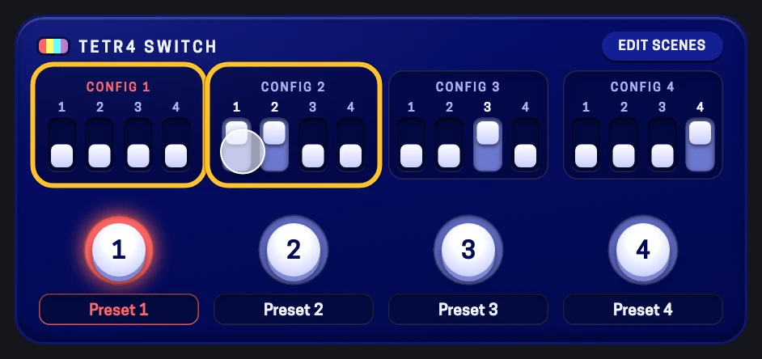

5. **Click the Preset 1 and Preset 2 footswitches** on the panel. The drive and delay turn on and off together, and the
   active Config bank lights up in that preset's colour.

    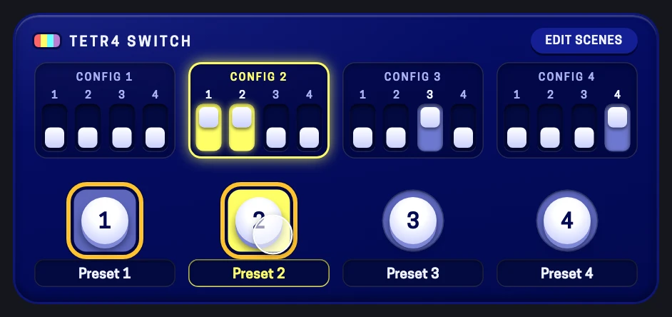

6. **Put it under your feet.** Address the **Preset 1** and **Preset 2** parameters to two device footswitches. Their LEDs
   light up in the preset colour while that preset is active. On the settings page ([section 4](#the-settings-page)) the tiles of
   the **Hardware assignment** do this in one tap.

    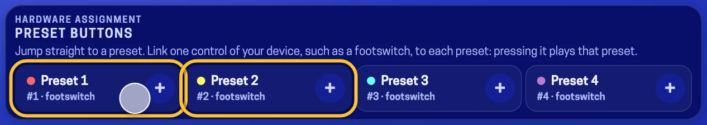

> [!TIP] The one trick to learn
> **Plan your outputs before your presets.** Each output is one "loop": a group of plugins that always switch on and off
> together. Decide those four groups first (for example: drive, octave+fuzz, chorus, delay+reverb). After that, each
> preset is just a matter of choosing which loops are on. Plugins that are always on, like your amp and cab, don't get a
> CV addressing at all.

[](https://youtu.be/sHKzSBM5Z8U)

[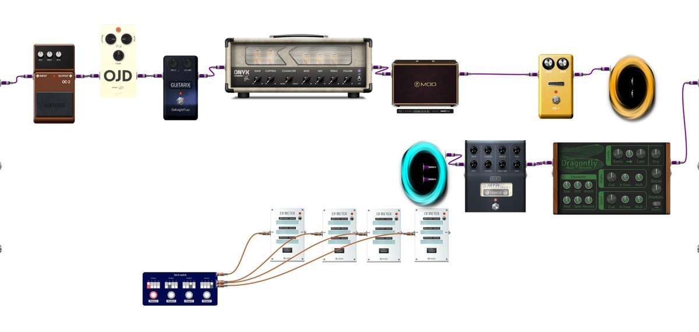](https://pedalboards.moddevices.com/pedalboards/66f8238d5e57562fcb26b0f3)

## 3. The controls

<figure class="annotated">
<div class="stage">
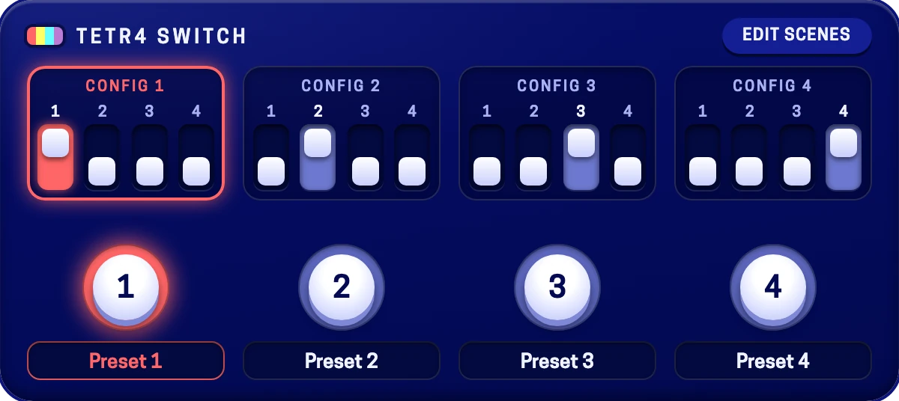
<span class="pin" style="--x:24.8%;--y:16.4%">1</span>
<span class="pin" style="--x:24%;--y:38%">2</span>
<span class="pin" style="--x:19.7%;--y:61%">3</span>
<span class="pin" style="--x:25.3%;--y:90%">4</span>
</div>
<figcaption>Factory settings: Preset 1 is active and each Config bank turns on a single output (Config 1 → output 1, Config 2 → output 2, and so on).</figcaption>
</figure>

### On the panel

| Control | What it does |
|---|---|
| <span class="num">1</span>**Config 1–4** (DIP banks) | One bank of four switches per preset. Config 1 belongs to Preset 1, Config 2 to Preset 2, and so on. The active preset's bank glows in that preset's colour, and the other banks are dimmed but stay editable. |
| <span class="num">2</span>**DIP switch 1–4** | Each switch is one output for that preset. **Up** = the output sends 10 V (on) while this preset is active. **Down** = 0 V (off). If you edit the active preset's bank, the outputs change right away. |
| <span class="num">3</span>**Preset 1–4 footswitches** | Select which preset drives the outputs. They work like radio buttons: selecting one deselects the others. The ring is the LED of the preset; only the cap in the middle goes down when you press it. Clicking the preset that is already active does nothing. |
| <span class="num">4</span>**Preset labels** | Show the name of each preset. You can edit the Preset Label text to whatever helps you better understand the function of each preset. |
| **Edit scenes** | Opens the settings page (section 4). The gear icon above the plugin opens it too. |
| **CV Output 1–4** (jacks) | The four outputs. On the pedalboard, they appear as CV jacks on the plugin's output side. Each one sends 0 V or 10 V, and one output can be paired with as many plugin inputs as you like. |

### Assignable parameters

These parameters aren't on the panel, but you'll find them when you address the plugin to footswitches, knobs or external
MIDI controllers.

#### Preset 1 · Preset 2 · Preset 3 · Preset 4

OFF
: That preset is not active. An assigned footswitch LED is dark and its label reads "N - OFF".

ON
: That preset is active. The LED lights in the preset's colour and the label reads "N - ON".

DEFAULT
: Preset 1 on, Presets 2–4 off.

USE
: Assign each to its own footswitch for direct access to every scene. This is the most hardware-switcher-like setup.

#### Current preset

VALUES
: `Prst 1` · `Prst 2` · `Prst 3` · `Prst 4`

DEFAULT
: Prst 1

USE
: A single list parameter. Assign it to one footswitch (e.g. B, C or B+C on the Dwarf) to step through the presets, or to a
  knob or list control. The display shows the preset number.

#### Assign to notify 1 – 4

VALUES
: Off / On. Changing the value does not affect the sound.

USE
: "Dummy" parameters used for on-screen notifications. If you address one of them, your MOD device shows a pop-up
  ("TETR4 SWITCH · *the name you gave the preset*") every time the preset changes. See [Hands-free control](#hands-free-control).

### Preset colours

| Preset | Panel colour | Device LED |
|---|---|---|
| Preset 1 | <span class="dot" style="--c:#ff6667"></span> Red | Red |
| Preset 2 | <span class="dot" style="--c:#ffff67"></span> Yellow | Yellow |
| Preset 3 | <span class="dot" style="--c:#66ffff"></span> Cyan | Cyan |
| Preset 4 | <span class="dot" style="--c:#bb7cd2"></span> Purple | Magenta |

## 4. The settings page

Click **Edit scenes** (or the gear icon above the plugin) to open a page that takes the whole screen and is made for
touch: big switches, nothing smaller than a fingertip.

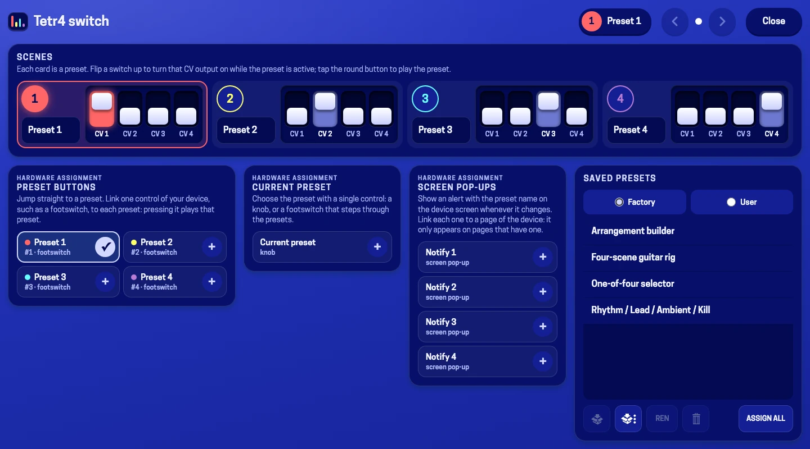

* **Scenes**: one card per preset. The round button plays that preset; the field next to it is its name; the four
  switches are its DIP switches (**up = on**). The card of the active preset is highlighted, and its lit switches are the
  CV signals actually leaving the plugin right now.
* **Hardware assignment**: tiles to assign a footswitch, a knob or a device screen page to the plugin's controls, told
  apart by purpose: the *preset buttons* (1 to 4), *Current preset* and the *screen pop-ups*. A tile shows a check mark
  once it is assigned.
* **Saved presets**: the factory presets (see [Recipes](#recipes)) and your own presets.

The page never scrolls up and down. What does not fit the screen goes on another **page**, to the right: the arrows in the
top bar (always there) and the dots between them show and change the page, and on a touch screen you can **swipe**
sideways too. A large screen shows everything at once; a phone shows each purpose on a page of its own.

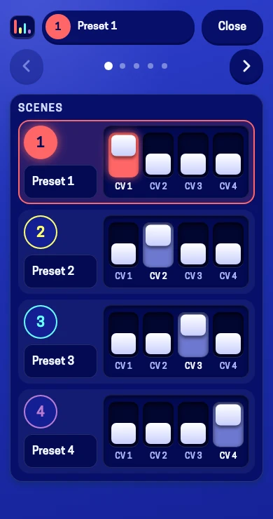

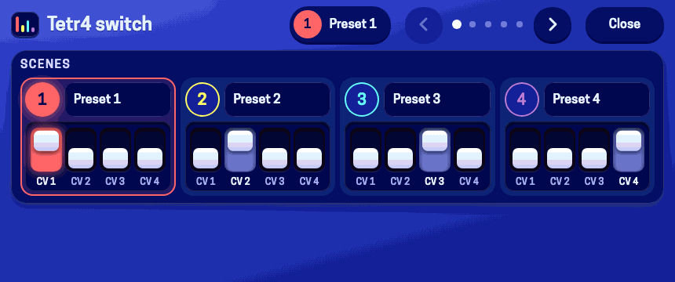

## 5. Hands-free control

A loop switcher only makes sense under your feet. Tetr4 Switch gives you three ways to change presets without touching the
web interface, plus a way to see what you selected when your controller has no LEDs or screen.

### Option A: one footswitch per preset (recommended)

1. Open the plugin's addressing and assign **Preset 1** to a device footswitch.
2. Repeat for **Preset 2, 3 and 4**. On a Dwarf with only two assignable footswitches, you can use a footswitch page or a
   combination such as B+C to scroll through the list of 4 presets.
3. **Step on a footswitch.** Its LED lights up in the preset colour and the LEDs of the other presets go dark, just like the
   LEDs on a hardware switcher.

### Option B: one footswitch that cycles through presets

1. Assign the **Current preset** parameter to a single footswitch (e.g. B, C or B+C on the Dwarf).

    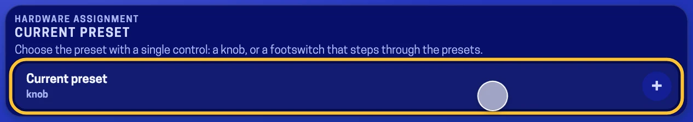

2. Each press moves to the next preset, and the display shows its number.

### Option C: an external MIDI controller with on-screen confirmation

Controllers such as the M-VAVE Chocolate have no LED per switch, so it's easy to lose track of the active preset. Use the
notifier parameters to get feedback:

1. MIDI-learn **Preset 1–4** (or **Current preset**) to your controller's switches.
2. Assign one of the **Assign to notify** parameters to a control on your MOD device, for example, a knob or footswitch on
   the screen you play from.

    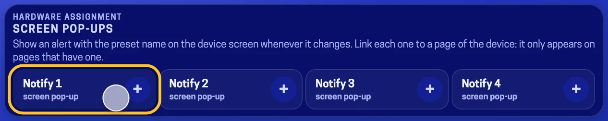

3. Change presets from the controller. Your MOD device shows a pop-up with the new preset number.

> [!WARNING] Heads-up
> The pop-up only appears while the parameter you assigned to a notifier is **visible on the device screen**. If you switch
> to another page, the notifications stop. Keep that control on the page you play from.

[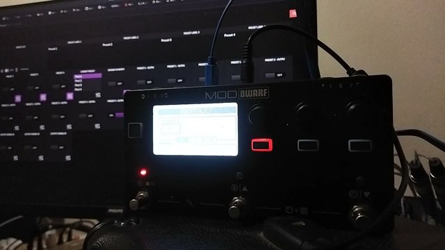](https://youtu.be/OigC8Hy5dpI)

## 6. Recipes

Each recipe shows the four Config banks as a grid. Rows are presets and columns are CV outputs 1–4. A coloured square
means the switch is up (10 V, on) and a grey square means down (0 V, off). Each one is also a factory preset of the plugin.

```recipe
Four-scene guitar rig
cols: 1 2 3 4
Clean: 0000
Modulation: 0011
Distortion: 1000
Solo: 0101
---
The classic setup from the developer. The pedalboard has an octaver, a distortion, a fuzz, an amp + cab, a chorus, a delay and a reverb. The amp + cab stays on all the time, so it gets no cable. The other plugins are grouped into four loops: **Clean** plays just the amp, **Modulation** adds chorus, delay and reverb, **Distortion** adds the drive, and **Solo** brings in octave + fuzz with delay and reverb.
assign: **Assigning the Tetr4 Switch:** Out 1 → Distortion · Out 2 → Octaver + Fuzz · Out 3 → Chorus · Out 4 → Delay + Reverb
```

```recipe
One-of-four selector
cols: 1 2 3 4
Amp A: 1000
Amp B: 0100
Amp C: 0010
Amp D: 0001
---
This is the factory setting. Each preset turns on exactly one output, so only one of four plugins can be active at a time. Use it to choose between four amps, four cabinets or four reverbs placed in parallel, without ever having two of them on at once.
assign: **Assigning the Tetr4 Switch:** Out 1–4 → the bypass of each of the four alternatives
```

```recipe
Arrangement builder
cols: 1 2 3 4
Intro: 1000
Verse: 1100
Pre: 1110
Chorus: 1111
---
Each preset adds one more layer to the previous one, so you move through the song from sparse to full. This works for effect layers (a pad, a shimmer, a harmony, a doubler) or for anything with an on/off switch that you want to bring in step by step. Step backwards through the presets to strip the sound down again for the outro.
assign: **Assigning the Tetr4 Switch:** Out 1 → base layer · Out 2 → second layer · Out 3 → third layer · Out 4 → final layer
```

```recipe
Rhythm / Lead / Ambient / Kill
cols: 1 2 3 4
Rhythm: 1000
Lead: 1110
Ambient: 0011
Bypass: 0000
---
A balanced live setup. **Rhythm** uses a light drive. **Lead** adds a boost and a delay on top. **Ambient** drops the drives for delay + a big reverb. The last preset, **Bypass**, turns every loop off, which is useful as a dry reset between songs.
assign: **Assigning the Tetr4 Switch:** Out 1 → Drive · Out 2 → Boost · Out 3 → Delay · Out 4 → Reverb
```

[](https://pedalboards.moddevices.com/pedalboards/66f8238d5e57562fcb26b0f3)

[](https://youtu.be/sHKzSBM5Z8U)

## 7. Tips

### One output, many plugins

A CV output can feed any number of inputs. Assign one output to delay and reverb, and they become a single loop that always
switches together.

### Leave always-on plugins alone

Your amp, cab, tuner or compressor don't need an assignment from Tetr4 Switch. Save the four outputs for the plugins you
actually switch.

### Keep a "nothing on" preset

Pressing the active preset again does nothing, so there's no toggle-off. If you want a dry reset, set all four switches of
one Config bank down.

### Tweak sounds freely

Tetr4 only stores which loops are on. Change your delay time or drive gain whenever you like, and every preset uses the new
setting.

### Name your scenes

Rename the Preset 1–4 labels to describe what each scene does, like "Clean", "Crunch", "Lead" or "Ambient". On stage, you
then pick a scene by its sound instead of having to remember which number does what.

### Edit live

You can change the switches of the active Config bank while playing. The outputs follow immediately, which makes it easy to
try out a combination before you commit to it.

### Colour-code your feet

Preset 1 is always red, 2 yellow, 3 cyan and 4 magenta, both on the panel and on the device LEDs. Assign the footswitches in
the same order and your feet learn the colours.

### Combine with snapshots

Use snapshots for song-level changes, like tempo or amp voicing, and Tetr4 for scene changes inside the song. A snapshot
also recalls which Tetr4 preset is active, so each song can start on the right scene.

### Watch the CV with a meter

If a scene doesn't behave as expected, temporarily connect a CV meter or display plugin to the outputs to check which ones
are high.

## 8. Questions & answers

### I switch presets but nothing happens to my plugins.

The target plugins need a CV address. Open the addressing for each plugin's On/Off parameter, choose **CV**, and then assign
a CV from a Tetr4 output. Also check that the active preset's Config bank actually has switches up.

### Why can't I turn a plugin on or off by hand anymore?

Once a parameter is controlled by CV, the CV signal decides its value, so you can no longer switch it directly in the web
interface. If you need one plugin on its own (e.g. only the octaver, not octave + fuzz), give it a dedicated output, or
leave it out of Tetr4 completely.

### Is it stereo? Does it add latency?

Neither question applies: Tetr4 Switch has no audio ports at all. It only sends four steady control voltages, so it works
the same with mono and stereo pedalboards and adds no latency.

### How many plugins can one output control?

There is no fixed limit. Assign one output to as many CV controls as you need. Everything on that Tetr4 Switch output
switches together.

### What is the difference from snapshots?

A snapshot stores every parameter value, while Tetr4 stores only which loops are on. Think of Tetr4 as a lighter
alternative to snapshots: less powerful, but your sound edits never go out of sync between scenes.

### Can it send MIDI instead of CV?

No. As a workaround, route a CV output into a plugin that turns CV into MIDI messages and send those to the MIDI loopback.
A community member has prototyped a MIDI-CC output, which may be included in a later version.

### I set up notifications, but no pop-up appears.

The pop-up only appears while the control you assigned to an **Assign to notify** parameter is visible on the device screen.
Move it to the page you play from.

## 9. Specifications

| Field | Value |
|---|---|
| Plugin name | Tetr4 switch |
| Version | 1.0.0 |
| Category | Control Voltage · Utility |
| Format | LV2 · URI `http://srmourasilva.github.io/plugins/tetr4-switch` |
| Audio I/O | None |
| CV outputs | 4 × CV, 0 V (off) / 10 V (on) |
| MIDI | None |
| Presets × outputs | 4 × 4 (16 toggle switches) |
| Assignable parameters | Preset 1–4 (toggle) · Current preset (list) · Assign to notify 1–4 (toggle) · 16 Config switches |
| Device feedback | Footswitch LED colour + label, preset number on display, pop-up notifications (MOD HMI) |
| Platforms | MOD Dwarf · MOD Duo X · MOD Duo |
| Developer | Paulo Mateus (SrMouraSilva) |
| License | Apache-2.0 |
| Source code | [github.com/SrMouraSilva/tetr4-switch-lv2](https://github.com/SrMouraSilva/tetr4-switch-lv2) |
| Store page | [Tetr4 switch](https://pedalboards.mod.audio/plugins/aHR0cDovL3NybW91cmFzaWx2YS5naXRodWIuaW8vcGx1Z2lucy90ZXRyNC1zd2l0Y2g=) |
| Forum thread | [forum.mod.audio – Tetr4 Switch plugin in Beta Store](https://forum.mod.audio/t/tetr4-switch-plugin-in-beta-store/8998) |
| Example pedalboard | [MOD Pedalboards Feed](https://pedalboards.moddevices.com/pedalboards/66f8238d5e57562fcb26b0f3) |

Tetr4 Switch is a community plugin. Feedback, bug reports and pull requests are welcome in the forum thread and on GitHub.
