# Tetr4 Switch — User Manual

## 1. What Tetr4 Switch does

Picture a hardware loop switcher on a pedalboard, the kind of box with a row of footswitches and a bank of tiny DIP
switches above each one. You set the DIP switches once to decide which pedals each footswitch should turn on. On stage,
one stomp swaps your whole rig from "clean" to "lead", without tap-dancing across five pedals.

Tetr4 Switch is that loop switcher, built for your MOD pedalboard. It has **four presets** (the footswitches) and
**four outputs** (the loops). For each preset, you flip four DIP switches to choose which outputs are on. Only one preset
is active at a time. When you select a preset, all four outputs jump to the pattern you stored for it.

The outputs are **control voltage (CV)** signals. CV is the MOD way of letting one plugin control another: a cable that
carries a value instead of sound. An output that is "on" sends 10 V and one that is "off" sends 0 V. Pair an output to
the on/off (bypass) switch of one or more plugins, and that output becomes a loop on your switcher.

Tetr4 Switch also has a **MIDI out**: each time the preset changes it sends a MIDI control change for every output, so the
same scenes can switch MIDI gear too (see [MIDI out](#midi-out)).

> [!NOTE] Good to know
> Tetr4 Switch has no audio inputs or outputs, so it doesn't sit in your signal chain. Place it anywhere on the pedalboard
> and map its CV outputs to the plugins you want it to switch.

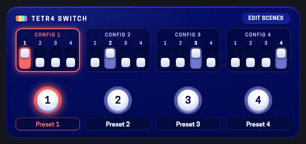

[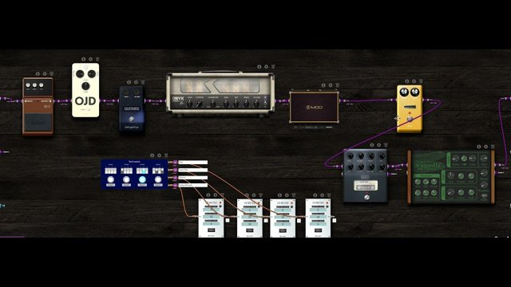](https://youtu.be/sHKzSBM5Z8U)

## 2. Quick start

This example gives you two scenes: a clean sound and a lead sound with a drive and a delay. You need a pedalboard with
any drive plugin and any delay plugin in the chain.

1. **Add Tetr4 Switch** to your pedalboard. You can find it among the Utility plugins. Put it anywhere; it has no audio
   connections.
2. Click on **"Manage CV ports"** on the Pedalboard actions bar (top of Constructor window on the MOD WebGUI) and check
   the boxes that appear next to the outputs of the Tetr4 Switch.
3. **Give your drive an on/off CV input.** Click the drive's gear icon, open the addressing for its On/Off (bypass)
   parameter and choose **CV**. The CV addresses with the names of the Tetr4 Switch outputs will be listed here. Select
   the one corresponding to the first Tetr4 Switch output. Do the same for the delay, but instead of selecting the first,
   select the second output from the Tetr4 Switch.
4. **Set the DIP switches.** In **Config 1**, set all four switches down (everything off: your clean scene). In
   **Config 2**, set switches **1** and **2** up (drive + delay: your lead scene).

    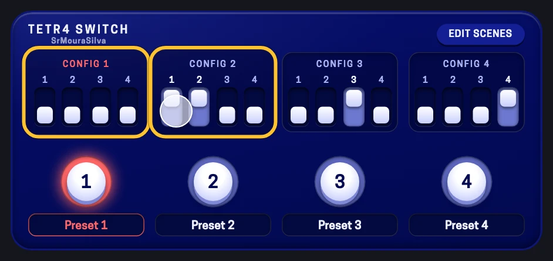

5. **Click the Preset 1 and Preset 2 footswitches** on the panel. The drive and delay turn on and off together, and the
   active Config bank lights up in that preset's colour.

    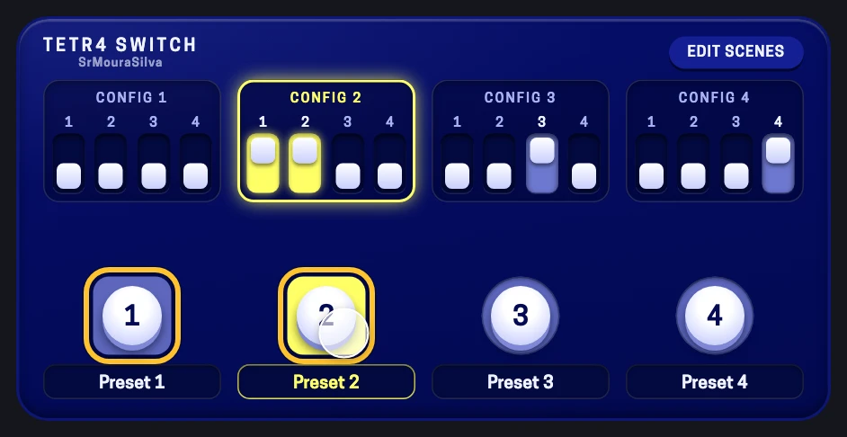

6. **Put it under your feet.** Address the **Preset 1** and **Preset 2** parameters to two device footswitches. Their LEDs
   light up in the preset colour while that preset is active. On the settings page ([section 5](#the-settings-page)) the small
   button beside the round button of each scene does this in one tap.

    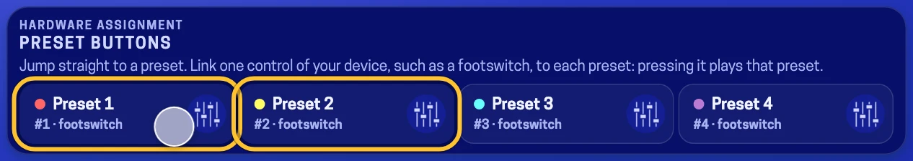

> [!TIP] The one trick to learn
> **Plan your outputs before your presets.** Each output is one "loop": a group of plugins that always switch on and off
> together. Decide those four groups first (for example: drive, octave+fuzz, chorus, delay+reverb). After that, each
> preset is just a matter of choosing which loops are on. Plugins that are always on, like your amp and cab, don't get a
> CV addressing at all.

[](https://youtu.be/sHKzSBM5Z8U)

[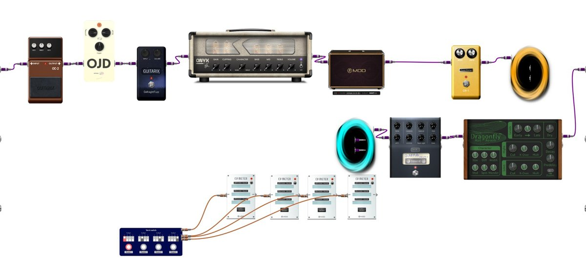](https://pedalboards.moddevices.com/pedalboards/66f8238d5e57562fcb26b0f3)

## 3. The controls

<figure class="annotated">
<div class="stage">
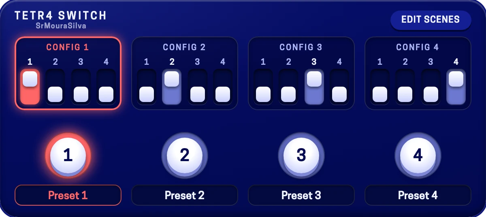
<span class="pin" style="--x:24.8%;--y:15.3%">1</span>
<span class="pin" style="--x:24%;--y:34.1%">2</span>
<span class="pin" style="--x:19.7%;--y:63.5%">3</span>
<span class="pin" style="--x:25.3%;--y:90.9%">4</span>
</div>
<figcaption>Factory settings: Preset 1 is active and each Config bank turns on a single output (Config 1 → output 1, Config 2 → output 2, and so on).</figcaption>
</figure>

### On the panel

| Control | What it does |
|---|---|
| <span class="num">1</span>**Config 1–4** (DIP banks) | One bank of four switches per preset. Config 1 belongs to Preset 1, Config 2 to Preset 2, and so on. The active preset's bank glows in that preset's colour, and the other banks are dimmed but stay editable. |
| <span class="num">2</span>**DIP switch 1–4** | Each switch is one output for that preset. **Up** = the output sends 10 V (on) while this preset is active. **Down** = 0 V (off). If you edit the active preset's bank, the outputs change right away. |
| <span class="num">3</span>**Preset 1–4 footswitches** | Select which preset drives the outputs. They work like radio buttons: selecting one deselects the others. The ring is the LED of the preset; only the cap in the middle goes down when you press it. Clicking the preset that is already active does nothing. |
| <span class="num">4</span>**Preset labels** | Show the name of each preset. You can edit the Preset Label text to whatever helps you better understand the function of each preset. |
| **Edit scenes** | Opens the settings page (section 5). The gear icon above the plugin opens it too. |
| **CV Output 1–4** (jacks) | The four outputs. On the pedalboard, they appear as CV jacks on the plugin's output side. Each one sends 0 V or 10 V, and one output can be paired with as many plugin inputs as you like. |
| **MIDI out** (jack) | The fifth jack, under the CV ones. It sends a MIDI control change for each output when the preset changes (see [MIDI out](#midi-out)). |

### Assignable parameters

These parameters aren't on the panel, but you'll find them when you address the plugin to footswitches, knobs or external
MIDI controllers.

#### Preset 1 · Preset 2 · Preset 3 · Preset 4

OFF
: That preset is not active. An assigned footswitch LED is dark and its label shows the name of the preset.

ON
: That preset is active. The LED lights in the preset's colour; the label shows the name of the preset (the first 7 characters; a name that was never changed, *Preset 3*, is written *Prst 3* there).

DEFAULT
: Preset 1 on, Presets 2–4 off.

USE
: Assign each to its own footswitch for direct access to every scene. This is the most hardware-switcher-like setup.

#### Current preset

VALUES
: `1` · `2` · `3` · `4`

DEFAULT
: 1

USE
: A single list parameter. Assign it to one footswitch (e.g. B, C or B+C on the Dwarf) to step through the presets, or to a
  knob or list control. On a single footswitch the label shows the name of the active preset (the first 6 characters, the rest
  of the room is for the value, which is the number of the option). On the B+C pair the device writes the text itself.

#### Assign to notify 1 – 4

VALUES
: Off / On. Changing the value does not affect the sound.

USE
: "Dummy" parameters used for on-screen notifications. If you address one of them, your MOD device shows a pop-up
  ("TETR4 SWITCH · *the name you gave the preset*") every time the preset changes. See [Hands-free control](#hands-free-control).

### Preset colours

| Preset | Panel colour | Device LED |
|---|---|---|
| Preset 1 | <span class="dot" style="--c:#ff6667"></span> Red | Red |
| Preset 2 | <span class="dot" style="--c:#ffff67"></span> Yellow | Yellow |
| Preset 3 | <span class="dot" style="--c:#66ffff"></span> Cyan | Cyan |
| Preset 4 | <span class="dot" style="--c:#bb7cd2"></span> Purple | Magenta |

## 4. Interactive manual

Here the plugin is **the real one**: the same interface, the same script, running inside the manual. Nothing you do is saved or sent
anywhere, and **Reset** puts it back the way it starts.

* **Explore**: tap any part of the plugin to read what it is for, or pick it from the list under the picture. **Show areas** outlines
  everything that can be tapped. Use the buttons at the top to switch between the plugin **on the pedalboard** and its **settings page**.
* **Guided tours**: step-by-step walkthroughs of the common tasks. A finger shows where to tap.
  Go forward and back with **Next** and **Back**: every step says what is happening and shows it in the plugin.

```interactive
```

## 5. The settings page

Click **Edit scenes** (or the gear icon above the plugin) to open a page that takes the whole screen and is made for
touch: big switches, nothing smaller than a fingertip.

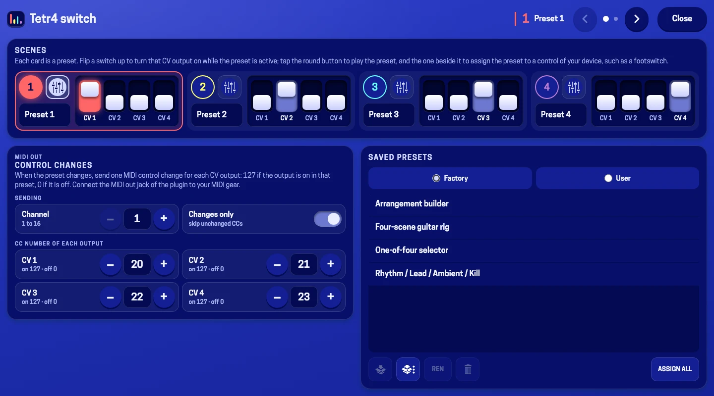

* **Scenes**: one card per preset. The round button plays that preset and the small button beside it assigns the preset to a
  footswitch, a knob or another control of your device (it fills in once it is assigned); the field under them is the
  name, and the four switches are its DIP switches (**up = on**). The card of the active preset is highlighted, and its
  lit switches are the CV signals actually leaving the plugin right now.
* **Hardware assignment**: tiles to assign a control of the device to the *Current preset* (the tile also says which
  preset is playing) and to the *screen pop-ups*. A tile shows a check mark once it is assigned. The MOD Duo has no widgets
  on its screen, so there the pop-up tiles are disabled and say so.
* **MIDI out**: the channel, whether to send only what changed, and the CC number of each output
  (see [MIDI out](#midi-out)).
* **Saved presets**: the factory presets (see [Recipes](#recipes)) and your own presets.

The page never scrolls up and down. What does not fit the screen goes on another **page**, to the right: the arrows in the
top bar (always there) and the dots between them show and change the page, and on a touch screen you can **swipe**
sideways too. A large screen shows everything at once; a phone shows each purpose on a page of its own.

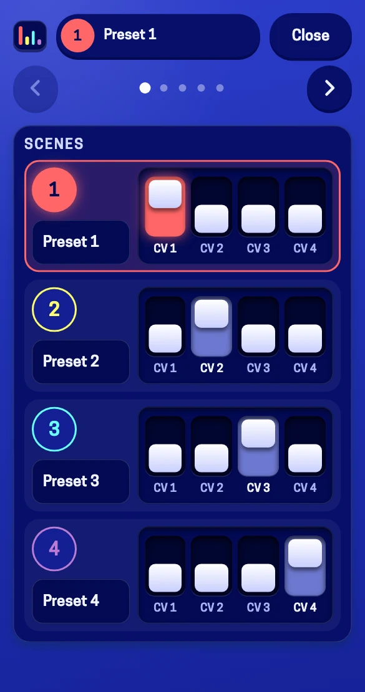

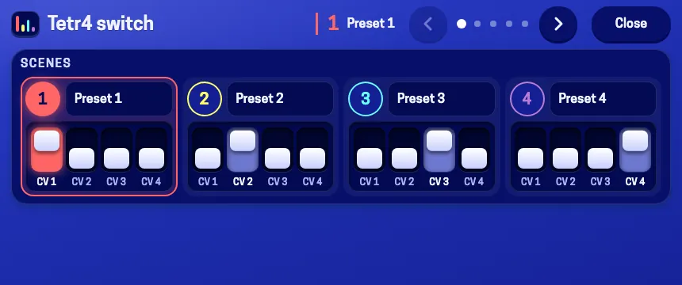

## 6. Hands-free control

A loop switcher only makes sense under your feet. Tetr4 Switch gives you three ways to change presets without touching the
web interface, plus a way to see what you selected when your controller has no LEDs or screen.

### Option A: one footswitch per preset (recommended)

1. Open the plugin's addressing (on the settings page, the small button beside the round button of the scene) and assign
   **Preset 1** to a device footswitch.
2. Repeat for **Preset 2, 3 and 4**. On a Dwarf with only two assignable footswitches, you can use a footswitch page or a
   combination such as B+C to scroll through the list of 4 presets.
3. **Step on a footswitch.** Its LED lights up in the preset colour and the LEDs of the other presets go dark, just like the
   LEDs on a hardware switcher.

### Option B: one footswitch that cycles through presets

1. Assign the **Current preset** parameter to a single footswitch (e.g. B, C or B+C on the Dwarf).

    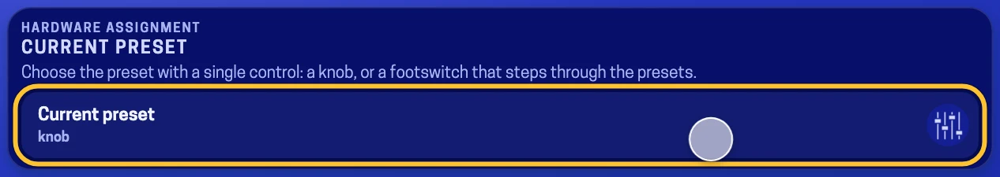

2. Each press moves to the next preset. On a single footswitch the label shows the name of the preset and the LED its colour.

### Option C: an external MIDI controller with on-screen confirmation

Controllers such as the M-VAVE Chocolate have no LED per switch, so it's easy to lose track of the active preset. Use the
notifier parameters to get feedback:

1. MIDI-learn **Preset 1–4** (or **Current preset**) to your controller's switches.
2. Assign one of the **Assign to notify** parameters to a control on your MOD device, for example, a knob or footswitch on
   the screen you play from.

    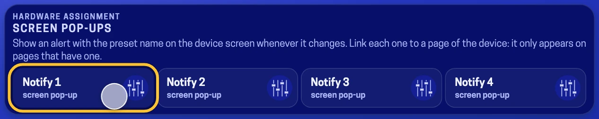

3. Change presets from the controller. Your MOD device shows a pop-up with the new preset number.

> [!WARNING] Heads-up
> The pop-up only appears while the parameter you assigned to a notifier is **visible on the device screen**. If you switch
> to another page, the notifications stop. Keep that control on the page you play from. The MOD Duo has no widgets on its
> screen, so the pop-ups are not available on it.

[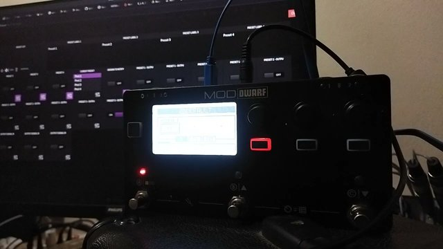](https://youtu.be/OigC8Hy5dpI)

### On the screen of the device

With the **aLabs Starless** image (Starless 19 or later) the MOD Dwarf and the MOD Duo X can show *widgets* of a plugin on their screens, drawn by
the plugin itself. The stock MOD firmware does not have this: the plugin works the same there and simply shows nothing. On the MOD Duo there is no
screen to draw on.

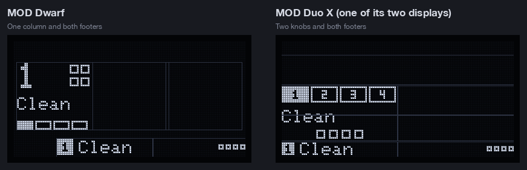

A widget **is for looking, not for touching**: nothing on the screen reacts to a finger or to a button of the device. What changes it are the
controls you assigned to the plugin, as always; the widget follows them.

#### Placing the widget

1. Open the **Display** dialog (the Device menu of MOD UI) and choose **Active preset** in the list of widgets of the pedalboard.
2. **Place** it on an area of the screen: a column above a knob, two or three columns, a footer, both footers or the whole screen on the Dwarf; a
   knob, two knobs, the four knobs, the encoder band, a footer, both footers or the whole screen on each display of the Duo X. The dialog only
   offers the areas that are big enough for it.
3. The dialog offers to assign **Current preset** to a control of the device; choose the control you want, or leave it out if the preset is already chosen by other controls.
4. **Save**. It can be placed on more than one area at once (a column and a footer, or one on each display of the Duo X).

It draws what fits in the area it gets: a footer shows the bare essentials, the whole screen shows everything.

#### Active preset

Shows **which preset is on** and what it switches, wherever the pedalboard is being played from: a footswitch, the settings page, a MIDI controller
or a snapshot. It follows the preset, so it is also the way to see it when the LEDs are out of sight. It is offered in every area, from a footer up.

| MOD Dwarf | MOD Duo X | What you see |
|---|---|---|
| 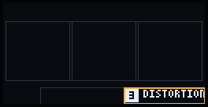<small>One footer · 51 × 10</small> | 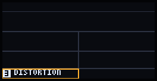<small>One footer · 64 × 8</small> | The **number** of the preset in an inverted box and its **name**. |
| 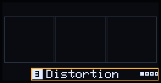<small>Both footers · 104 × 10</small> | 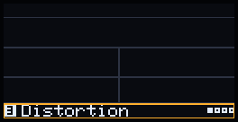<small>Both footers · 128 × 8</small> | The same, and the **4 outputs** at the right (filled: on in this preset). |
| 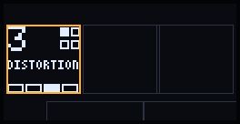<small>One column · 40 × 37</small> | 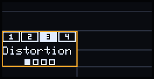<small>Two knobs, one above the other · 64 × 30</small> | **Dwarf:** the number, big; the outputs in two rows; the name; and one box for each of the 4 presets (the active one filled). **Duo X:** a cell with the number of each preset (the active one filled), the **name** big and the outputs. |
| 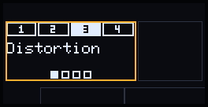<small>Two columns · 82 × 37</small> | 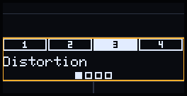<small>The four knobs · 128 × 30</small> | A cell with the number of each preset (the active one filled), the **name** big and the outputs. |
| 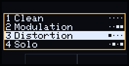<small>Three columns · 124 × 37</small> | 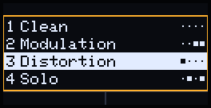<small>Encoder band and knobs · 128 × 47</small> | **All 4 presets** in a list, each with its name and its outputs; the active one inverted. |
| 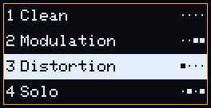<small>Whole screen · 128 × 64</small> | <small>Whole screen · 128 × 64</small> | **All 4 presets** in a list, each with its name and its outputs; the active one inverted. In the list an output that is on is a small square and one that is off a dot. |
| *No area of this kind* | 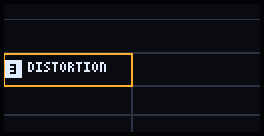<small>One knob · 64 × 16</small> | The **number** of the preset in an inverted box and its **name**. |
| *No area of this kind* | 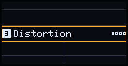<small>Two knobs side by side · 128 × 16</small> | The same, and the **4 outputs** at the right. |

The squares are the **CV outputs** of the active preset: a filled one is on (its DIP switch in the preset is up). In the lists a small square is an
output that is on and a dot one that is off. The names are the ones you gave the presets, and the widget changes when you rename one.

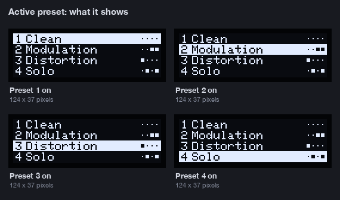

The widget needs no `Assign to notify` control: it is drawn where you place it, and stays there, unlike the pop-up, which goes away after a moment.

## 7. MIDI out

Besides its four CV outputs, Tetr4 Switch has a **MIDI out** jack (the fifth, under the CV ones). Each time the active
preset changes, it sends one MIDI **control change** (CC) for every output: **127** when that output is on in the new
preset and **0** when it is off. Use it to switch a MIDI-controlled pedal or a looper with the same scenes you set for the
CV outputs.

1. **Connect the MIDI out jack** to a MIDI input: the MIDI output of your device, a MIDI loopback port or a plugin that
   takes MIDI.
2. Open the settings page and go to the **MIDI out** panel.

    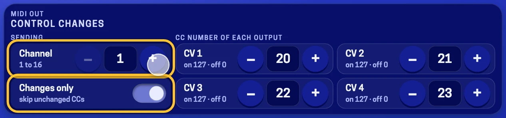

3. Choose the **channel** (1 to 16) and the **CC number of each output**. They start at 20 to 23, numbers that have no
   standard meaning in MIDI. Tap the field to type a number, or use the buttons on its sides.
4. **Change presets** as usual. The receiving device gets, for example, CC 20 = 127 and CC 21 = 0 when Preset 1 turns
   output 1 on and output 2 off.

#### MIDI channel

VALUES
: 1 to 16

DEFAULT
: 1

#### CC for output 1 – 4

VALUES
: 0 to 127. One number for each CV output

DEFAULT
: 20, 21, 22 and 23

#### MIDI changes only

VALUES
: Off / On

DEFAULT
: On

USE
: On: when the preset changes, only the outputs whose value differs from the last one sent are sent. Off: every output
  is sent on every change of preset. The plugin counts every output as "off" (0) until it sends something, so with this on
  the first change after the plugin is loaded sends only the outputs that are on.

> [!NOTE] When MIDI is sent
> Only when the preset changes. Loading a pedalboard sends nothing, and flipping a DIP switch of the active preset
> changes the CV outputs right away but sends no MIDI until the next change of preset.

## 8. Recipes

Each recipe shows the four Config banks as a grid. Rows are presets and columns are CV outputs 1–4. A coloured square
means the switch is up (10 V, on) and a grey square means down (0 V, off). Each one is also a factory preset of the plugin.

```recipe
Four-scene guitar rig
cols: 1 2 3 4
Clean: 0000
Modulation: 0011
Distortion: 1000
Solo: 0101
---
The classic setup from the developer. The pedalboard has an octaver, a distortion, a fuzz, an amp + cab, a chorus, a delay and a reverb. The amp + cab stays on all the time, so it gets no cable. The other plugins are grouped into four loops: **Clean** plays just the amp, **Modulation** adds chorus, delay and reverb, **Distortion** adds the drive, and **Solo** brings in octave + fuzz with delay and reverb.
assign: **Assigning the Tetr4 Switch:** Out 1 → Distortion · Out 2 → Octaver + Fuzz · Out 3 → Chorus · Out 4 → Delay + Reverb
```

```recipe
One-of-four selector
cols: 1 2 3 4
Amp A: 1000
Amp B: 0100
Amp C: 0010
Amp D: 0001
---
This is the factory setting. Each preset turns on exactly one output, so only one of four plugins can be active at a time. Use it to choose between four amps, four cabinets or four reverbs placed in parallel, without ever having two of them on at once.
assign: **Assigning the Tetr4 Switch:** Out 1–4 → the bypass of each of the four alternatives
```

```recipe
Arrangement builder
cols: 1 2 3 4
Intro: 1000
Verse: 1100
Pre: 1110
Chorus: 1111
---
Each preset adds one more layer to the previous one, so you move through the song from sparse to full. This works for effect layers (a pad, a shimmer, a harmony, a doubler) or for anything with an on/off switch that you want to bring in step by step. Step backwards through the presets to strip the sound down again for the outro.
assign: **Assigning the Tetr4 Switch:** Out 1 → base layer · Out 2 → second layer · Out 3 → third layer · Out 4 → final layer
```

```recipe
Rhythm / Lead / Ambient / Kill
cols: 1 2 3 4
Rhythm: 1000
Lead: 1110
Ambient: 0011
Bypass: 0000
---
A balanced live setup. **Rhythm** uses a light drive. **Lead** adds a boost and a delay on top. **Ambient** drops the drives for delay + a big reverb. The last preset, **Bypass**, turns every loop off, which is useful as a dry reset between songs.
assign: **Assigning the Tetr4 Switch:** Out 1 → Drive · Out 2 → Boost · Out 3 → Delay · Out 4 → Reverb
```

[](https://pedalboards.moddevices.com/pedalboards/66f8238d5e57562fcb26b0f3)

[](https://youtu.be/sHKzSBM5Z8U)

## 9. Tips

### One output, many plugins

A CV output can feed any number of inputs. Assign one output to delay and reverb, and they become a single loop that always
switches together.

### Leave always-on plugins alone

Your amp, cab, tuner or compressor don't need an assignment from Tetr4 Switch. Save the four outputs for the plugins you
actually switch.

### Keep a "nothing on" preset

Pressing the active preset again does nothing, so there's no toggle-off. If you want a dry reset, set all four switches of
one Config bank down.

### Tweak sounds freely

Tetr4 only stores which loops are on. Change your delay time or drive gain whenever you like, and every preset uses the new
setting.

### Name your scenes

Rename the Preset 1–4 labels to describe what each scene does, like "Clean", "Crunch", "Lead" or "Ambient". On stage, you
then pick a scene by its sound instead of having to remember which number does what.

### Edit live

You can change the switches of the active Config bank while playing. The outputs follow immediately, which makes it easy to
try out a combination before you commit to it.

### Colour-code your feet

Preset 1 is always red, 2 yellow, 3 cyan and 4 magenta, both on the panel and on the device LEDs. Assign the footswitches in
the same order and your feet learn the colours.

### Combine with snapshots

Use snapshots for song-level changes, like tempo or amp voicing, and Tetr4 for scene changes inside the song. A snapshot
also recalls which Tetr4 preset is active, so each song can start on the right scene.

### Watch the CV with a meter

If a scene doesn't behave as expected, temporarily connect a CV meter or display plugin to the outputs to check which ones
are high.

## 10. Questions & answers

### I switch presets but nothing happens to my plugins.

The target plugins need a CV address. Open the addressing for each plugin's On/Off parameter, choose **CV**, and then assign
a CV from a Tetr4 output. Also check that the active preset's Config bank actually has switches up.

### Why can't I turn a plugin on or off by hand anymore?

Once a parameter is controlled by CV, the CV signal decides its value, so you can no longer switch it directly in the web
interface. If you need one plugin on its own (e.g. only the octaver, not octave + fuzz), give it a dedicated output, or
leave it out of Tetr4 completely.

### Is it stereo? Does it add latency?

Neither question applies: Tetr4 Switch has no audio ports at all. It only sends four steady control voltages, so it works
the same with mono and stereo pedalboards and adds no latency.

### How many plugins can one output control?

There is no fixed limit. Assign one output to as many CV controls as you need. Everything on that Tetr4 Switch output
switches together.

### What is the difference from snapshots?

A snapshot stores every parameter value, while Tetr4 stores only which loops are on. Think of Tetr4 as a lighter
alternative to snapshots: less powerful, but your sound edits never go out of sync between scenes.

### Can it send MIDI instead of CV?

Yes, in addition to CV. The **MIDI out** sends a control change for each output whenever the preset changes
(see [MIDI out](#midi-out)). The MIDI output was first prototyped by a community member, stiv bennett.

### I set up notifications, but no pop-up appears.

The pop-up only appears while the control you assigned to an **Assign to notify** parameter is visible on the device screen.
Move it to the page you play from. On the MOD Duo there are no pop-ups at all: its screen has no widgets for them.

## 11. Specifications

| Field | Value |
|---|---|
| Plugin name | Tetr4 switch |
| Version | 1.2.15 (the version of the plugin this manual is for) |
| Category | Control Voltage · Utility |
| Format | LV2 · URI `http://srmourasilva.github.io/plugins/tetr4-switch` |
| Audio I/O | None |
| CV outputs | 4 × CV, 0 V (off) / 10 V (on) |
| MIDI | MIDI out: a control change (channel 1–16) per output when the preset changes |
| Presets × outputs | 4 × 4 (16 toggle switches) |
| Assignable parameters | Preset 1–4 (toggle) · Current preset (list) · Assign to notify 1–4 (toggle) · 16 Config switches · MIDI channel, CC 1–4 and changes only |
| Device feedback | Footswitch LED colour + label, preset number on display, pop-up notifications (MOD HMI) |
| Platforms | MOD Dwarf · MOD Duo X · MOD Duo |
| Developer | Paulo Mateus (SrMouraSilva) |
| License | Apache-2.0 |
| Source code | [github.com/SrMouraSilva/tetr4-switch-lv2](https://github.com/SrMouraSilva/tetr4-switch-lv2) |
| Store page | [Tetr4 switch](https://pedalboards.mod.audio/plugins/aHR0cDovL3NybW91cmFzaWx2YS5naXRodWIuaW8vcGx1Z2lucy90ZXRyNC1zd2l0Y2g=) |
| Forum thread | [forum.mod.audio – Tetr4 Switch plugin in Beta Store](https://forum.mod.audio/t/tetr4-switch-plugin-in-beta-store/8998) |
| Example pedalboard | [MOD Pedalboards Feed](https://pedalboards.moddevices.com/pedalboards/66f8238d5e57562fcb26b0f3) |

Tetr4 Switch is a community plugin. Feedback, bug reports and pull requests are welcome in the forum thread and on GitHub.
